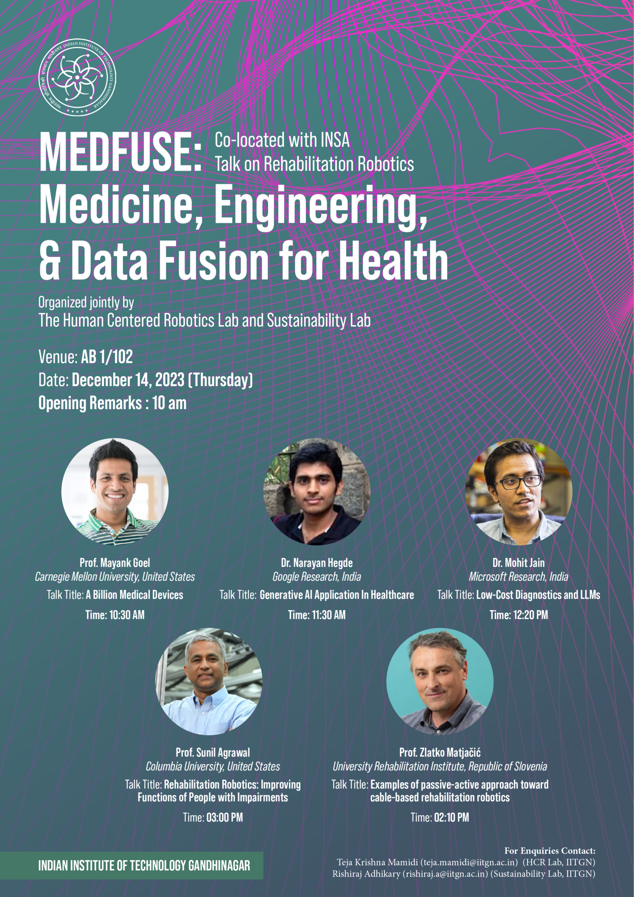

::: {.frame .page-main}

```{=html}
<section>
  <h1 class="page">Events</h1>
  <p class="lede" style="margin-top:12px">Schools and workshops the lab has organised or co-organised.</p>
</section>
<section>
  <div class="event-row">
    <a href="../images/events/acm-summer-2025.png" class="lightbox"></a>
    <div><div class="kicker">June 2–13, 2025 · IIT Gandhinagar</div><h2>ACM India Summer School on AI for Social Good</h2>
      <p class="muted">Organised by the Sustainability Lab at IIT Gandhinagar.</p>
      <p><a class="arrow" href="https://sustainability-lab.github.io/acm-summer-2025/">Programme, speakers and materials</a></p></div>
  </div>
  <div class="event-row">
    <a href="../images/events/MEDFUSE_NEW.png" class="lightbox"></a>
    <div><div class="kicker">2023</div><h2>MEDFUSE: Medicine, Engineering and Data Fusion for Health</h2></div>
  </div>
</section>
```

:::
