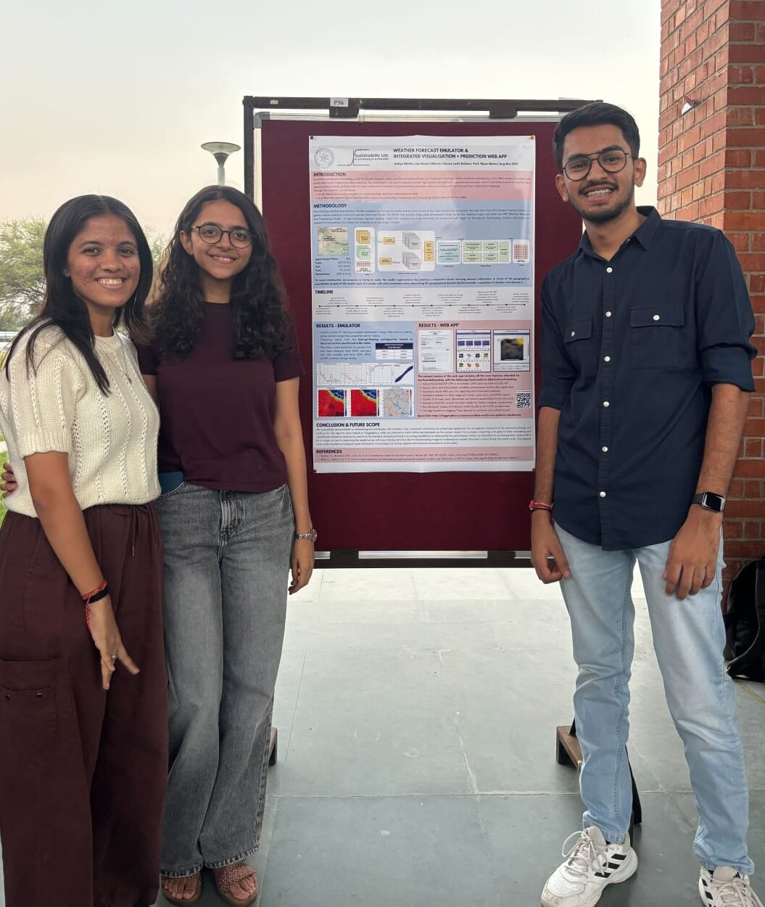
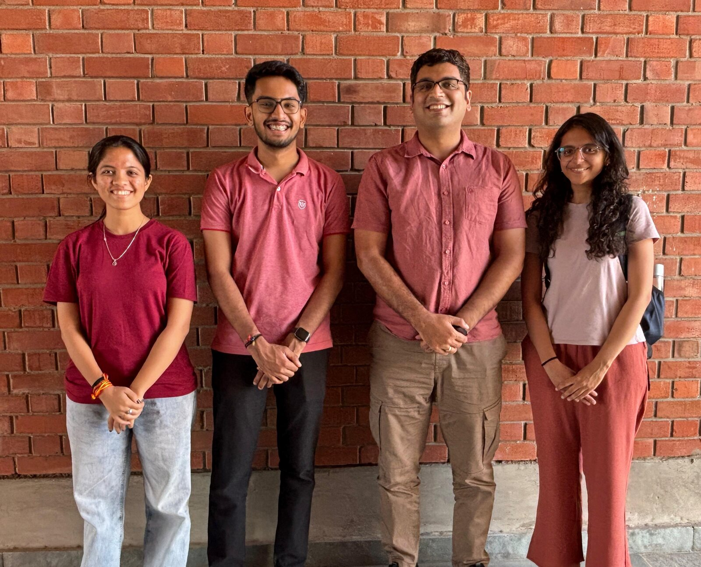
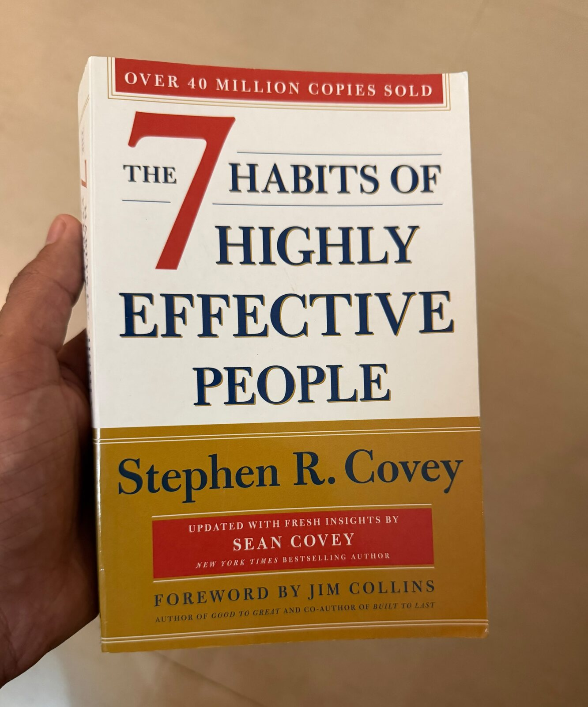
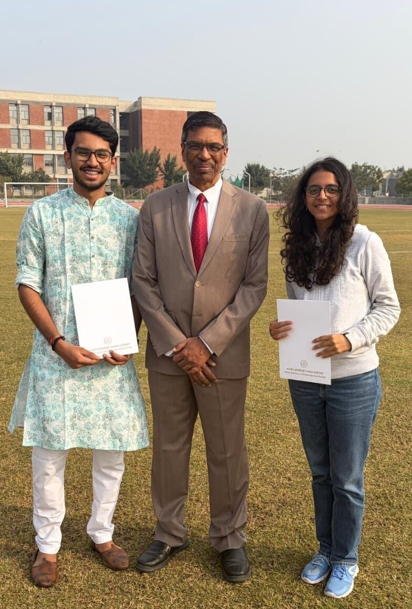

Hey there! I’m Aditya Mehta and I joined the Sustainability Lab in my 4th year. Yes, pretty late, and I still regret it. I walked in thinking I was just going to do a project in a lab. I walked out feeling like I’d been part of a group of people who really cared about what they were building. If I could go back and talk to day-one me for five minutes, this is what I’d tell him.

Some context first. From August to November 2025, Jiya Desai and I worked on a weather forecast emulator and a web app built around it, mentored by Deena Lad and advised by Nipun Sir. Global forecasts like GFS are coarse (about 27 km grid cells), while the regional WRF model gives finer detail (9 km) but is expensive to run. So we trained a vision transformer to take the GFS forecast and predict the WRF-style 2-metre temperature field, and it reached an R² of 0.98 on our test set. Alongside it we built a web app on Hugging Face where you can pull in atmospheric data, plot it interactively and run Microsoft’s Aurora air pollution model without touching a raw NetCDF file. 

{loading="lazy" width="520"}

So here are 10 things I would say to my day-one self. 

### 1. This is not going to be like any other lab.
Forget how project courses usually go, where nothing happens for twelve weeks and then everyone panics in the last three. It doesn’t work like that here. There’s a weekly catch-up, so every week you need to have something to show, even if it’s small. That sounds like pressure, but being around people who are all working hard makes you want to keep up, and research just becomes part of your week.

### 2. The data is going to be messy. Very messy.
You’ll walk in thinking about models and architectures, and then spend a big chunk of your time finding, collecting and cleaning data. The lab works on real sustainability and environmental problems, so the data never shows up in the neat format you were hoping for. Different sources, missing values, formats that don’t match. Some days feel like data archaeology. It’s annoying, but a model is only as good as its data, and real problems come with real data.

### 3. Learn to tell the story behind your work.
Presenting isn’t just putting your graphs on a slide and explaining the axes. You have to explain what you did, why, what went wrong and what you think the results mean. The weekly meetings are good practice, so take them seriously and get comfortable talking about your blockers. Knowing something and explaining it well are two different skills, and the second one will be useful long after you’ve left IIT.

### 4. “It didn’t work as expected” is a perfectly good answer.
There will be weeks when you’re wondering what on earth you’re going to show Nipun Sir. The idea didn’t work, or the model did badly, or you ended up exactly where you started. Your first instinct will be to make the result sound better than it is. Don’t. In our own project we tried several different ViT training setups (scaling the parameters, masking NaN channels, adding static variables, fusing in a projection vector), and only one of them ended up being the best configuration. Just say what happened. He’ll ask why and help you work out the next question. It’s quite freeing to work somewhere a failed experiment is treated as information and not as a failure.

### 5. Document everything. Future you will be grateful.

Please document your work every week. You’ll think you’ll remember why you made that dataset, or which version of the code made that graph, or why you changed that one parameter. You won’t. Three weeks later you’ll be staring at `final.ipynb`, `final_new.ipynb`, `final_v2.ipynb` and `final_latest.ipynb` with no idea what happened. A clean repo, proper versioning and some notes feel like boring housekeeping, but they save you hours, and someone else might have to pick up your work someday.

### 6. Use AI. You are in the right place to experiment with it.

Treat AI tools as force multipliers, not crutches. Use Claude and ChatGPT to write code faster, debug stubborn errors, and digest complex papers, but never stop thinking critically. You still need to understand what you're asking and spot when the output is wrong. Developing that judgment early is what will make you a truly effective researcher (and it's the exact habit that prepared me for my upcoming role as a Gen-AI Developer at Barclays Investment Bank)

### 7. Find your “why”.
This matters more than you think. There will be weeks where all you do is clean data and debug, and results won’t be enough to keep you going. What helped me was remembering what the lab is actually about: using AI for a more sustainable future. When you see your work as a small piece of that, you stop just pushing a metric up and start trying to understand a real problem.

### 8. Be grateful for the people you’re doing this with.
I was really lucky to have Jiya Desai as my project partner. Research is hard enough on your own, and it helps to have someone with you for the good experiments, the bad ones and the “why is this not working?” moments. We also had Deena Lad as our mentor, who guided us through the ups and downs of the project. Somewhere between all the meetings, datasets and presentations, they stopped being just a teammate and a mentor and became friends. You’ll make bonds here that go beyond the work.

{loading="lazy"}

### 9. Make a personal connection with your mentor, not just a professional one.
Some of my best memories with Nipun Sir have nothing to do with research. Take the time to talk to him about other things and get to know him as a person, not just as a professor. I still remember him giving me The *7 Habits of Highly Effective People* with a personal note written inside. It was a small gesture, but it has stayed with me more than a lot of the technical discussions we had. 

{loading="lazy" width="420"}

### 10.  One day, you are going to miss this.
This is the one I most wish I could get through to day-one me. You’re always focused on the next experiment, the next meeting, the next presentation, and before you know it, it’s over. Along the way there are moments that make you realise how much it meant. For us, one of those was the UG Research Showcase, where we ended up as runners-up for Best Project Presentation. Technically runners-up, but let’s not get too technical about a good photograph. Look at that picture and think about everything before it: the messy data, the weekly meetings, the failed experiments and the small wins nobody else saw. That’s what it all turns into. And of course the Akshardham Trip, which I am not going to spoil for you now, but is going to be one of the core memories of your life.

{loading="lazy" width="520"}

So that’s it. Don’t just try to finish your project, let yourself become part of the lab. Ask questions, get your hands dirty with the data, show the bad results, find people you enjoy working with and talk to your mentors. Every once in a while, stop thinking about the next deadline and look around. I joined in my 4th year and I still regret not joining sooner. But one thing I’m sure about:
**I am really, really glad I joined.**

Here are a few links that might be helpful:

- Link to the poster of the project we worked on: [Drive Link](https://drive.google.com/file/d/1MUbKkyu9SqKyDagGQZ4yUS-RX5-vOI-A/view?usp=sharing)
- Link to the HuggingFace Space of the Dashboard: [CAMS Pollution Dashboard](https://huggingface.co/spaces/aditya-me13/cams-pollution-dashboard)
- Just in case you want to connect on LinkedIn: [Aditya Mehta](https://www.linkedin.com/in/aditya-me13/)
