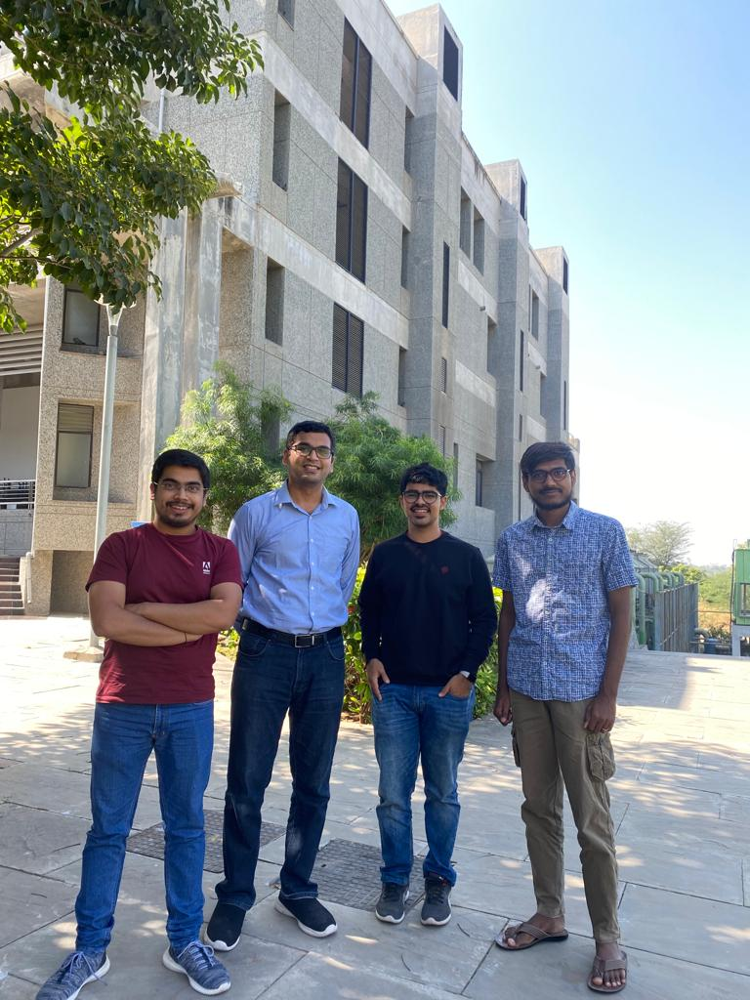

{loading="lazy"}

I worked at the Sustainability Lab at IIT Gandhinagar (IITGN) from 2018 to 2020. It is an understatement to say that this was one of the best experiences I have had working in a scientific lab. Nipun Batra created an environment where every person could shine. Looking back over the last six years, I see that the environment at the lab was not an accident. It was curated to help everyone do their best work.

There are many things I love about my time in the lab. It was collaborative, which made room for interesting collaborations because everyone felt heard and valued. The lab also excelled at resolving conflicts, which are bound to happen.

Nipun built the lab so that, alongside doing great research, one of its core pillars was helping everyone become their best selves. I cannot remember a time when the lab did not take five extra steps to help a team member reach a goal, even if that meant accepting short-term challenges when that person was away from the lab.

I got to work with amazing people during my time in the lab, and I feel it was one of the best experiences I have had in a scientific lab. Now, as I think about having a lab of my own some years down the line, I am reading books like *Lab Dynamics: Management and Leadership Skills for Scientists*. I am truly amazed by how effectively Nipun applies those concepts, and by the chance I had to experience such a lab so early in my career. It would be uncanny if Nipun had not read the book and still managed a lab like the Sustainability Lab.

## The decision that brought me to the lab

My decision to work with the Sustainability Lab was one of the most “unscientific” decisions I made during my bachelor’s degree. I first knew Nipun through the Operating Systems course, which was his first time teaching it. During the course, there were times when I remember him saying something worked a bit differently from how it actually worked. Later, I told him that I thought he had made a mistake during a lecture. His reaction was the first point at which I felt I wanted to work with him. He mentioned that he was teaching the topic for the first time and thanked me for the comment. (???) This was unheard of for me: an IIT professor acknowledging that he did not know something and thanking a student for pointing out a mistake.

I am truly grateful for my time with Prof. Nipun. I know I have grown over the years, but I never felt that my youthful immaturity stopped him from wishing the best for me. He is, in the truest sense, a *Guru*. I can sincerely recommend joining the Sustainability Lab. You will learn things you only realize years later.

Yours, Apoorv
