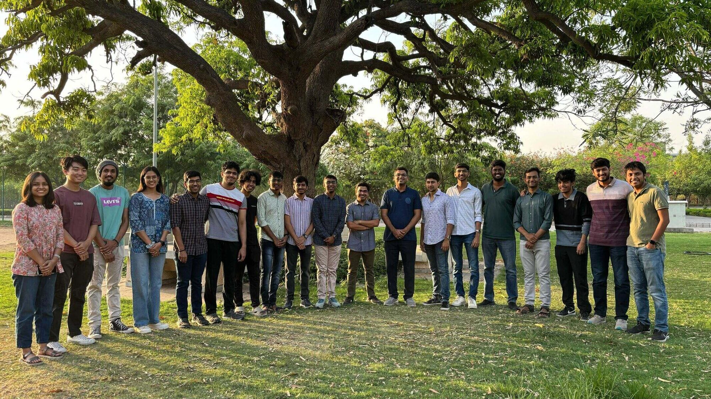

### Who am I?

Hi, I am Kalash Kankaria, a 2024 graduate of IIT Gandhinagar and a proud member of the Sustainability Lab. I graduated with a B.Tech in Computer Science and Engineering, spent close to two years working as a Data Scientist at Skan AI in Bangalore, and am currently pursuing an MS in Computational Finance at Carnegie Mellon University.

But before all of that, there was IIT Gandhinagar, Machine Learning, Prof. Nipun Batra, and eventually, the Sustainability Lab. This is a little about what that journey meant to me.

{loading="lazy"}

### Outside the Lab

It feels strange to think that I took my first Machine Learning course around the time ChatGPT had just been released, and Prof. Nipun was already asking us to experiment with it as part of an assignment.

It is not an exaggeration when I say that ML (ES654) was probably the only class where I never felt like sleeping. The lectures rarely felt like textbook study. Concepts were presented in a way that made you visualize what was happening, question why it worked, and understand where it could actually matter.

That course was also the first time I worked on a project under Prof. Nipun. One of his requirements was that every project report be written and formatted almost like a prospective research publication. At the time, I remember wondering whether all that effort was really necessary for a course project. Looking back at those reports now, I understand exactly why he insisted on it. We were being taught much more than just how to finish an assignment.

Fast forward to the next semester, when I formally joined the Sustainability Lab for a project course while simultaneously taking his Probabilistic Machine Learning class. Our research was, in some ways, connected to ideas from the course, but it never felt repetitive. If anything, the classroom gave us the tools, while the lab showed us what happened when those tools met an open-ended problem with no answer waiting at the back of a textbook.

In my final semester, I got the opportunity to TA the very Machine Learning course that had drawn me into the field in the first place. That experience made the circle feel complete. With Prof. Nipun, being a TA was never limited to grading assignments. We were encouraged to conduct tutorials, take vivas, explain concepts, and engage with students. It strengthened my own understanding enormously and gave me a small taste of what teaching actually feels like.

### The Lab

It is relatively easy to guide a student who already understands how research works. Teaching someone how to think about research—how to approach an open-ended problem, figure out which questions are worth asking, deal with uncertainty, and slowly turn an idea into a meaningful contribution—is much harder.

That is probably the most valuable thing I learned during my year at the Sustainability Lab.

My primary work was around Bayesian Unlearning, but the biggest learning went far beyond the specific problem I happened to be working on. I learned how to take an unfamiliar research question, understand why it matters, study what has already been attempted, question existing approaches, identify what might be missing, and then work towards making our own contribution.

Prof. Nipun managed a balance that I now realize is extremely difficult to get right. We were never spoon-fed solutions, but we were also never left without direction. There was enough freedom to explore, get things wrong, and develop our own ideas, while still having the guidance needed to move forward when we were stuck.

The lab itself has an energy that is difficult to capture in words. It is full of exceptionally talented people, but what stood out to me even more was how approachable everyone was. Discussions happened naturally, people helped each other, ideas moved across projects, and there was a genuine excitement about figuring things out. It never felt like everyone was simply working on their own isolated research problem.

What distinguishes the Sustainability Lab most for me, however, is the intention behind the research.

The projects are not built around technology simply because a particular technology happens to be exciting at the moment. They begin with real problems. The underlying question is often: Can the advances we are making in computing, machine learning, and AI be used not just to make things faster or smarter, but to make something meaningfully better?

That philosophy personally resonates with me a lot. There is something incredibly motivating about working on technically challenging problems while knowing that the eventual goal extends beyond the technology itself.

Perhaps the simplest way I can describe my experience at the Sustainability Lab is this: after almost every meeting with Prof. Nipun, I would leave the room wanting to immediately get back to work on the ideas we had just discussed.

For me, that says more about the research culture of the lab than almost anything else could.

### Even After That

One might assume that once we graduated, the connection with the lab would slowly fade away. For me, that was never the case.

As a farewell gift, Prof. Nipun gave each of us a book with personalized impressions and messages about us. It was such a small but deeply thoughtful gesture.

About a year and a half into working in industry, I decided that I wanted to pursue a master’s in quantitative finance. Even though this was a very different direction from the research I had done in the lab, Prof. Nipun was one of my biggest supporters throughout the process. From writing a recommendation letter that got me into CMU, to later connecting us with people in the relevant industry whenever he came across an opportunity, that support did not stop just because I was no longer his student.

And every time I visited IIT Gandhinagar after graduating and met him again, it somehow never felt as if so much time had passed. The conversations were still just as easy, the lab still felt just as welcoming, and there was always the same warmth that I remembered from my time there.

I think that is what ultimately makes the Sustainability Lab more than just a place where I did research for a year. The projects end, courses finish, and people graduate, but the mentorship and relationships somehow continue beyond all of that.

And I believe they always will.
