```{=html}
<style>
/* No child combinators here: Quarto escapes them inside page styles. */
.k { font-weight: 700; font-size: .7rem; letter-spacing: .06em; text-transform: uppercase; }
.k.prob { color: var(--muted); } .k.idea { color: var(--accent); } .k.pay { color: var(--ok); } .k.scope { color: var(--ink); }
.hf-grid { display: grid; grid-template-columns: 1fr 1fr; gap: 22px 20px; grid-auto-flow: dense; margin: 1rem 0 2.2rem; align-items: start; }
.hf { border-top: 3px solid var(--rule); padding-top: .6rem; min-width: 0; scroll-margin-top: 90px; }
.hf.wide { grid-column: 1 / -1; }
.hf.prob { border-color: var(--muted); } .hf.idea { border-color: var(--accent); } .hf.pay { border-color: var(--ok); } .hf.scope { border-color: var(--ink); }
.hf p { margin: 0 0 .35rem; font-size: .93rem; line-height: 1.45; }
.hf .hd { font-size: 1rem; }
.hf .cap { display: block; font-size: .82rem; font-style: italic; color: var(--muted); margin: .1rem 0 .4rem; }
.hf .meta, .hf-note { font-size: .76rem; color: var(--muted); }
.hf img { display: block; width: 100%; background: #fff; border: 1px solid var(--rule); margin: .45rem 0 .5rem; }
/* Dark mode: never invert. The figures hold photos, and their colours carry meaning. Only soften the white. */
body.quarto-dark .hf img { filter: brightness(.88); }
.hf-scroll { overflow-x: auto; }
.hf-scroll table { font-size: .8rem; min-width: 640px; }
@media (max-width: 760px) { .hf-grid { grid-template-columns: 1fr; } }
</style>
```

The hero figure is Figure 1: the picture a reviewer sees before reading the introduction. In about **ten seconds** it should answer three questions.

1. [Problem]{.k .prob} What is hard or missing today?
2. [Idea]{.k .idea} What is the one thing that changes that?
3. [Payoff]{.k .pay} What becomes possible, and by how much?

It is a visual abstract, not the architecture diagram: for that, see [Making method figures](method-figures.qmd). This page shows 24 first figures from ICML, NeurIPS, ICLR, CVPR, ICCV, ECCV, KDD, AAAI and SIGGRAPH, and what to borrow from each. It is part of [Writing Papers](writing-papers.qmd#hero-figures).

```{=html}
<figure style="margin:1.4rem 0 1.8rem;max-width:760px">
<div style="aspect-ratio:16/9;background:#151816"><iframe src="https://www.youtube-nocookie.com/embed/3pj1DY27aeQ?rel=0" title="Making Hero Figures: the film" referrerpolicy="strict-origin-when-cross-origin" style="width:100%;height:100%;border:0;display:block" allow="accelerometer; encrypted-media; gyroscope; picture-in-picture; fullscreen" allowfullscreen></iframe></div>
<figcaption style="font-size:.86rem;color:var(--muted);margin-top:.45rem">This page as a short film (7½ minutes) · <a href="https://youtu.be/3pj1DY27aeQ">open on YouTube</a></figcaption>
</figure>
```

## Choose what leads

Ask which sentence of the abstract a reviewer should repeat to the other reviewers. Draw that sentence.

| Your main claim | Lead with | Layout | See |
|----------------|-------|-----------------|----------|
| "Everyone has missed problem X." | [problem]{.k .prob} | A plot of the failure | [Informer](#informer), [ResNet](#resnet) |
| "A small change to a known method matters." | [idea]{.k .idea} | Old and new, side by side | [Chain-of-Thought](#cot), [Swin Transformer](#swin) |
| "One simple idea solves X." | [idea]{.k .idea} | One example in, the idea, the result out | [CLIP](#clip), [MAE](#mae), [LIME](#lime), [LLMTime](#llmtime) |
| "One method handles many settings." | [idea]{.k .idea} | Many inputs, one model, many outputs | [AnySat](#anysat), [pix2pix](#pix2pix) |
| "We do X better, faster or cheaper." | [payoff]{.k .pay} | Methods side by side, numbers on the picture | [3D Gaussian Splatting](#3dgs), [EfficientNet](#efficientnet) |
| "We can now do X, which nobody could." | [payoff]{.k .pay} | A gallery of real outputs | [CycleGAN](#cyclegan), [ImageBind](#imagebind), [GeoChat](#geochat) |
| "Here is a dataset or a benchmark." | [scope]{.k .scope} | Real samples and counts, or one item from input to score | [SatlasPretrain](#satlas), [SWE-bench](#swebench), [CheXpert](#chexpert) |
| "We make several contributions." | [scope]{.k .scope} | One panel per contribution | [Segment Anything](#sam) |

**Our default for an applied paper:** three panels, problem then idea then payoff, on *one real example*, with *one number*. Give the most space to your strongest panel.

## Lead with the problem

Use this when the gap itself is your news.

::: {.hf-grid}
::: {.hf .prob #informer}
[**Informer** · AAAI 2021 · [paper](https://arxiv.org/abs/2012.07436)]{.hd}

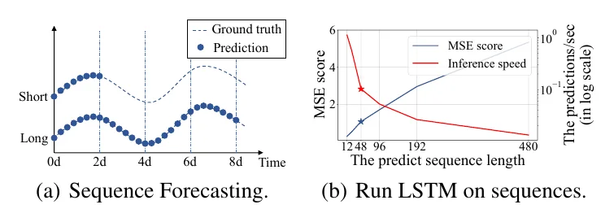{fig-alt="Two small plots: a short and a long forecast of one series, and an LSTM whose error rises and speed falls as the forecast lengthens." loading="lazy"}

[problem]{.k .prob} [· plot · page 1, one column]{.meta}

[Its caption opens: “(a) LSTF can cover an extended period than the short sequence predictions, making vital distinction in policy-planning and investment-protecting.”]{.cap}

It measures an existing model breaking as the forecast gets longer. The new method is not even shown.

**Borrow:** If a reader may doubt the gap, plot the baseline failing.

[Figure 1, Zhou et al. © the authors.]{.meta}
:::
::: {.hf .prob #resnet}
[**ResNet** · CVPR 2016 · [paper](https://arxiv.org/abs/1512.03385)]{.hd}

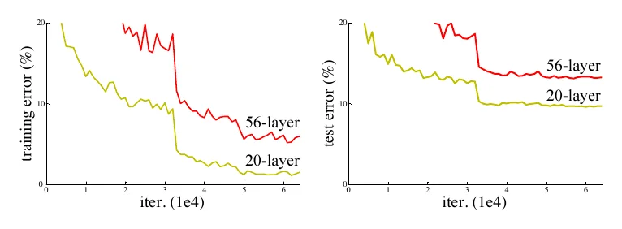{fig-alt="Two plots of error against training iterations. In both, the 56-layer curve lies above the 20-layer curve." loading="lazy"}

[problem]{.k .prob} [· plot · page 1, one column]{.meta}

[Its caption opens: “Training error (left) and test error (right) on CIFAR-10 with 20-layer and 56-layer “plain” networks.”]{.cap}

Two lines per plot, named on the lines. The deeper network is worse, which nobody expects.

**Borrow:** A surprising measurement is a complete Figure 1.

[Figure 1, He et al. © the authors.]{.meta}
:::
::: {.hf .prob .wide #cot}
[**Chain-of-Thought** · NeurIPS 2022 · [paper](https://arxiv.org/abs/2201.11903)]{.hd}

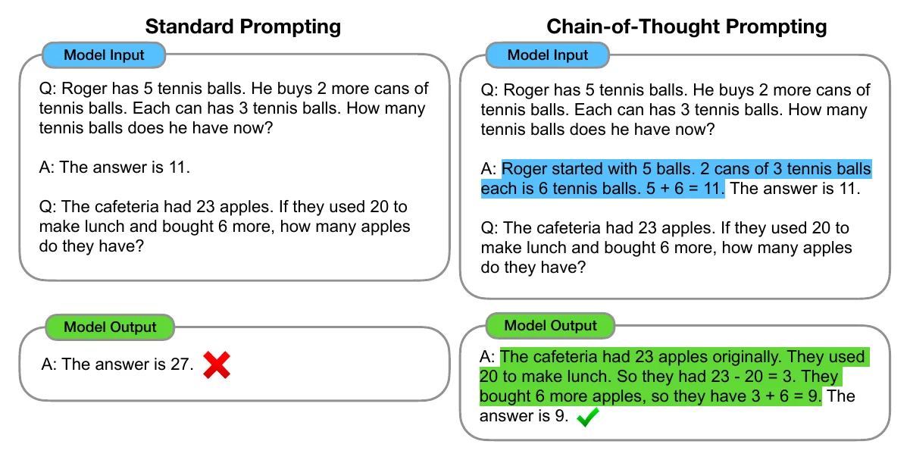{fig-alt="Two columns. Standard prompting gives a wrong answer with a red cross. Chain-of-thought prompting, with highlighted reasoning, gives the right answer with a tick." loading="lazy"}

[problem]{.k .prob} → [idea]{.k .idea} → [payoff]{.k .pay} [· contrast pair · page 1, full width]{.meta}

[Its caption opens: “Chain-of-thought prompting enables large language models to tackle complex arithmetic, commonsense, and symbolic reasoning tasks.”]{.cap}

The two columns are identical except for the highlighted text, so the eye lands on the idea. ✗ becomes ✓.

**Borrow:** Hold everything fixed except your idea, and colour only that.

[Figure 1, Wei et al. CC BY 4.0.]{.meta}
:::
:::

## Lead with the idea

Use this when one idea carries the paper.

::: {.hf-grid}
::: {.hf .idea .wide #clip}
[**CLIP** · ICML 2021 · [paper](https://arxiv.org/abs/2103.00020)]{.hd}

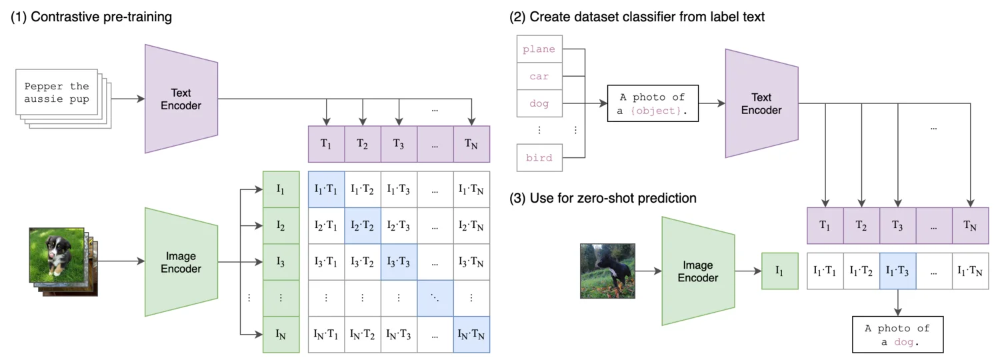{fig-alt="Three numbered panels: contrastive pre-training on a grid of images against captions, building a classifier from class names, and zero-shot prediction on a photo of a dog." loading="lazy"}

[idea]{.k .idea} → [payoff]{.k .pay} [· strip · page 2, full width]{.meta}

[Its caption opens: “Summary of our approach.”]{.cap}

Three numbered panels show how the model is trained, and then how it is used.

**Borrow:** Number the panels, and end on the use.

[Figure 1, Radford et al. From the authors' repository, MIT licence.]{.meta}
:::
::: {.hf .idea #mae}
[**MAE** · CVPR 2022 · [paper](https://arxiv.org/abs/2111.06377)]{.hd}

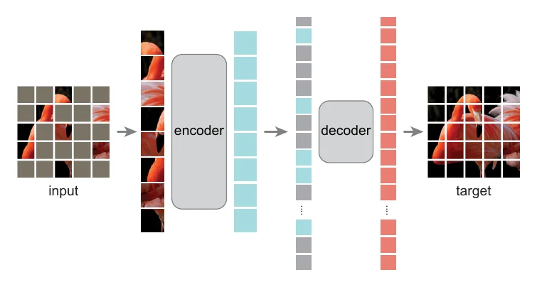{fig-alt="A flamingo photo with most patches masked; the visible patches enter a large encoder; a small decoder rebuilds the full image." loading="lazy"}

[idea]{.k .idea} → [payoff]{.k .pay} [· strip · page 1, one column]{.meta}

[Its caption opens: “Our MAE architecture.”]{.cap}

An architecture with five elements and one real image. The big encoder takes few patches; the small decoder takes all.

**Borrow:** Draw only what is new, and let size mean something.

[Figure 1, He et al. CC BY 4.0.]{.meta}
:::
::: {.hf .idea .wide #lime}
[**LIME** · KDD 2016 · [paper](https://arxiv.org/abs/1602.04938)]{.hd}

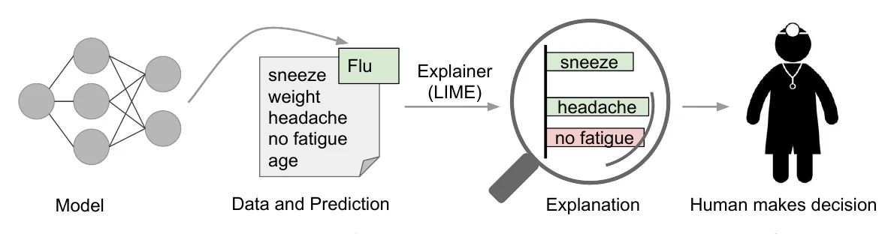{fig-alt="A model predicts flu from a patient's symptoms; a magnifying glass labelled LIME highlights sneeze and headache; a doctor makes the decision." loading="lazy"}

[problem]{.k .prob} → [idea]{.k .idea} → [payoff]{.k .pay} [· strip · page 2, full width]{.meta}

[Its caption opens: “Explaining individual predictions.”]{.cap}

One patient tells the whole method, and the figure ends at the doctor who decides.

**Borrow:** End at the person who uses the output. **Watch out:** Generic icons. Use a real case today.

[Figure 1, Ribeiro et al. © the authors.]{.meta}
:::
::: {.hf .idea .wide #gid}
[**Generative Image Dynamics** · CVPR 2024 · [paper](https://arxiv.org/abs/2309.07906)]{.hd}

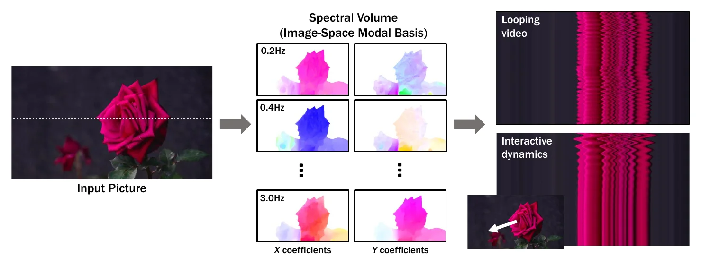{fig-alt="A photo of a rose, then colourful motion maps at several frequencies, then a looping video and interactive dynamics shown as time slices." loading="lazy"}

[idea]{.k .idea} → [payoff]{.k .pay} [· strip · page 1, full width]{.meta}

[Its caption opens: “We model a generative image-space prior on scene motion: from a single RGB image, our method generates a spectral volume …”]{.cap}

The middle panel shows what the new representation looks like, where most papers put a labelled box.

**Borrow:** Replace boxes with pictures of what is inside them.

[Figure 1, Li et al. © the authors.]{.meta}
:::
::: {.hf .idea #anysat}
[**AnySat** · CVPR 2025 · [paper](https://arxiv.org/abs/2412.14123)]{.hd}

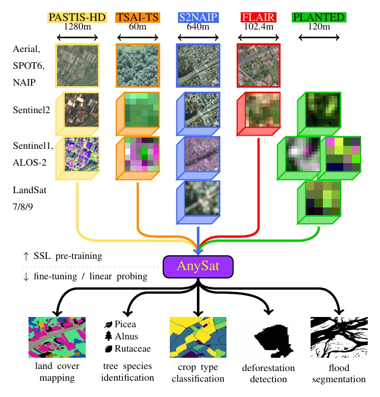{fig-alt="Five satellite datasets with different sensors and resolutions flow into one box labelled AnySat, which feeds five tasks with real output maps." loading="lazy"}

[problem]{.k .prob} → [idea]{.k .idea} → [payoff]{.k .pay} [· funnel · page 1, one column]{.meta}

[Its caption opens: “Multi-Dataset Training.”]{.cap}

Many real inputs, one model, many real outputs. The shape is the claim.

**Borrow:** For generality, draw the funnel and fill both ends with real samples.

[Figure 1, Astruc et al. CC BY 4.0.]{.meta}
:::
::: {.hf .idea #swin}
[**Swin Transformer** · ICCV 2021 · [paper](https://arxiv.org/abs/2103.14030)]{.hd}

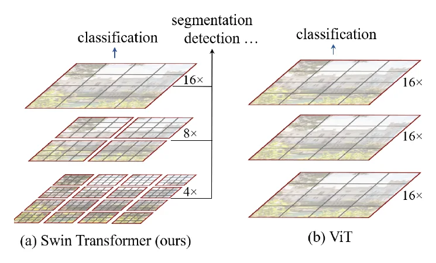{fig-alt="Two stacks of feature maps. Swin has three scales and serves classification, detection and segmentation. ViT has one scale and serves classification only." loading="lazy"}

[idea]{.k .idea} → [problem]{.k .prob} [· contrast pair · page 1, one column]{.meta}

[Its caption opens: “(a) The proposed Swin Transformer builds hierarchical feature maps by merging image patches (shown in gray) in deeper layers …”]{.cap}

Ours and the nearest baseline are drawn with the same shapes, so the only difference is the contribution.

**Borrow:** Draw the baseline the same way as your method.

[Figure 1, Liu et al. CC BY 4.0.]{.meta}
:::
::: {.hf .idea #yolo}
[**YOLO** · CVPR 2016 · [paper](https://arxiv.org/abs/1506.02640)]{.hd}

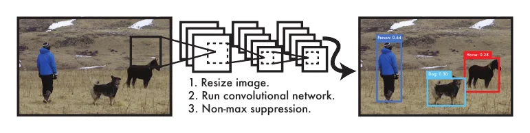{fig-alt="A photo of a person, a dog and a horse; one network; the same photo with a labelled box on each. Three steps are listed." loading="lazy"}

[idea]{.k .idea} → [payoff]{.k .pay} [· strip · page 1, one column]{.meta}

[Its caption opens: “The YOLO Detection System.”]{.cap}

The claim is simplicity, and the figure is one photo, one network and three steps.

**Borrow:** If simplicity is the point, stop at three parts. **Watch out:** Tiny in print.

[Figure 1, Redmon et al. © the authors.]{.meta}
:::
::: {.hf .idea .wide #llmtime}
[**LLMTime** · NeurIPS 2023 · [paper](https://arxiv.org/abs/2310.07820)]{.hd}

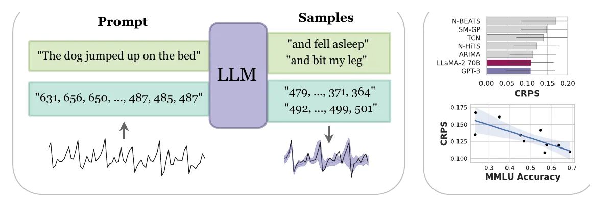{fig-alt="A language model completes a sentence and, below it, a string of numbers that is a forecast. Two small plots on the right show results." loading="lazy"}

[idea]{.k .idea} → [payoff]{.k .pay} [· strip · page 2, full width]{.meta}

[Its caption opens: “We propose LLMTime, a method for time series forecasting with large language models (LLMs) by encoding numbers as text and sampling possible extrapolations as text completions.”]{.cap}

Text above, numbers below, the same model between. The analogy is the idea, and two small plots pay it off.

**Borrow:** For "treat X as Y", draw X and Y in parallel.

[Figure 1, Gruver et al. © the authors.]{.meta}
:::
:::

## Lead with the payoff

Use this when the result speaks for itself: a new ability, or a clear win.

::: {.hf-grid}
::: {.hf .pay .wide #3dgs}
[**3D Gaussian Splatting** · SIGGRAPH 2023 · [paper](https://arxiv.org/abs/2308.04079)]{.hd}

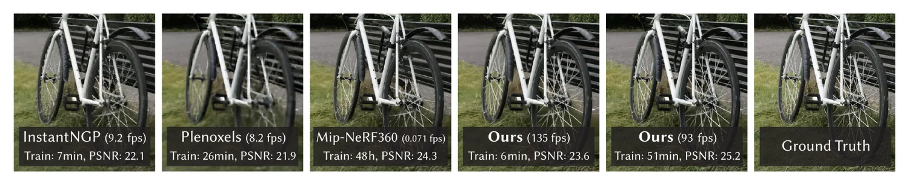{fig-alt="Six crops of one bicycle wheel: three earlier methods, the paper's method twice, and ground truth. Each carries its frame rate, training time and PSNR." loading="lazy"}

[problem]{.k .prob} → [payoff]{.k .pay} [· comparison row · page 1, full width]{.meta}

[Its caption opens: “Our method achieves real-time rendering of radiance fields with quality that equals the previous method with the best quality …”]{.cap}

One scene for every method, with speed, training time and quality printed on each image.

**Borrow:** Put the numbers on the picture, and include the ground truth.

[Figure 1, Kerbl et al. CC BY 4.0.]{.meta}
:::
::: {.hf .pay #efficientnet}
[**EfficientNet** · ICML 2019 · [paper](https://arxiv.org/abs/1905.11946)]{.hd}

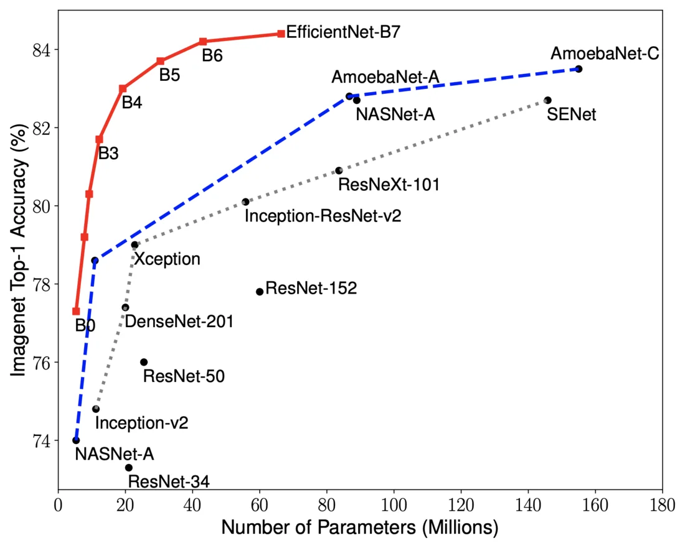{fig-alt="Accuracy against number of parameters. A red line of EfficientNet models rises above dashed lines of other named models." loading="lazy"}

[payoff]{.k .pay} [· plot · page 1, one column]{.meta}

[Its caption opens: “Model Size vs. ImageNet Accuracy.”]{.cap}

The claim is a trade-off, so the figure is the trade-off: one red line above every named rival.

**Borrow:** Plot accuracy against cost, and label the points directly.

[Figure 1, Tan and Le. From the authors' repository, Apache 2.0 licence.]{.meta}
:::
::: {.hf .pay .wide #cyclegan}
[**CycleGAN** · ICCV 2017 · [paper](https://arxiv.org/abs/1703.10593)]{.hd}

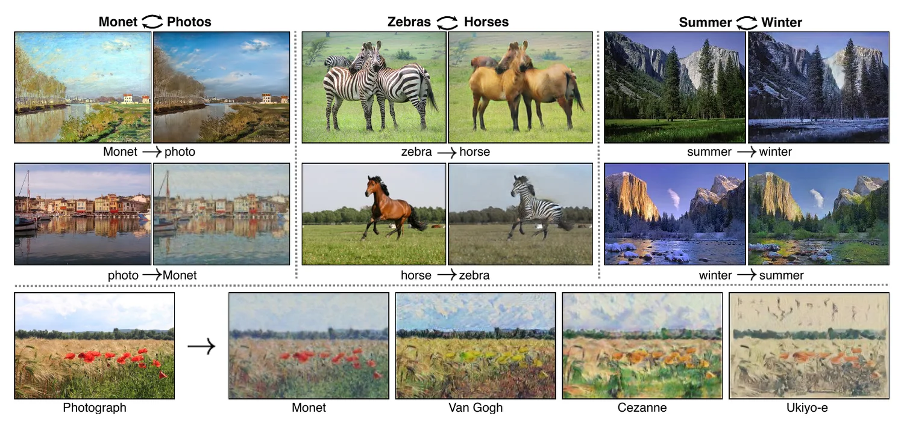{fig-alt="Image pairs translated both ways: Monet and photos, zebras and horses, summer and winter. Below, one photo in four painters' styles." loading="lazy"}

[payoff]{.k .pay} [· gallery · page 1, full width]{.meta}

[Its caption opens: “Given any two unordered image collections X and Y, our algorithm learns to automatically “translate” an image from one into the other and vice versa …”]{.cap}

Examples anyone can judge in a second, and a two-way arrow for the method's key property.

**Borrow:** Choose examples a stranger can judge.

[Figure 1, Zhu et al. © the authors.]{.meta}
:::
::: {.hf .pay .wide #pix2pix}
[**pix2pix** · CVPR 2017 · [paper](https://arxiv.org/abs/1611.07004)]{.hd}

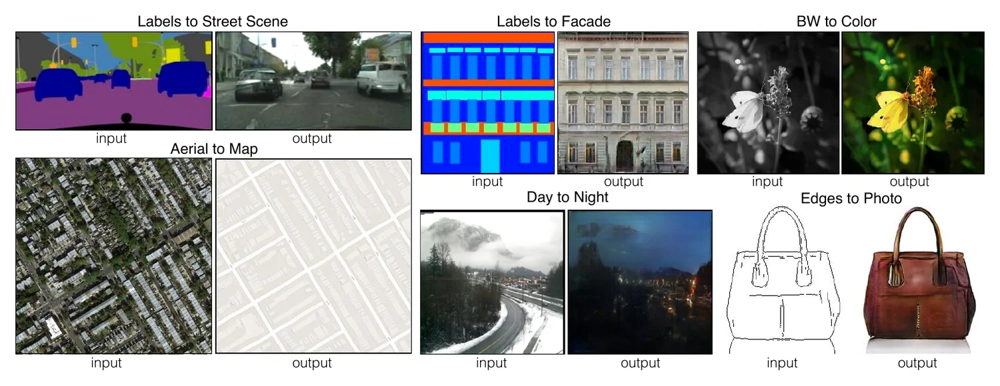{fig-alt="Six input and output pairs: labels to street scene, labels to facade, black-and-white to colour, aerial to map, day to night, edges to photo." loading="lazy"}

[payoff]{.k .pay} [· gallery · page 1, full width]{.meta}

[Its caption opens: “Many problems in image processing, graphics, and vision involve translating an input image into a corresponding output image.”]{.cap}

Six problems solved the same way, each as an input and an output under a two-word title.

**Borrow:** For breadth, repeat one small unit.

[Figure 1, Isola et al. © the authors.]{.meta}
:::
::: {.hf .pay .wide #dino}
[**DINO** · ICCV 2021 · [paper](https://arxiv.org/abs/2104.14294)]{.hd}

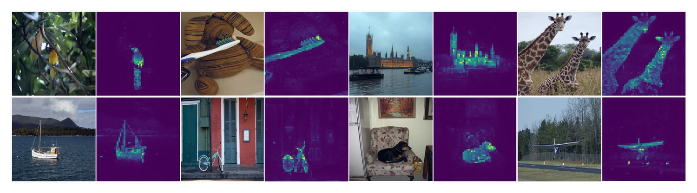{fig-alt="Eight photos, each beside an attention map in which the main object glows." loading="lazy"}

[payoff]{.k .pay} [· gallery · page 1, full width]{.meta}

[Its caption opens: “Self-attention from a Vision Transformer with 8 × 8 patches trained with no supervision.”]{.cap}

The finding is a surprise, so the figure shows only the surprise: objects light up without any labels.

**Borrow:** Show the unexpected behaviour on many inputs.

[Figure 1, Caron et al. CC BY 4.0.]{.meta}
:::
::: {.hf .pay .wide #imagebind}
[**ImageBind** · CVPR 2023 · [paper](https://arxiv.org/abs/2305.05665)]{.hd}

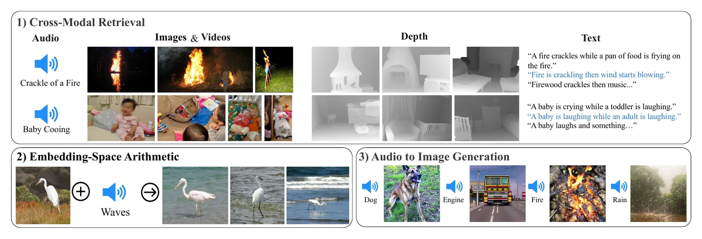{fig-alt="Three numbered boxes: a sound retrieves images, depth and text; a bird photo plus wave sounds gives birds in water; sounds generate images." loading="lazy"}

[payoff]{.k .pay} [· gallery · page 1, full width]{.meta}

[Its caption opens: “ImageBind’s joint embedding space enables novel multimodal capabilities.”]{.cap}

Three new abilities in three numbered boxes, shown before the model is explained.

**Borrow:** Give each new ability a box and a three-word title.

[Figure 1, Girdhar et al. © the authors.]{.meta}
:::
::: {.hf .pay #geochat}
[**GeoChat** · CVPR 2024 · [paper](https://arxiv.org/abs/2311.15826)]{.hd}

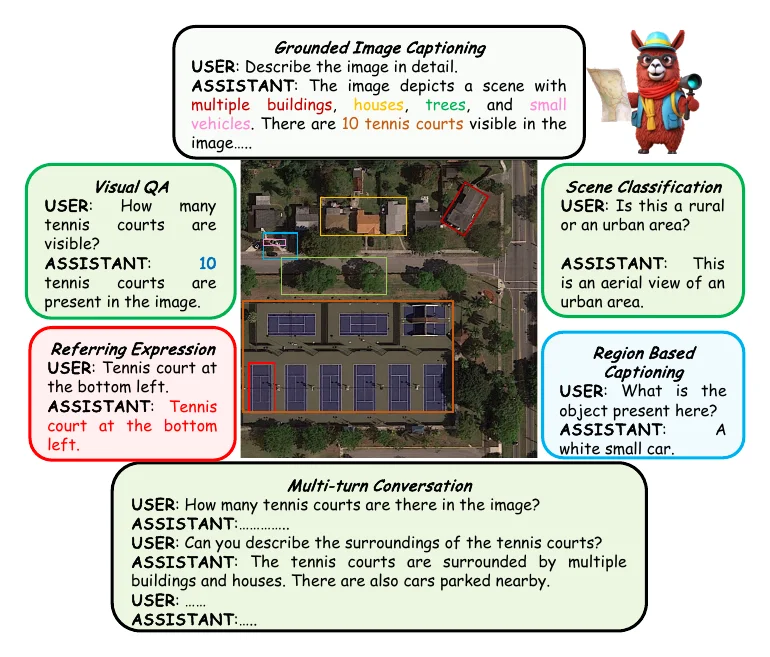{fig-alt="One aerial image in the centre with six dialogue boxes around it, each a different task." loading="lazy"}

[payoff]{.k .pay} [· hub · page 1, one column]{.meta}

[Its caption opens: “GeoChat can accomplish multiple tasks for remote-sensing (RS) image comprehension in a unified framework.”]{.cap}

One aerial image with six tasks around it. Colours tie each answer to its region.

**Borrow:** Hold the input fixed, and vary the question. **Watch out:** Dense at column width.

[Figure 1, Kuckreja et al. CC BY 4.0.]{.meta}
:::
:::

## Lead with the scope

Use this for datasets, benchmarks and papers with several contributions.

::: {.hf-grid}
::: {.hf .scope .wide #sam}
[**Segment Anything** · ICCV 2023 · [paper](https://arxiv.org/abs/2304.02643)]{.hd}

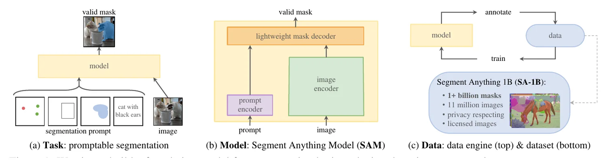{fig-alt="Three panels labelled task, model and data: promptable segmentation, the model's three parts, and a data loop giving one billion masks." loading="lazy"}

[scope]{.k .scope} [· triptych · page 1, full width]{.meta}

[Its caption opens: “We aim to build a foundation model for segmentation by introducing three interconnected components …”]{.cap}

Three contributions, three panels, and the same three names as the introduction.

**Borrow:** Give each contribution a panel, with matching words.

[Figure 1, Kirillov et al. © the authors.]{.meta}
:::
::: {.hf .scope .wide #satlas}
[**SatlasPretrain** · ICCV 2023 · [paper](https://arxiv.org/abs/2211.15660)]{.hd}

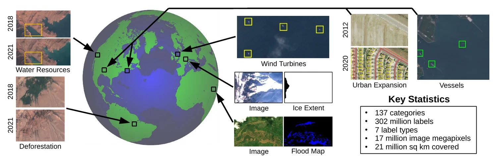{fig-alt="A globe with arrows to real satellite tiles for deforestation, wind turbines, floods, vessels and more, and a box of key statistics." loading="lazy"}

[scope]{.k .scope} → [payoff]{.k .pay} [· hub · page 1, full width]{.meta}

[Its caption opens: “SatlasPretrain is a large-scale remote sensing dataset.”]{.cap}

A globe for coverage, real tiles named by their use, and the counts in one box.

**Borrow:** For a dataset: real samples, real uses, three or four counts.

[Figure 1, Bastani et al. CC BY 4.0.]{.meta}
:::
::: {.hf .scope .wide #swebench}
[**SWE-bench** · ICLR 2024 · [paper](https://arxiv.org/abs/2310.06770)]{.hd}

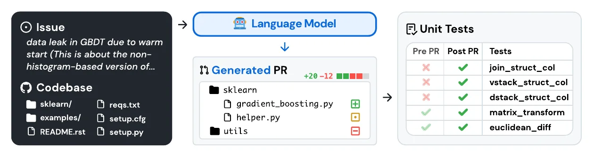{fig-alt="A GitHub issue and codebase, a language model that writes a pull request, and unit tests that fail before and pass after." loading="lazy"}

[scope]{.k .scope} → [payoff]{.k .pay} [· strip · page 1, full width]{.meta}

[Its caption opens: “SWE-bench sources task instances from real-world Python repositories by connecting GitHub issues to merged pull request solutions that resolve related tests.”]{.cap}

It follows one real issue from input to score, so the task and the metric are learnt together.

**Borrow:** For a benchmark, show one item end to end.

[Figure 1, Jimenez et al. CC BY 4.0.]{.meta}
:::
::: {.hf .scope #sustainbench}
[**SustainBench** · NeurIPS 2021 · [paper](https://arxiv.org/abs/2111.04724)]{.hd}

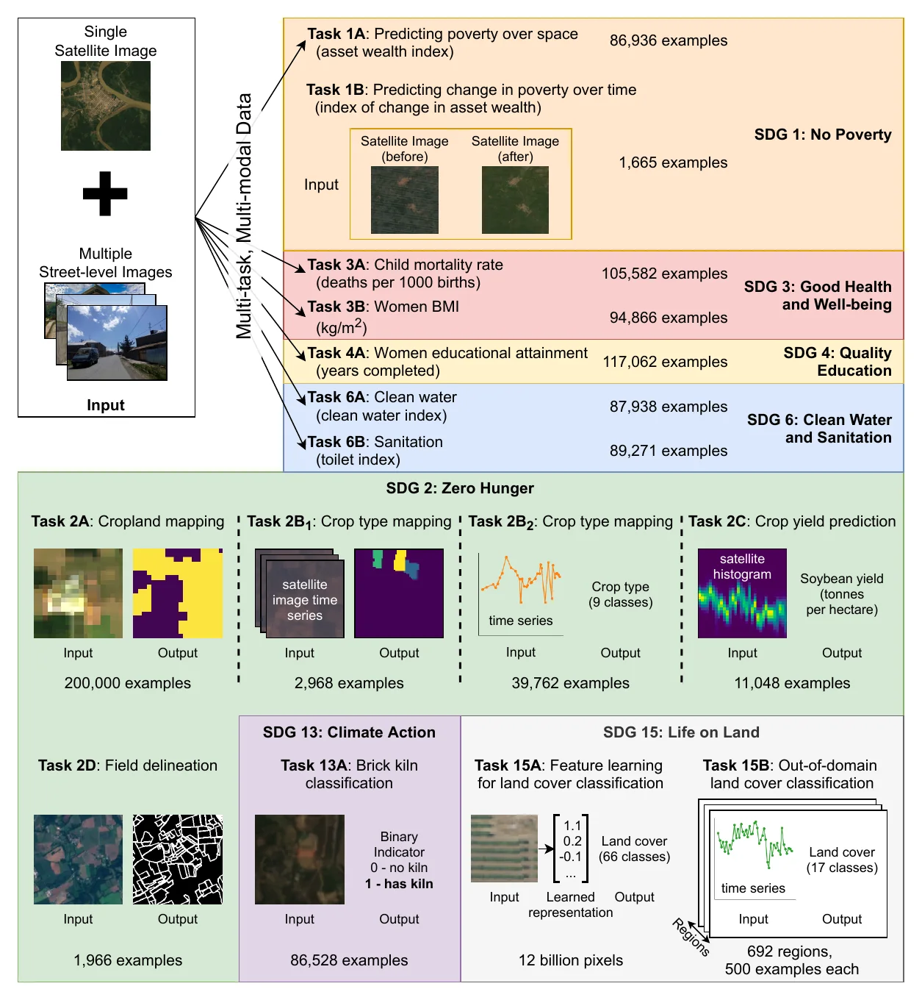{fig-alt="Coloured blocks, one per Sustainable Development Goal, each listing tasks with an input image, an output image and a count of examples." loading="lazy"}

[scope]{.k .scope} [· gallery · page 2, one column]{.meta}

[Its caption opens: “Datasets and tasks included in SustainBench ranging from poverty prediction to land cover classification …”]{.cap}

Fifteen tasks, grouped and coloured by the goal each serves, each with its input, output and size.

**Borrow:** Group many items by something the reader cares about. **Watch out:** Near the limit for one figure.

[Figure 1, Yeh et al. © the authors.]{.meta}
:::
::: {.hf .scope #chexpert}
[**CheXpert** · AAAI 2019 · [paper](https://arxiv.org/abs/1901.07031)]{.hd}

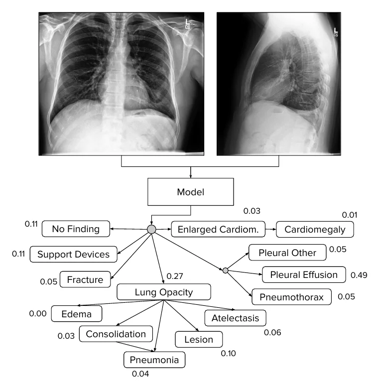{fig-alt="Two chest X-rays feed a model, which gives a probability for each of 14 findings." loading="lazy"}

[scope]{.k .scope} → [payoff]{.k .pay} [· strip · page 1, one column]{.meta}

[Its caption opens: “The CheXpert task is to predict the probability of different observations from multi-view chest radiographs.”]{.cap}

One real case defines the task: these X-rays in, these fourteen probabilities out.

**Borrow:** Show one real input and its full output.

[Figure 1, Irvin et al. CC BY 4.0.]{.meta}
:::
::: {.hf .scope .wide #blink}
[**BLINK** · ECCV 2024 · [paper](https://arxiv.org/abs/2404.12390)]{.hd}

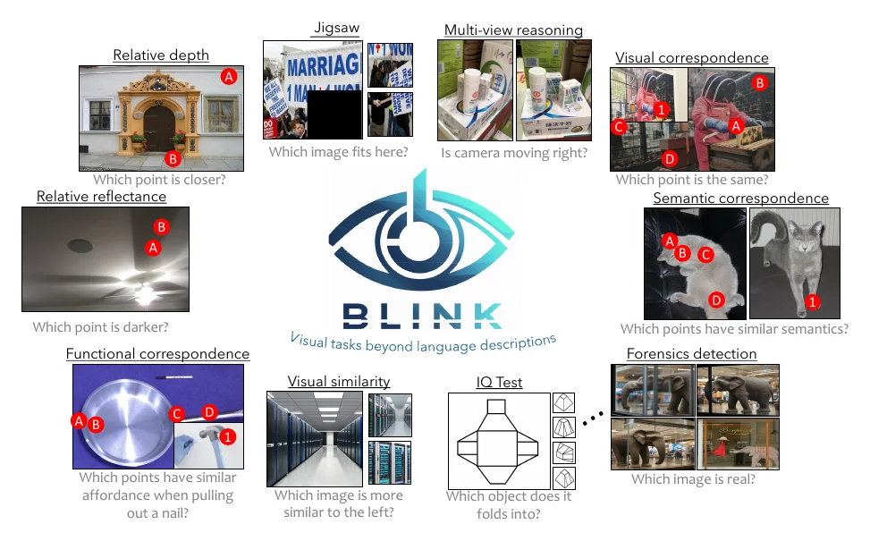{fig-alt="Ten sample tasks around the BLINK logo, each an image with marked points and a one-line question." loading="lazy"}

[scope]{.k .scope} [· hub · page 1, full width]{.meta}

[Its caption opens: “The Blink Benchmark.”]{.cap}

Each task is an image and a question that the reader can try, which shows they are easy for people.

**Borrow:** Let the reader attempt a sample. **Watch out:** Very small in print.

[Figure 1, Fu et al. CC BY-NC-SA 4.0.]{.meta}
:::
:::

## What the 24 have in common

- **Page 1.** 20 of 24 put Figure 1 on the first page. The other 4 put it on the second.
- **Real data.** 20 of 24 are built from real images, series or text, not icons.
- **Few parts.** Most have two to four groups. A gallery repeats one small unit.
- **Rarely an architecture.** Only MAE calls itself one, and it has five elements.
- **Captions differ.** 7 of 24 open with a label, such as "Our MAE architecture." The strongest open with the claim itself, as Chain-of-Thought, DINO and ImageBind do.
- **Few numbers.** Only 5 carry a measured result. The rest show outputs that anyone can judge by eye. A forecast or a temperature cannot be judged by eye, so **our figures need the number**.

::: {.callout-note collapse="true"}
## All 24 on the same axes

::: {.hf-scroll}
| Paper | Leads with | Layout | Page | Real data | Number | Strongest on |
|--------|------|-------|--|----|-----|-------------|
| [Informer](#informer) | [problem]{.k .prob} | plot | 1 | yes | result | problem framing, evidence |
| [ResNet](#resnet) | [problem]{.k .prob} | plot | 1 | yes | result | clarity, problem framing, readable in print |
| [Chain-of-Thought](#cot) | [problem]{.k .prob} | contrast pair | 1 | yes | none | clarity, novelty, real examples |
| [CLIP](#clip) | [idea]{.k .idea} | strip | 2 | partly | none | novelty, hierarchy, stands alone |
| [MAE](#mae) | [idea]{.k .idea} | strip | 1 | yes | none | novelty, readable in print, clarity |
| [LIME](#lime) | [idea]{.k .idea} | strip | 2 | no | none | clarity, hierarchy |
| [Generative Image Dynamics](#gid) | [idea]{.k .idea} | strip | 1 | yes | none | hierarchy, novelty |
| [AnySat](#anysat) | [idea]{.k .idea} | funnel | 1 | yes | none | real examples, clarity |
| [Swin Transformer](#swin) | [idea]{.k .idea} | contrast pair | 1 | no | none | novelty, problem framing, readable in print |
| [YOLO](#yolo) | [idea]{.k .idea} | strip | 1 | yes | none | clarity, novelty |
| [LLMTime](#llmtime) | [idea]{.k .idea} | strip | 2 | yes | result | novelty, evidence, real examples |
| [3D Gaussian Splatting](#3dgs) | [payoff]{.k .pay} | comparison row | 1 | yes | result | evidence, stands alone, problem framing |
| [EfficientNet](#efficientnet) | [payoff]{.k .pay} | plot | 1 | yes | result | evidence, clarity, readable in print |
| [CycleGAN](#cyclegan) | [payoff]{.k .pay} | gallery | 1 | yes | none | real examples, clarity |
| [pix2pix](#pix2pix) | [payoff]{.k .pay} | gallery | 1 | yes | none | real examples, hierarchy, stands alone |
| [DINO](#dino) | [payoff]{.k .pay} | gallery | 1 | yes | none | stands alone, real examples |
| [ImageBind](#imagebind) | [payoff]{.k .pay} | gallery | 1 | yes | none | real examples, hierarchy |
| [GeoChat](#geochat) | [payoff]{.k .pay} | hub | 1 | yes | none | real examples, stands alone |
| [Segment Anything](#sam) | [scope]{.k .scope} | triptych | 1 | partly | counts | hierarchy, stands alone |
| [SatlasPretrain](#satlas) | [scope]{.k .scope} | hub | 1 | yes | counts | real examples, evidence |
| [SWE-bench](#swebench) | [scope]{.k .scope} | strip | 1 | yes | none | real examples, clarity |
| [SustainBench](#sustainbench) | [scope]{.k .scope} | gallery | 2 | yes | counts | hierarchy, real examples |
| [CheXpert](#chexpert) | [scope]{.k .scope} | strip | 1 | yes | none | clarity, real examples |
| [BLINK](#blink) | [scope]{.k .scope} | hub | 1 | yes | none | real examples, hierarchy |
:::

*Number*: the figure carries a measured result, only counts of data, or no number.
:::

## Make your own

1. **Write the sentence.** "Today, [problem]. We [idea]. Now, [payoff with a number]."
2. **Choose what leads,** from the table above.
3. **Follow one real example** through every panel. Pick a typical case, not the best of fifty.
4. **Sketch on paper first,** in week one, with three or four groups and one reading direction.
5. **Replace boxes with pictures.** A box that says "Encoder" shows nothing.
6. **Put one number on it,** with the baseline beside it.
7. **Colour only what is new.** Everything else is grey.
8. **Build it at final width,** as a vector PDF, with text of at least 6 to 7 pt. Put it on page 1.
9. **Open the caption with the claim,** and use the abstract's words on the figure.
10. **Test it for ten seconds** on someone outside the project. Redraw what they miss.

[Writing Papers](writing-papers.qmd#hero-figures) works through these steps for five papers.

## Checklist

- [ ] The claim is clear in ten seconds.
- [ ] The reader can see what existing methods cannot do.
- [ ] The new part stands out, and is not buried in a pipeline.
- [ ] Real inputs and outputs replace icons.
- [ ] A number or a comparison supports the claim.
- [ ] It has three or four groups and one reading direction.
- [ ] Every label is legible in the compiled PDF, and spelt correctly.
- [ ] The figure and its caption stand alone.
- [ ] It is on page 1, and its words match the abstract's.

[The figures are reproduced from the cited papers for teaching and criticism only. Each belongs to its authors and publisher. If you are an author and would like a figure removed, please write to us.]{.hf-note}
