```{=html}
<style>
/* No child combinators here: Quarto escapes them inside page styles. */
.hf-grid { display: grid; grid-template-columns: 1fr 1fr; gap: 22px 20px; grid-auto-flow: dense; margin: 1rem 0 2.2rem; align-items: start; }
.hf { border-top: 3px solid var(--accent); padding-top: .6rem; min-width: 0; scroll-margin-top: 90px; }
.hf.wide { grid-column: 1 / -1; }
.hf p { margin: 0 0 .35rem; font-size: .93rem; line-height: 1.45; }
.hf .hd { font-size: 1rem; }
.hf .cap { display: block; font-size: .82rem; font-style: italic; color: var(--muted); margin: .1rem 0 .4rem; }
.hf .meta, .hf-note { font-size: .76rem; color: var(--muted); }
.hf img { display: block; width: 100%; max-height: 560px; object-fit: contain; background: #fff; border: 1px solid var(--rule); margin: .45rem 0 .5rem; }
/* Dark mode: never invert. The figures hold photos, and their colours carry meaning. Only soften the white. */
body.quarto-dark .hf img { filter: brightness(.88); }
.hf-scroll { overflow-x: auto; }
.hf-scroll table { font-size: .8rem; min-width: 620px; }
@media (max-width: 760px) { .hf-grid { grid-template-columns: 1fr; } }
</style>
```

The method figure is a separate figure from the [hero figure](hero-figures.qmd). The hero figure answers *why should I care?* The method figure answers ***how does it work?***

| | Hero figure | Method figure |
|--------|--------------------|--------------------|
| **Answers** | Why should I care? | How does it work? |
| **Sits** | On page 1 | Where the method section starts |
| **Shows** | Problem, idea, payoff | Steps, parts, and what is new |
| **Detail** | None | Enough to explain the idea back, not to rewrite the code |

A method figure can answer six different questions. Pick the one where your novelty lives. This page shows 28 method figures from NeurIPS, ICML, ICLR, CVPR, ICCV, ECCV, KDD, AAAI, NAACL, MICCAI, JMLR and Nature, grouped by that question. They cover vision, language models, graphs, time series, weather, remote sensing and classic machine learning.

```{=html}
<figure style="margin:1.4rem 0 1.8rem;max-width:760px">
<div style="aspect-ratio:16/9;background:#151816"><iframe src="https://www.youtube-nocookie.com/embed/D62npQIxqWA?rel=0" title="Making Method Figures: the film" referrerpolicy="strict-origin-when-cross-origin" style="width:100%;height:100%;border:0;display:block" allow="accelerometer; encrypted-media; gyroscope; picture-in-picture; fullscreen" allowfullscreen></iframe></div>
<figcaption style="font-size:.86rem;color:var(--muted);margin-top:.45rem">This page as a short film (9 minutes) · <a href="https://youtu.be/D62npQIxqWA">open on YouTube</a></figcaption>
</figure>
```

## Choose the question

| Your novelty is | The figure answers | Draw | See |
|--------------|----------------|-------------------|-----------|
| A new sequence of steps | What happens to one input? | One example, shown at every step | [NeRF](#nerf), [YOLO](#yolo), [GraphSAGE](#graphsage), [GenCast](#gencast), [RAG](#rag) |
| A new model | What is it made of? | The parts, with the new ones marked | [Transformer](#transformer), [U-Net](#unet), [Vision Transformer](#vit), [Segment Anything](#sam), [Diffusion Transformer](#dit), [Flamingo](#flamingo) |
| One piece in a known model | What is the new piece? | Only that piece, before and after | [ResNet](#resnet-block), [ControlNet](#controlnet), [LoRA](#lora), [Dropout](#dropout) |
| A choice among known designs | How does it differ? | The alternatives side by side, yours last | [EfficientNet](#efficientnet-scaling), [Feature Pyramid Networks](#fpn), [ConvNeXt](#convnext), [Time-LLM](#timellm), [Tree of Thoughts](#tot) |
| A new way to train | How does it learn? | What the objective compares | [CycleGAN](#cyclegan-model), [SimCLR](#simclr), [BERT](#bert), [SatCLIP](#satclip) |
| An idea that needs intuition | Why should it work? | A toy case in two dimensions | [LIME](#lime-toy), [node2vec](#node2vec), [MAML](#maml), [Score-based SDEs](#scoresde) |

**Our default for an applied paper:** one real example followed through every step, with the new step in colour and everything standard in grey. If the novelty is one block, add a second, small figure of only that block.

## What happens to one input?

Your novelty is a new sequence of steps. Follow one example through all of them.

::: {.hf-grid}
::: {.hf .wide #nerf}
[**NeRF** · ECCV 2020 · [paper](https://arxiv.org/abs/2003.08934)]{.hd}

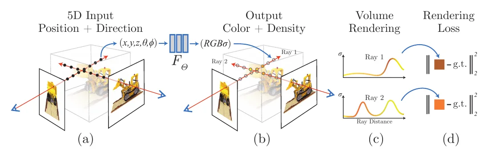{fig-alt="Four panels lettered a to d: points sampled along camera rays through a scene, a small network giving colour and density, curves of density along two rays, and a loss against the true pixel." loading="lazy"}

[vision · Figure 2 · page 5, full width · real data]{.meta}

[Its caption opens: “An overview of our neural radiance field scene representation and differentiable rendering procedure.”]{.cap}

One scene runs through four lettered panels, and the caption walks from (a) to (d) in the same order.

**Borrow:** Letter the stages, and reuse the letters in the caption and the text.

[Mildenhall et al. © the authors.]{.meta}
:::
::: {.hf #yolo}
[**YOLO** · CVPR 2016 · [paper](https://arxiv.org/abs/1506.02640)]{.hd}

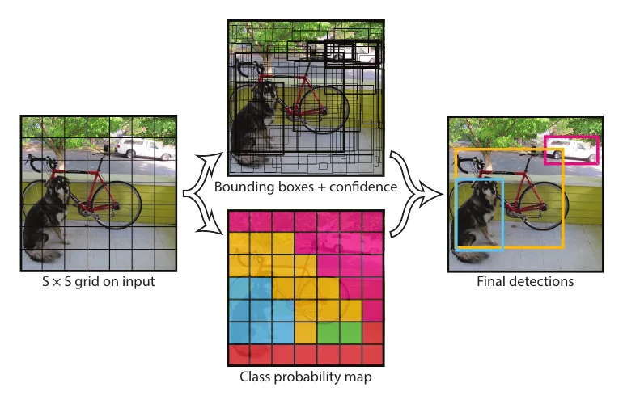{fig-alt="A photo of a dog and a bicycle with a grid on it; in parallel, the same photo with many boxes and a coloured class map; then the photo with three final boxes." loading="lazy"}

[vision · Figure 2 · page 2, one column · real data]{.meta}

[Its caption opens: “The Model.”]{.cap}

One photo becomes a grid, then boxes and a class map in parallel, then the final detections. Every stage is a picture of the data.

**Borrow:** Show the data at each stage, not the name of the stage.

[Redmon et al. © the authors.]{.meta}
:::
::: {.hf .wide #graphsage}
[**GraphSAGE** · NeurIPS 2017 · [paper](https://arxiv.org/abs/1706.02216)]{.hd}

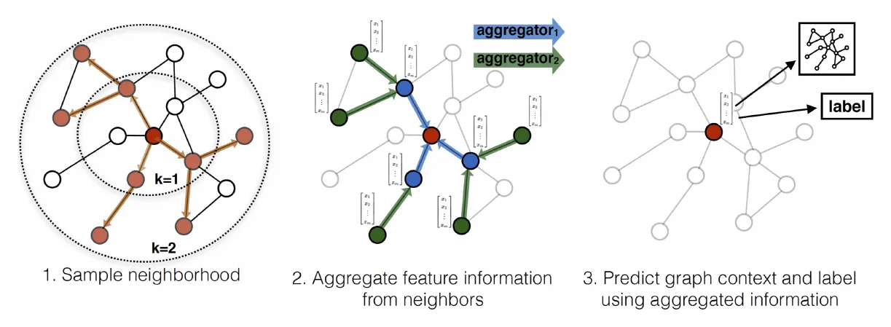{fig-alt="The same small graph three times: a neighbourhood is sampled around a red node, features flow inward along coloured edges, and the red node's label is predicted." loading="lazy"}

[graphs · Figure 1 · page 2, full width · schematic]{.meta}

[Its caption opens: “Visual illustration of the GraphSAGE sample and aggregate approach.”]{.cap}

Three numbered steps on the same small graph. Colour shows which nodes each step touches.

**Borrow:** Use one toy example, redrawn at every step.

[Hamilton et al. © the authors.]{.meta}
:::
::: {.hf #gencast}
[**GenCast** · Nature 2024 · [paper](https://arxiv.org/abs/2312.15796)]{.hd}

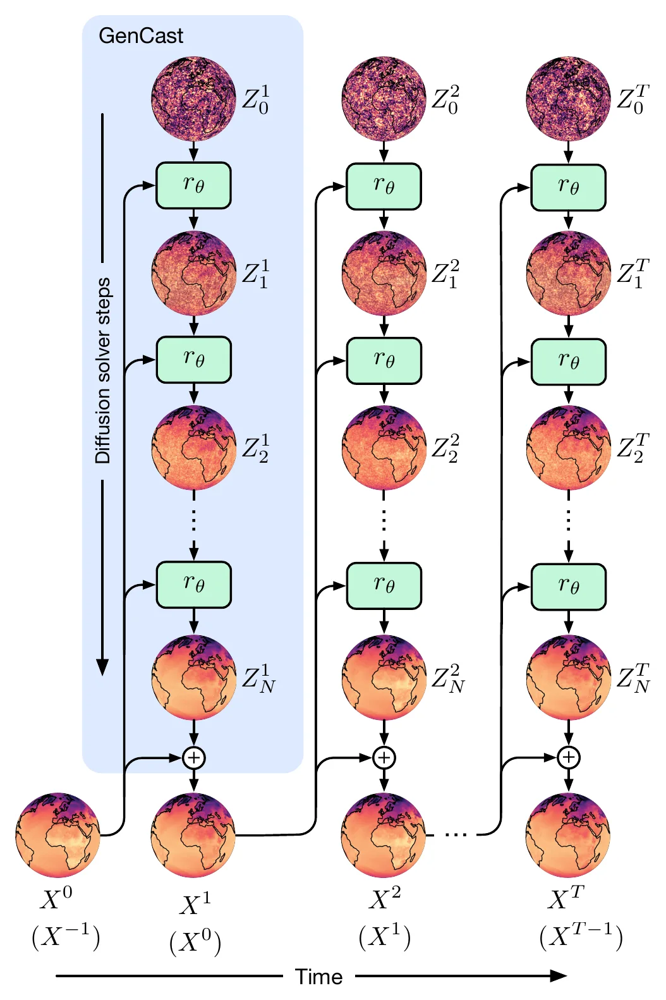{fig-alt="Columns of globes showing weather states. In each column a noisy globe is refined step by step into a forecast, which is passed along a time axis to the next column. The first column is shaded blue." loading="lazy"}

[weather · Figure 1 · page 2, one column · real data]{.meta}

[Its caption opens: “Schematic of how GenCast produces a forecast.”]{.cap}

Real weather states sit at every node. Noise is refined into a forecast, and that forecast feeds the next step. A blue box isolates one step.

**Borrow:** Shade one pass of a loop, then show it repeating.

[Price et al. CC BY 4.0.]{.meta}
:::
::: {.hf .wide #rag}
[**RAG** · NeurIPS 2020 · [paper](https://arxiv.org/abs/2005.11401)]{.hd}

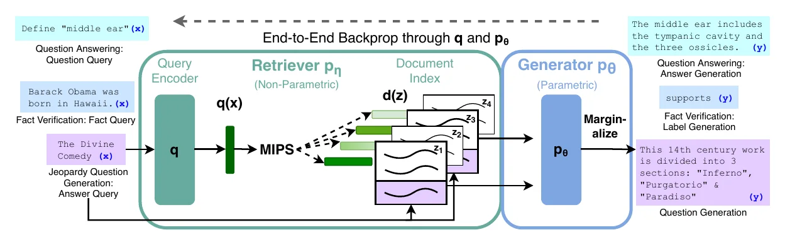{fig-alt="Example questions on the left enter a query encoder; a retriever finds documents in an index; a generator reads them and produces the answers shown on the right. A dashed arrow across the top is labelled end-to-end backprop." loading="lazy"}

[language models · Figure 1 · page 2, full width · real data]{.meta}

[Its caption opens: “Overview of our approach.”]{.cap}

Three real questions go in on the left and their answers come out on the right. Two rounded boxes group the retriever and the generator, and a dashed arrow on top shows what is trained end to end.

**Borrow:** Group the boxes into the two or three parts that your text names. **Watch out:** It is dense at print size.

[Lewis et al. © the authors.]{.meta}
:::
:::

## What is it made of?

Your novelty is a new model. Draw its parts, and mark the new ones.

::: {.hf-grid}
::: {.hf #transformer}
[**Transformer** · NeurIPS 2017 · [paper](https://arxiv.org/abs/1706.03762)]{.hd}

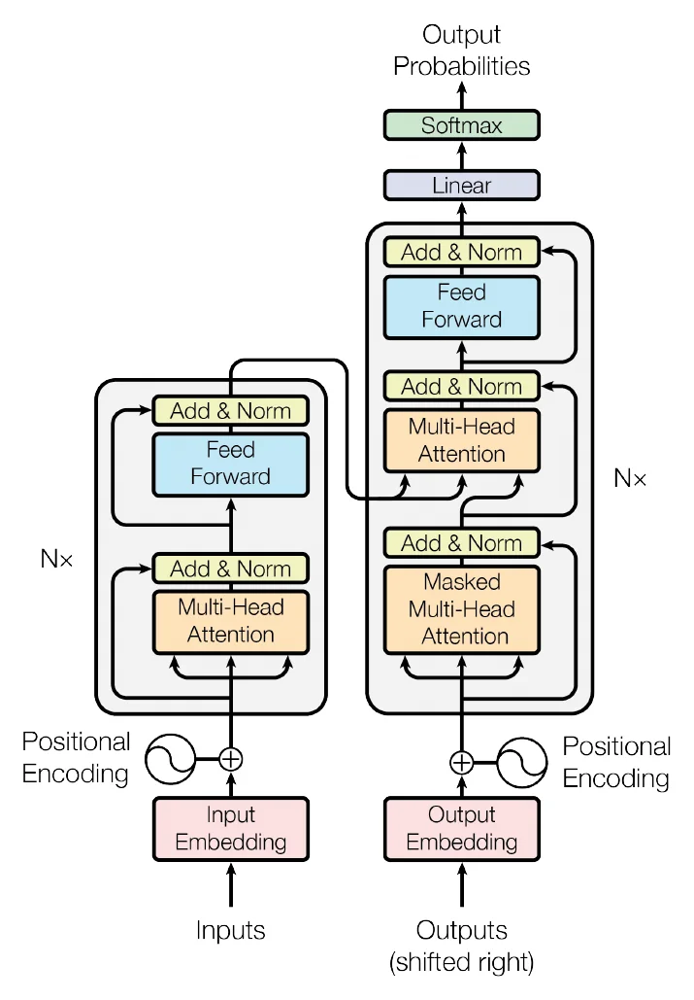{fig-alt="An encoder stack and a decoder stack of coloured blocks: attention in orange, feed-forward in blue, add and norm in yellow, each stack marked N times." loading="lazy"}

[language · Figure 1 · page 3, one column · schematic]{.meta}

[Its caption opens: “The Transformer - model architecture.”]{.cap}

Colour means block type, and the same colour is the same block everywhere. "N×" replaces a stack of copies.

**Borrow:** Use one colour per kind of block, and a repeat mark in place of repeats.

[Vaswani et al. Reproduced under the permission stated in the paper.]{.meta}
:::
::: {.hf .wide #unet}
[**U-Net** · MICCAI 2015 · [paper](https://arxiv.org/abs/1505.04597)]{.hd}

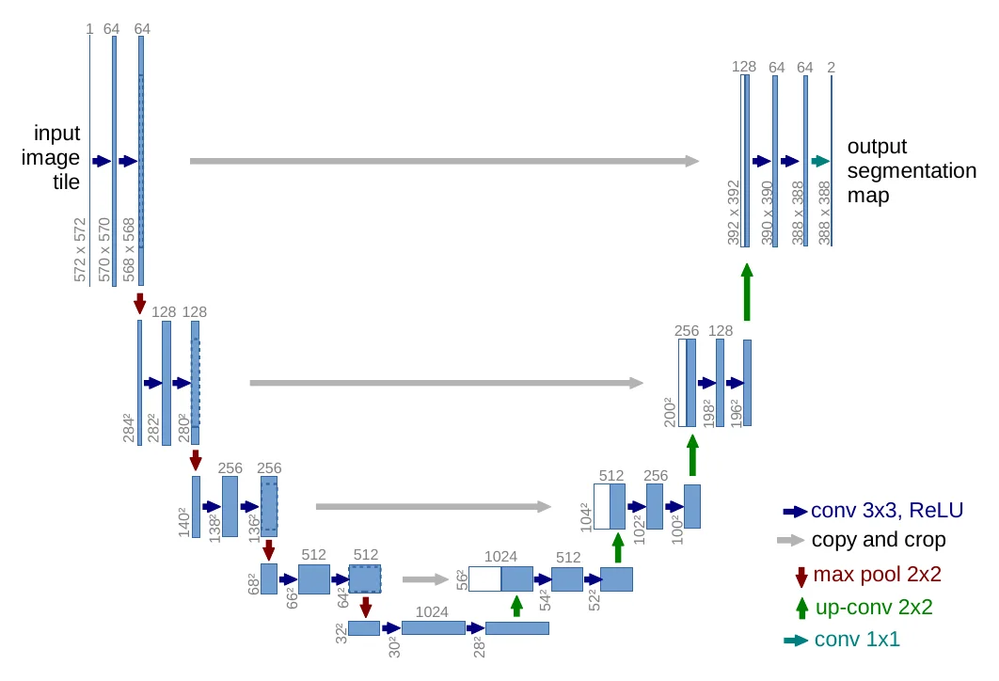{fig-alt="Blue boxes arranged in a U shape, with grey arrows crossing from the left arm to the right arm, and a legend of five arrow colours." loading="lazy"}

[medical imaging · Figure 1 · page 2, full width · schematic]{.meta}

[Its caption opens: “U-net architecture (example for 32x32 pixels in the lowest resolution).”]{.cap}

The layout is the idea: down one side, up the other, with skip arrows across. A legend gives each arrow colour one meaning.

**Borrow:** Give each arrow style one meaning, and say it in a legend. **Watch out:** The size labels are tiny.

[Ronneberger et al. © the authors.]{.meta}
:::
::: {.hf .wide #vit}
[**Vision Transformer** · ICLR 2021 · [paper](https://arxiv.org/abs/2010.11929)]{.hd}

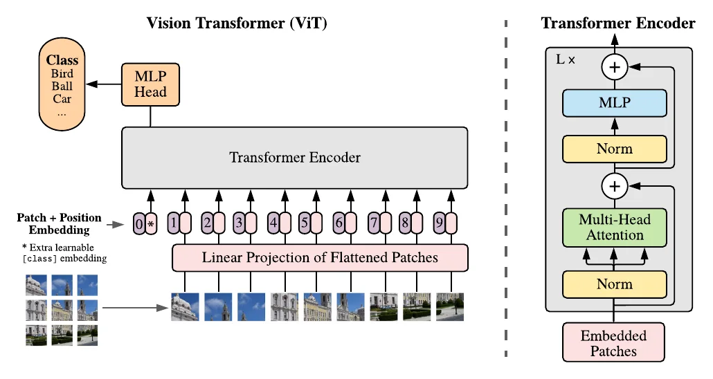{fig-alt="Left: a photo cut into nine patches, which are embedded and fed to a transformer encoder and a classification head. Right: the encoder block drawn in detail." loading="lazy"}

[vision · Figure 1 · page 3, full width · real data]{.meta}

[Its caption opens: “Model overview.”]{.cap}

The overview is on the left, with real image patches going in. The one block that needs detail is enlarged on the right.

**Borrow:** Give the overview first, then zoom into one block.

[Dosovitskiy et al. © the authors.]{.meta}
:::
::: {.hf .wide #sam}
[**Segment Anything** · ICCV 2023 · [paper](https://arxiv.org/abs/2304.02643)]{.hd}

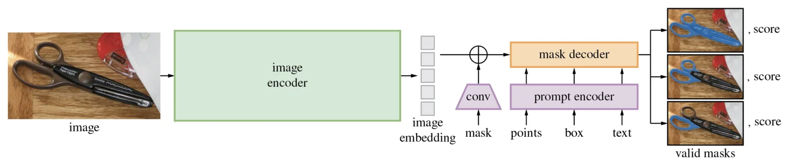{fig-alt="A photo of scissors enters a large image-encoder box; a small prompt encoder takes points, a box or text; a small mask decoder gives three masks with scores." loading="lazy"}

[vision · Figure 4 · page 5, full width · real data]{.meta}

[Its caption opens: “Segment Anything Model (SAM) overview.”]{.cap}

A real image goes in and real masks come out. The heavy encoder is drawn large and the light decoder small, which is the point of the design.

**Borrow:** Let the size of a box show its cost.

[Kirillov et al. From the authors' repository, Apache 2.0 licence.]{.meta}
:::
::: {.hf .wide #dit}
[**Diffusion Transformer** · ICCV 2023 · [paper](https://arxiv.org/abs/2212.09748)]{.hd}

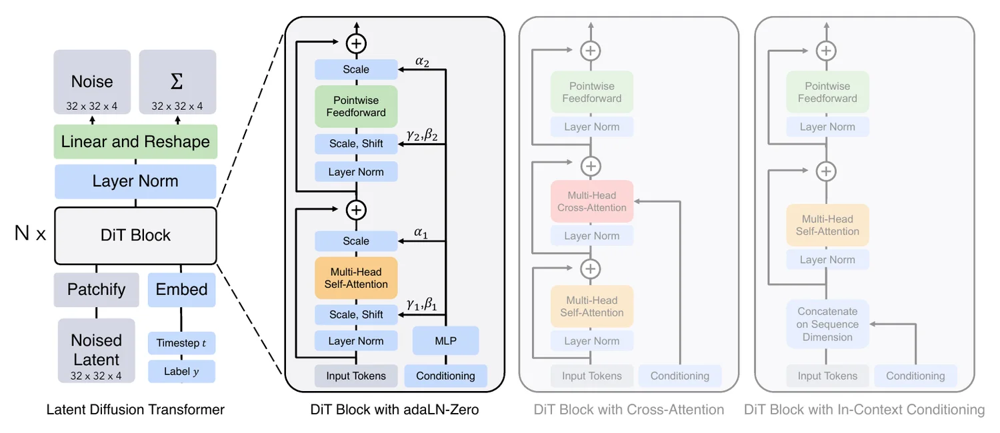{fig-alt="Left: the overall model as a short stack. Centre: one block in full colour. Right: two alternative blocks drawn faded." loading="lazy"}

[image generation · Figure 3 · page 3, full width · schematic]{.meta}

[Its caption opens: “The Diffusion Transformer (DiT) architecture.”]{.cap}

The chosen block is in full colour. The two variants that were tried are faded beside it.

**Borrow:** Fade the alternatives you tried, and keep yours in colour.

[Peebles and Xie. CC BY 4.0.]{.meta}
:::
::: {.hf .wide #flamingo}
[**Flamingo** · NeurIPS 2022 · [paper](https://arxiv.org/abs/2204.14198)]{.hd}

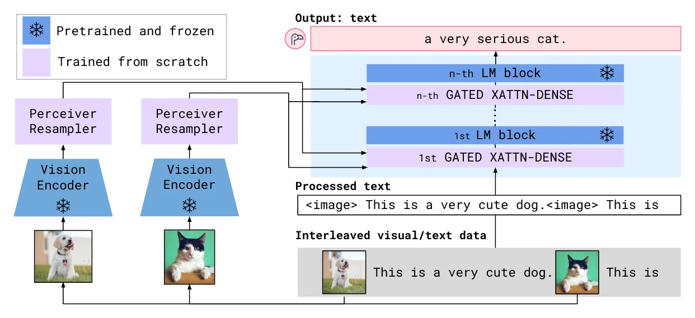{fig-alt="Two photos pass through blue vision encoders marked with snowflakes and purple resamplers into a stack of language-model blocks; a key says blue is pretrained and frozen, purple is trained from scratch." loading="lazy"}

[vision and language · Figure 3 · page 4, full width · real data]{.meta}

[Its caption opens: “Flamingo architecture overview.”]{.cap}

A two-colour key separates what is frozen from what is trained, and a real example of photos and text runs through the model.

**Borrow:** Mark the trained and the frozen parts, with a key.

[Alayrac et al. © the authors.]{.meta}
:::
:::

## What is the new piece?

Your novelty is one piece inside a known model. Draw only that piece.

::: {.hf-grid}
::: {.hf #resnet-block}
[**ResNet** · CVPR 2016 · [paper](https://arxiv.org/abs/1512.03385)]{.hd}

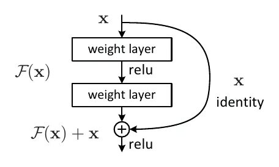{fig-alt="Two weight layers in a column, with a curved arrow carrying the input x around them to an addition." loading="lazy"}

[vision · Figure 2 · page 2, one column · schematic]{.meta}

[Its caption opens: “Residual learning: a building block.”]{.cap}

Two layers, one curved arrow, and symbols that match the equations. That is the whole contribution.

**Borrow:** If the novelty is one connection, draw one connection.

[He et al. © the authors.]{.meta}
:::
::: {.hf #controlnet}
[**ControlNet** · ICCV 2023 · [paper](https://arxiv.org/abs/2302.05543)]{.hd}

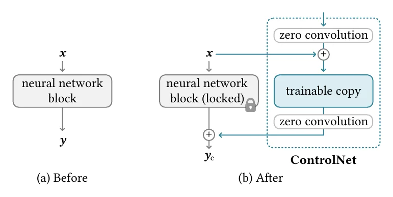{fig-alt="Left, before: one grey network block. Right, after: the same block locked, beside a blue trainable copy joined by two zero-convolution layers." loading="lazy"}

[image generation · Figure 2 · page 3, one column · schematic]{.meta}

[Its caption opens: “A neural block takes a feature map x as input and outputs another feature map y, as shown in (a).”]{.cap}

Before and after, side by side. The original block is grey and locked, and everything that was added is blue.

**Borrow:** Draw "before" in grey, and add your part in one colour.

[Zhang et al. © the authors.]{.meta}
:::
::: {.hf #lora}
[**LoRA** · ICLR 2022 · [paper](https://arxiv.org/abs/2106.09685)]{.hd}

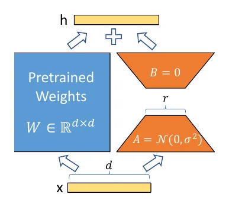{fig-alt="A blue square of pretrained weights beside two orange trapezoids, A and B, that narrow to a small width r between them." loading="lazy"}

[language models · Figure 1 · page 1, one column · schematic]{.meta}

[Its caption opens: “Our reparametrization.”]{.cap}

Blue is frozen and orange is trained. The orange shapes narrow to r, the low rank.

**Borrow:** Let a shape show the key quantity.

[Hu et al. © the authors.]{.meta}
:::
::: {.hf .wide #dropout}
[**Dropout** · JMLR 2014 · [paper](https://jmlr.org/papers/v15/srivastava14a.html)]{.hd}

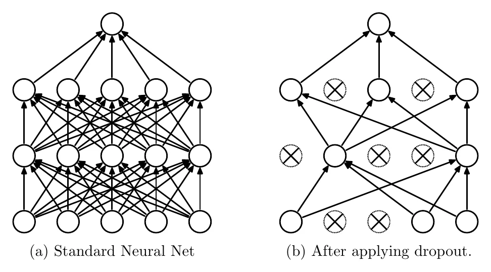{fig-alt="Two small neural networks side by side. The left one is fully connected. In the right one several units are crossed out and their connections are gone." loading="lazy"}

[classic ML · Figure 1 · page 2, full width · schematic]{.meta}

[Its caption opens: “Dropout Neural Net Model.”]{.cap}

The same network twice: complete on the left, and with crossed-out units on the right. It needs no equation.

**Borrow:** Show the same thing before and after your change.

[Srivastava et al. © the authors.]{.meta}
:::
:::

## How does it differ from what came before?

Your novelty is a choice among known designs. Draw them side by side, yours last.

::: {.hf-grid}
::: {.hf .wide #efficientnet-scaling}
[**EfficientNet** · ICML 2019 · [paper](https://arxiv.org/abs/1905.11946)]{.hd}

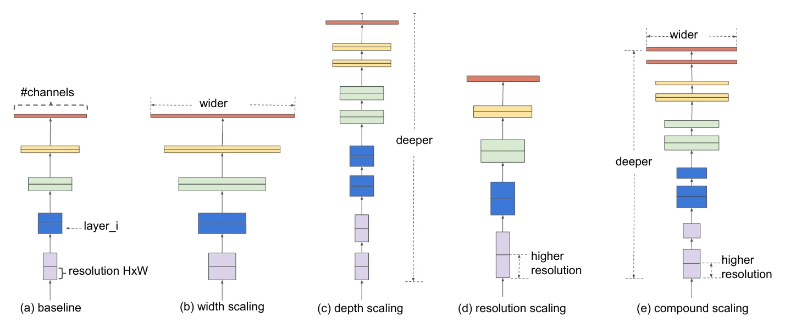{fig-alt="Five network sketches: a baseline, a wider one, a deeper one, a higher-resolution one, and one scaled in all three ways." loading="lazy"}

[vision · Figure 2 · page 2, full width · schematic]{.meta}

[Its caption opens: “Model Scaling.”]{.cap}

A baseline, three ways to scale one dimension, and then ours, all drawn with the same shapes.

**Borrow:** Line up the alternatives, and put yours last.

[Tan and Le. © the authors.]{.meta}
:::
::: {.hf #fpn}
[**Feature Pyramid Networks** · CVPR 2017 · [paper](https://arxiv.org/abs/1612.03144)]{.hd}

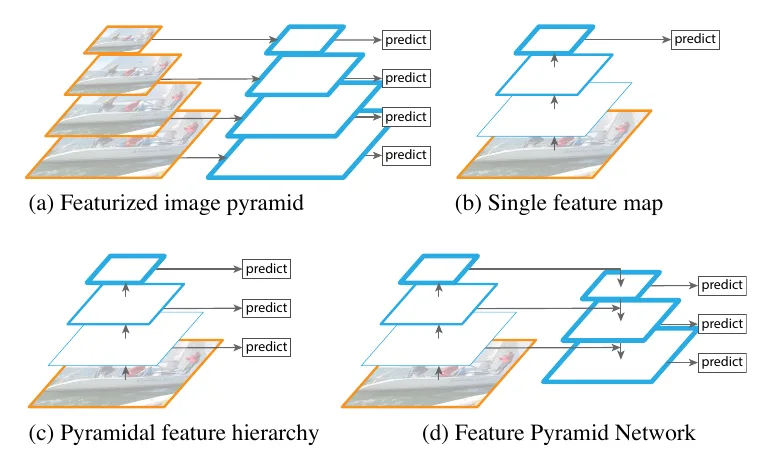{fig-alt="Four small diagrams of stacked feature maps with predict arrows, lettered a to d; the fourth, the paper's own, has thick outlines at every level." loading="lazy"}

[vision · Figure 1 · page 1, one column · schematic]{.meta}

[Its caption opens: “(a) Using an image pyramid to build a feature pyramid.”]{.cap}

Four pyramid designs in one drawing style. Thicker outlines mean stronger features, so the reader sees what each design lacks.

**Borrow:** Use one drawing style for every alternative, and one cue for quality.

[Lin et al. © the authors.]{.meta}
:::
::: {.hf #convnext}
[**ConvNeXt** · CVPR 2022 · [paper](https://arxiv.org/abs/2201.03545)]{.hd}

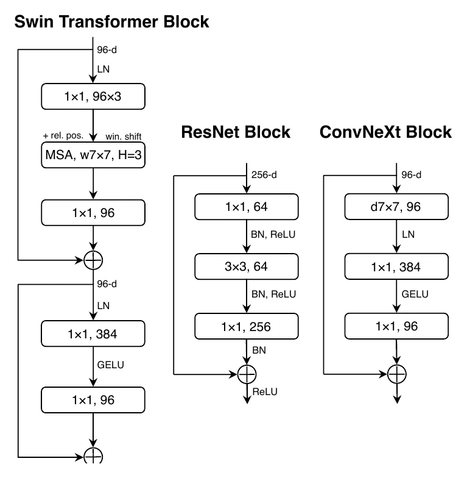{fig-alt="Three block diagrams side by side, labelled Swin Transformer block, ResNet block and ConvNeXt block, each a column of layers with their sizes." loading="lazy"}

[vision · Figure 4 · page 5, one column · schematic]{.meta}

[Its caption opens: “Block designs for a ResNet, a Swin Transformer, and a ConvNeXt.”]{.cap}

Three blocks side by side, with every layer and size written out. The reader can count the differences.

**Borrow:** For a change inside a block, put the blocks next to each other at one scale.

[Liu et al. CC BY 4.0.]{.meta}
:::
::: {.hf .wide #timellm}
[**Time-LLM** · ICLR 2024 · [paper](https://arxiv.org/abs/2310.01728)]{.hd}

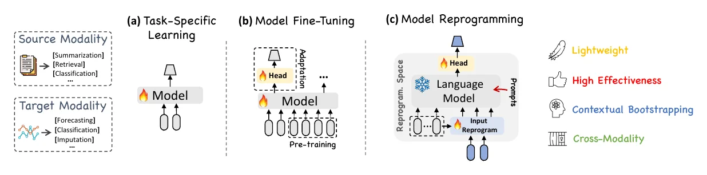{fig-alt="Three small panels: task-specific learning, model fine-tuning, and model reprogramming, with icons for frozen and fine-tuned parts and a list of benefits." loading="lazy"}

[time series · Figure 1 · page 3, full width · schematic]{.meta}

[Its caption opens: “Schematic illustration of reprogramming large language models (LLMs) in comparison of (a) task-specific learning and (b) model fine-tuning.”]{.cap}

Three ways to adapt a model to time series, (a) to (c), with a flame on trained parts and a snowflake on frozen ones.

**Borrow:** Place your approach in a row with the existing ones. **Watch out:** Its icons and labels are small.

[Jin et al. CC BY 4.0.]{.meta}
:::
::: {.hf .wide #tot}
[**Tree of Thoughts** · NeurIPS 2023 · [paper](https://arxiv.org/abs/2305.10601)]{.hd}

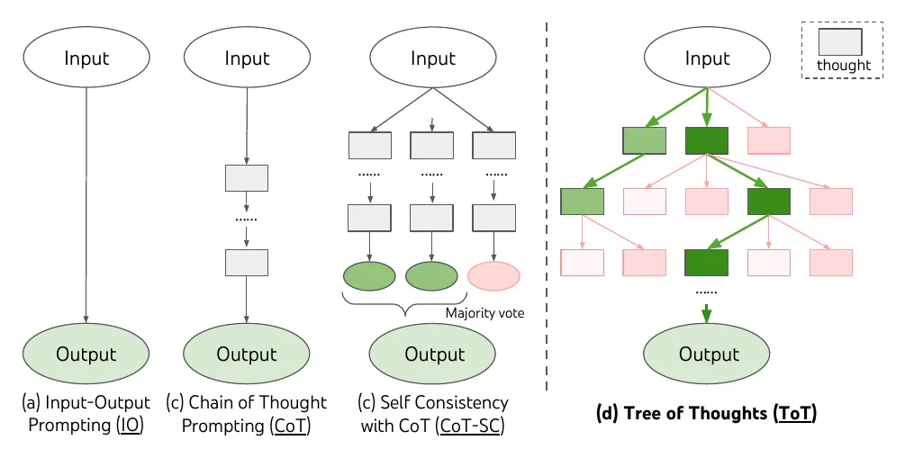{fig-alt="Four panels from input to output: a single arrow, a chain of boxes, several chains with a majority vote, and a tree of boxes in which a green path leads to the output." loading="lazy"}

[language models · Figure 1 · page 2, full width · schematic]{.meta}

[Its caption opens: “Schematic illustrating various approaches to problem solving with LLMs.”]{.cap}

Four ways to prompt a language model, drawn with the same boxes, from one straight line to a tree. Ours is the last panel, and green marks the path that is kept.

**Borrow:** Draw the earlier methods as simpler versions of yours.

[Yao et al. CC BY 4.0.]{.meta}
:::
:::

## How does it learn?

Your novelty is how the model is trained. Draw what the objective compares.

::: {.hf-grid}
::: {.hf .wide #cyclegan-model}
[**CycleGAN** · ICCV 2017 · [paper](https://arxiv.org/abs/1703.10593)]{.hd}

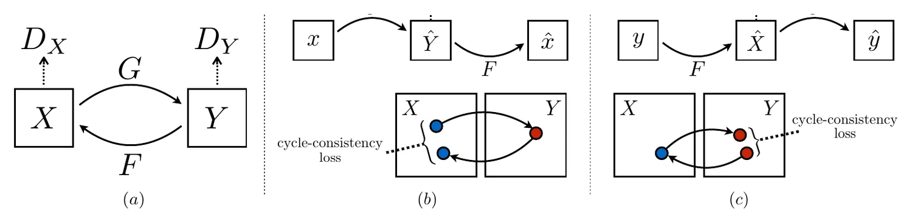{fig-alt="Three panels: two domains X and Y joined by mappings G and F; a sample sent from X to Y and back, with the gap marked as cycle-consistency loss; and the reverse." loading="lazy"}

[image generation · Figure 3 · page 3, full width · schematic]{.meta}

[Its caption opens: “(a) Our model contains two mapping functions G: X → Y and F: Y → X, and associated adversarial discriminators …”]{.cap}

(a) shows the two mappings. (b) and (c) show one sample going round the loop and landing near where it started.

**Borrow:** To explain a loss, draw what it compares.

[Zhu et al. © the authors.]{.meta}
:::
::: {.hf #simclr}
[**SimCLR** · ICML 2020 · [paper](https://arxiv.org/abs/2002.05709)]{.hd}

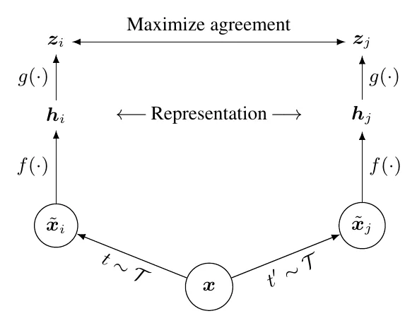{fig-alt="An image x is augmented into two views, each passed through an encoder f and a head g, with a double arrow between the two outputs labelled maximize agreement." loading="lazy"}

[vision · Figure 2 · page 2, one column · schematic]{.meta}

[Its caption opens: “A simple framework for contrastive learning of visual representations.”]{.cap}

One image, two views, two branches, and one arrow labelled "Maximize agreement". Every symbol is used in the text.

**Borrow:** Label the figure with the paper's own symbols.

[Chen et al. © the authors.]{.meta}
:::
::: {.hf .wide #bert}
[**BERT** · NAACL 2019 · [paper](https://arxiv.org/abs/1810.04805)]{.hd}

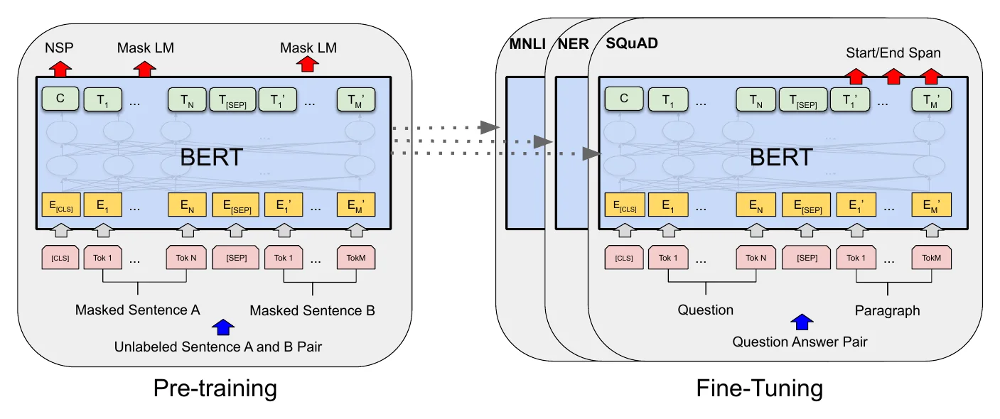{fig-alt="Two copies of the same model, labelled pre-training and fine-tuning, with different inputs below and different outputs above." loading="lazy"}

[language · Figure 1 · page 3, full width · schematic]{.meta}

[Its caption opens: “Overall pre-training and fine-tuning procedures for BERT.”]{.cap}

Pre-training and fine-tuning are drawn as the same model twice, so the reader sees that only the inputs and outputs change.

**Borrow:** Draw the two phases side by side, with the same shapes.

[Devlin et al. © the authors.]{.meta}
:::
::: {.hf .wide #satclip}
[**SatCLIP** · AAAI 2025 · [paper](https://arxiv.org/abs/2311.17179)]{.hd}

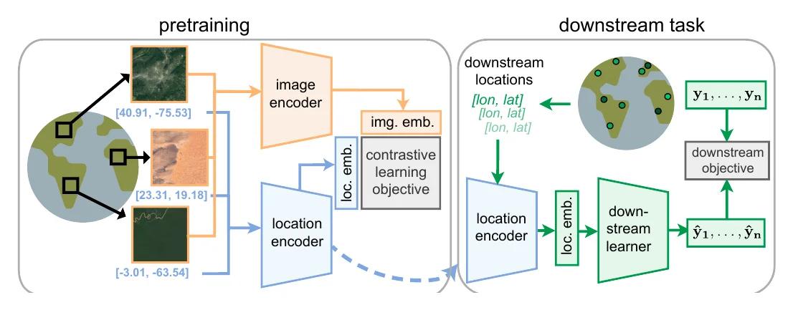{fig-alt="Left: a globe with satellite tiles and their coordinates feeding an image encoder and a location encoder with a contrastive objective. Right: the location encoder reused for a downstream task." loading="lazy"}

[remote sensing · Figure 2 · page 4, full width · real data]{.meta}

[Its caption opens: “The SatCLIP pretraining and deployment pipeline.”]{.cap}

Pretraining is on the left and use is on the right, with real satellite tiles and coordinates. Each encoder keeps its colour across both halves.

**Borrow:** Show how it is trained and how it is used, in one figure.

[Klemmer et al. CC BY 4.0.]{.meta}
:::
:::

## Why should it work?

Your idea needs an intuition first. Draw a toy case in two dimensions.

::: {.hf-grid}
::: {.hf #lime-toy}
[**LIME** · KDD 2016 · [paper](https://arxiv.org/abs/1602.04938)]{.hd}

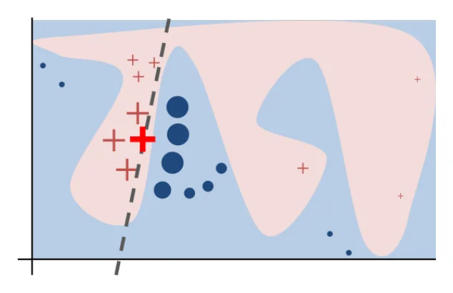{fig-alt="A pink and blue region with a wiggly boundary, a bold red cross for the point being explained, nearby samples sized by closeness, and a straight dashed line." loading="lazy"}

[classic ML · Figure 3 · page 4, one column · schematic]{.meta}

[Its caption opens: “Toy example to present intuition for LIME.”]{.cap}

A toy in two dimensions: a wiggly decision boundary, one point to explain, and a straight dashed line that fits only nearby.

**Borrow:** Draw the idea in two dimensions before the real pipeline.

[Ribeiro et al. © the authors.]{.meta}
:::
::: {.hf #node2vec}
[**node2vec** · KDD 2016 · [paper](https://arxiv.org/abs/1607.00653)]{.hd}

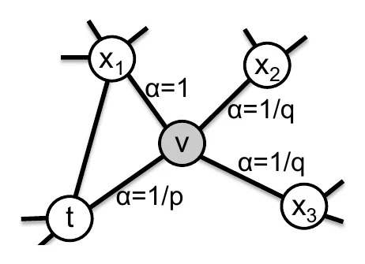{fig-alt="Five nodes: t, v and three neighbours of v. Each edge out of v is labelled with a weight: one over p, one, or one over q." loading="lazy"}

[graphs · Figure 2 · page 4, one column · schematic]{.meta}

[Its caption opens: “Illustration of the random walk procedure in node2vec.”]{.cap}

Five nodes are enough. The walk has just moved from t to v, and each possible next edge carries its bias.

**Borrow:** Use the smallest example that shows the rule.

[Grover and Leskovec. © the authors.]{.meta}
:::
::: {.hf #maml}
[**MAML** · ICML 2017 · [paper](https://arxiv.org/abs/1703.03400)]{.hd}

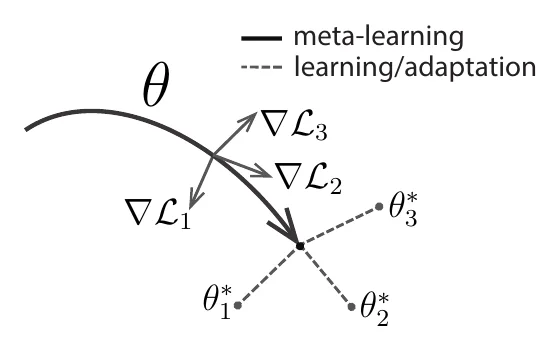{fig-alt="A thick curve labelled theta ends at a point. Three grey arrows show the gradients of three task losses, and three dashed lines lead from the point to three nearby optima. A key separates meta-learning from adaptation." loading="lazy"}

[classic ML · Figure 1 · page 2, one column · schematic]{.meta}

[Its caption opens: “Diagram of our model-agnostic meta-learning algorithm (MAML), which optimizes for a representation θ that can quickly adapt to new tasks.”]{.cap}

One curve and three dashed lines: the parameters move to a point from which each task's optimum is one short step away.

**Borrow:** A sketch of the geometry can explain an algorithm faster than its pseudocode.

[Finn et al. © the authors.]{.meta}
:::
::: {.hf .wide #scoresde}
[**Score-based SDEs** · ICLR 2021 · [paper](https://arxiv.org/abs/2011.13456)]{.hd}

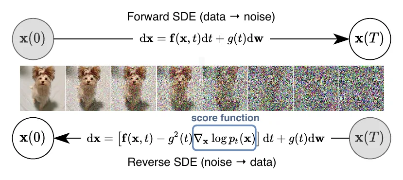{fig-alt="A forward equation above a strip of images in which a dog dissolves into noise, and a reverse equation below, with the score term boxed." loading="lazy"}

[generative models · Figure 1 · page 2, full width · real data]{.meta}

[Its caption opens: “Solving a reverse-time SDE yields a score-based generative model.”]{.cap}

The equations and the picture are stacked. A photo dissolves into noise along the top arrow and comes back along the bottom one.

**Borrow:** Put the equation next to what it does.

[Song et al. © the authors.]{.meta}
:::
:::

## What the 28 have in common

- **It sits with the method.** 26 of 28 are on pages 2 to 5, where the method is first described.
- **It can double as the hero.** In 14 of 28 it is Figure 1: those papers have no separate hero figure. If your idea *is* the method, one figure can do both jobs.
- **It is a schematic.** Only 9 of 28 show real data, against 20 of 24 hero figures. The ones that do, such as NeRF, YOLO and Segment Anything, are the easiest to follow.
- **Colour and shape mean something.** Frozen against trained, old against new, one colour per kind of block. The best ones give each colour one meaning.
- **Its caption is often only a label.** 11 of 28 open with a title such as "Model overview." A sentence that says what the method does, as ControlNet's and MAML's do, helps the reader more.
- **It leaves things out.** "N×" stands for a stack, a zoom stands for the detail, and the standard parts are small or grey.

::: {.callout-note collapse="true"}
## All 28 on the same axes

::: {.hf-scroll}
| Paper | Field | Answers | Figure | Page | Width | Shows |
|--------|------|----------------|--|--|------|------|
| [NeRF](#nerf) | vision | What happens to one input? | 2 | 5 | full | real data |
| [YOLO](#yolo) | vision | What happens to one input? | 2 | 2 | column | real data |
| [GraphSAGE](#graphsage) | graphs | What happens to one input? | 1 | 2 | full | schematic |
| [GenCast](#gencast) | weather | What happens to one input? | 1 | 2 | column | real data |
| [RAG](#rag) | language models | What happens to one input? | 1 | 2 | full | real data |
| [Transformer](#transformer) | language | What is it made of? | 1 | 3 | column | schematic |
| [U-Net](#unet) | medical imaging | What is it made of? | 1 | 2 | full | schematic |
| [Vision Transformer](#vit) | vision | What is it made of? | 1 | 3 | full | real data |
| [Segment Anything](#sam) | vision | What is it made of? | 4 | 5 | full | real data |
| [Diffusion Transformer](#dit) | image generation | What is it made of? | 3 | 3 | full | schematic |
| [Flamingo](#flamingo) | vision and language | What is it made of? | 3 | 4 | full | real data |
| [ResNet](#resnet-block) | vision | What is the new piece? | 2 | 2 | column | schematic |
| [ControlNet](#controlnet) | image generation | What is the new piece? | 2 | 3 | column | schematic |
| [LoRA](#lora) | language models | What is the new piece? | 1 | 1 | column | schematic |
| [Dropout](#dropout) | classic ML | What is the new piece? | 1 | 2 | full | schematic |
| [EfficientNet](#efficientnet-scaling) | vision | How does it differ from what came before? | 2 | 2 | full | schematic |
| [Feature Pyramid Networks](#fpn) | vision | How does it differ from what came before? | 1 | 1 | column | schematic |
| [ConvNeXt](#convnext) | vision | How does it differ from what came before? | 4 | 5 | column | schematic |
| [Time-LLM](#timellm) | time series | How does it differ from what came before? | 1 | 3 | full | schematic |
| [Tree of Thoughts](#tot) | language models | How does it differ from what came before? | 1 | 2 | full | schematic |
| [CycleGAN](#cyclegan-model) | image generation | How does it learn? | 3 | 3 | full | schematic |
| [SimCLR](#simclr) | vision | How does it learn? | 2 | 2 | column | schematic |
| [BERT](#bert) | language | How does it learn? | 1 | 3 | full | schematic |
| [SatCLIP](#satclip) | remote sensing | How does it learn? | 2 | 4 | full | real data |
| [LIME](#lime-toy) | classic ML | Why should it work? | 3 | 4 | column | schematic |
| [node2vec](#node2vec) | graphs | Why should it work? | 2 | 4 | column | schematic |
| [MAML](#maml) | classic ML | Why should it work? | 1 | 2 | column | schematic |
| [Score-based SDEs](#scoresde) | generative models | Why should it work? | 1 | 2 | full | real data |
:::
:::

## Make your own

1. **Choose the question,** from the table above. One figure answers one question.
2. **Take the labels from your method section.** Use the same names and the same symbols as the text.
3. **Follow one example,** and show the data at each step, not only the name of the step.
4. **Keep one reading direction.** A solid arrow means "data flows". Use another line style for anything else, such as a loss or a gradient, and say so.
5. **Give colour one meaning:** grey for what exists, one colour for what is new. If parts are frozen and parts are trained, mark them.
6. **Letter the stages** (a), (b), (c), and reuse the letters in the caption and the section headings.
7. **Leave out what the reader knows.** Write "N×" for repeats. Put the full detail in a second figure or the appendix.
8. **Stop at about seven boxes.** If you need more, you need two figures.
9. **Build it at final width,** as a vector PDF, with text of at least 6 to 7 pt.
10. **Test it.** Give the figure and its caption to a labmate, without the method section, and ask them to explain the method back.

## Checklist

- [ ] The figure answers one question, and the caption says which.
- [ ] The new part is obvious at a glance.
- [ ] One example runs through it, and the data is visible at each step.
- [ ] Every arrow style, colour and shape has one meaning.
- [ ] Its names and symbols match the text and the equations.
- [ ] Its stages are lettered, and the caption follows the letters.
- [ ] It has about seven boxes or fewer at the top level.
- [ ] Every label is legible in the compiled PDF, and spelt correctly.

[The figures are reproduced from the cited papers for teaching and criticism only. Each belongs to its authors and publisher. If you are an author and would like a figure removed, please write to us.]{.hf-note}
