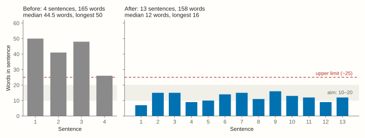
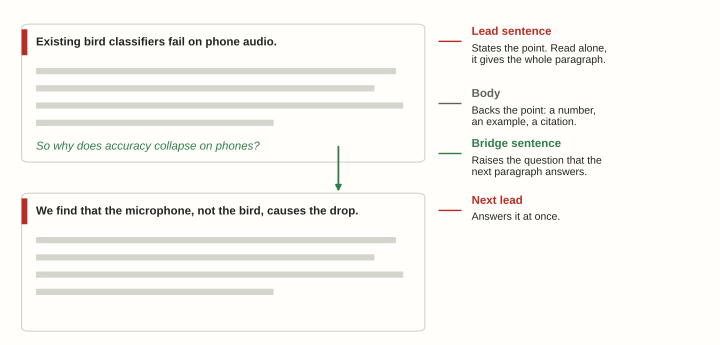
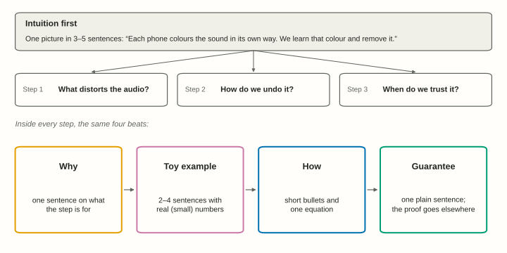
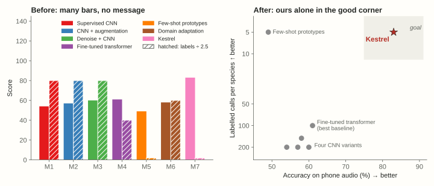

```{=html}
<style>
.wp-ill { width: 100%; aspect-ratio: 16/9; object-fit: cover; background: var(--ill); margin: 0.4rem 0 1.2rem; }
.wp-fig img { border: 1px solid var(--rule); }
body.quarto-dark .wp-ill, body.quarto-dark .wp-fig img { filter: brightness(.88); }
.ba { display: grid; grid-template-columns: 1fr 1fr; gap: 14px; margin: 1rem 0 1.4rem; }
.ba > div { padding: 12px 16px 4px; background: var(--soft); border-left: 4px solid; }
.ba > div > :last-child { margin-bottom: 0.6rem; }
.ba .bad { border-color: #8a8a8a; }
.ba .good { border-color: #0072B2; }
.ba .bad::before, .ba .good::before { display: block; font-weight: 700; font-size: .78rem; letter-spacing: .06em; text-transform: uppercase; margin-bottom: 6px; }
.ba .bad::before { content: "✗  Before"; color: var(--muted); }
.ba .good::before { content: "✓  After"; color: #0072B2; }
body.quarto-dark .ba .good::before { color: #56B4E9; }
.example { background: var(--soft); border-left: 4px solid var(--rule); padding: 12px 16px 2px; margin: 1rem 0 1.4rem; }
.example::before { content: "Example"; display: block; font-weight: 700; font-size: .78rem; letter-spacing: .06em; text-transform: uppercase; color: var(--muted); margin-bottom: 6px; }
.lead-hl { color: var(--accent); font-weight: 600; }
.bridge-hl { color: #0072B2; font-style: italic; }
body.quarto-dark .bridge-hl { color: #56B4E9; }
@media (max-width: 760px) { .ba { grid-template-columns: 1fr; } }
/* The site's legacy rule gives every <pre> a dark background, but Quarto's highlighter emits dark token colours. Keep tokens readable here. */
pre.sourceCode code span { color: #d4d4d4 !important; }
pre.sourceCode code span.co { color: #9aab9a !important; font-style: italic; }
pre.sourceCode code span.kw, pre.sourceCode code span.fu, pre.sourceCode code span.bu, pre.sourceCode code span.cf { color: #8cc8f0 !important; }
pre.sourceCode code span.st, pre.sourceCode code span.ss { color: #e2a07c !important; }
pre.sourceCode code span.dv, pre.sourceCode code span.fl { color: #b8d7a3 !important; }
.wp-abs td:nth-child(3) { min-width: 55%; }
</style>
```

{.wp-ill fig-alt="Eight small tiles, each one line, grow into eight paragraph tiles, which flow into a stack of paper pages."}

This page sets out how we write papers in the lab. It is for students writing their first paper, for anyone reviewing a draft, and for AI agents that help with either. Writing is a skill, and like any skill it improves with *deliberate* practice. This page gives you something concrete to practise against.

Every rule comes with an example. The examples follow one running paper, **Kestrel**. Kestrel is *invented*. It counts birds from recordings made on cheap phones, and all its numbers are made up. We chose a topic outside our lab's work so that you notice the rules, not the topic.

::: {.callout-tip}
## Using an AI agent?
This guide also ships as an **agent skill** that Claude Code, Codex, Gemini and similar agents can follow. See [Using this guide with AI agents](#ai-agents).
:::

## Five principles

Every rule on this page comes from one of five principles.

1. **Write for a smart reader from a neighbouring field.** Picture a researcher who knows machine learning well but has never read a paper in your subfield. That reader should be able to follow every section.
2. **State the point first.** Every abstract line, paragraph, section and caption opens with its takeaway. The details follow.
3. **Go from concrete to abstract.** Show a small example with real numbers, and then give the general form.
4. **Back every claim with evidence.** Use a number, a table, a figure, a proof or a citation. If you cannot back a claim, narrow it until you can.
5. **Be honest.** Show your failures and limitations yourself, before a reviewer finds them. A reviewer trusts you more when you do.

{.wp-ill fig-alt="A stack of paper pages on one platform, connected by a small bridge with a red arrow to a figure reading a booklet on another platform."}

## The skeleton: abstract, introduction, paper {#skeleton}

I gave a talk on how to write a paper ([recording](https://www.youtube.com/watch?v=LoCoplWgvp4), [slides](https://github.com/nipunbatra/CS-Research-Methods-Bootcamp/blob/master/RM101.pdf)), and I recommend watching it. Other material from the talk is in the [Research Methods Bootcamp](https://github.com/nipunbatra/CS-Research-Methods-Bootcamp) repository. The core idea is simple: **the abstract is the skeleton of the paper.**

Write the abstract *first*. Each abstract line then grows into one paragraph of the introduction. Each paragraph then grows into one section of the paper.

{.wp-fig fig-alt="Three columns of eight boxes linked by arrows: abstract lines, introduction paragraphs and paper sections."}

**A quick test.** Read only the first sentence of each introduction paragraph, in order. If those sentences read like your abstract, the structure works. If they don't, fix the structure before you polish any sentence.

## Title

A good title names the method and says what it does. Keep it short.

::: {.ba}
::: {.bad}
A Novel Deep Learning Framework for Robust Few-Shot Bioacoustic Species Classification Using Low-Cost Mobile Devices in Real-World Settings
:::
::: {.good}
Kestrel: Few-Shot Bird Counting from Cheap Phone Recordings
:::
:::

- **Give the method a name people can say.** A real word that fits the idea works best. If you build an acronym, make it spell out the subtitle.
- **Use no word the paper does not earn.** Drop words like *novel*, *robust* and *real-world* unless the paper argues them explicitly.
- **Keep scoping words that are true.** "Cheap phone recordings" is a promise you can keep. "Any audio" is not.
- **Put the name in a macro**, so a late rename is a one-line change:

```tex
\newcommand{\method}{Kestrel\xspace}   % needs \usepackage{xspace}
```

## Abstract

We follow the structure from [RM101](https://github.com/nipunbatra/CS-Research-Methods-Bootcamp/blob/master/RM101.pdf): seven parts, plus an optional *insight*. Each part gets one line, so a full abstract is **7–8 lines**. A line may hold two short sentences.

| Part | What it says | Kestrel |
|-----------|------------|------------------------------|
| 1 Context | Where the field is | Bird counts tell ecologists how habitats change. Volunteers now record birdsong on cheap phones, at a scale no survey team can match. |
| 2 Motivation | The problem | But phone audio is noisy, and most species have only a handful of labelled calls. |
| 3 Prior art | Why existing work falls short | Existing classifiers need hundreds of clean calls per species. On phone audio, their accuracy drops from 91% to 54%. |
| 4 Insight *(optional)* | What explains the gap | We find that the phone's microphone, not the bird, causes most of this drop. |
| 5 Approach | What we do | We present Kestrel, which learns to undo each phone's microphone before it classifies a call. Kestrel needs only five labelled calls to add a new species. |
| 6 Evaluation | How we test it | We test it on 12,000 clips from 40 phone models and 150 species, against six baselines. |
| 7 Results | What we found, in numbers | Kestrel reaches 83% accuracy on phone audio, against 61% for the best baseline. That baseline needs a hundred labelled calls per species; Kestrel needs five. |
| 8 Conclusion | What it means, and its limits | Cheap phones can thus support bird surveys at scale. Kestrel still fails on overlapping calls, which we leave to future work. |

Here is the same content, written the way first drafts usually are, and then rewritten.

::: {.ba}
::: {.bad}
Bird population monitoring is an important problem in ecology which has received a lot of attention, and with the proliferation of low-cost smartphones it has become possible for large numbers of volunteers to record bird vocalisations, although the resulting recordings are noisy and labelled data for most species is scarce. Existing approaches, which are mostly based on deep convolutional networks trained on curated recordings, have been shown to perform well on clean audio, but it is observed that their accuracy degrades significantly when they are applied to recordings collected using phones. In this paper, a novel framework called Kestrel is proposed, in which the frequency response of each device is estimated and compensated before classification is performed, and a few-shot learning strategy is employed so that new species can be added with only a small number of labelled examples. Extensive experiments were conducted on a large dataset and it is shown that Kestrel significantly outperforms state-of-the-art baselines, which demonstrates the effectiveness of the proposed approach.
:::
::: {.good}
Bird counts tell ecologists how habitats change. Volunteers now record birdsong on cheap phones, at a scale no survey team can match. But phone audio is noisy, and most species have only a handful of labelled calls. Existing classifiers need hundreds of clean calls per species. On phone audio, their accuracy drops from 91% to 54%. We find that the phone's microphone, not the bird, causes most of this drop. We present Kestrel, which learns to undo each phone's microphone before it classifies a call. Kestrel needs only five labelled calls to add a new species. We test it on 12,000 clips from 40 phone models and 150 species, against six baselines. Kestrel reaches 83% accuracy on phone audio, against 61% for the best baseline. That baseline needs a hundred labelled calls per species; Kestrel needs five. Cheap phones can thus support bird surveys at scale. Kestrel still fails on overlapping calls, which we leave to future work.
:::
:::

The two versions are almost the same length. The second one says *more*. It gives the size of the drop, the insight, the data, the margin over the best baseline, and a limitation. The first one hides behind "significantly" and "extensive".

{.wp-fig fig-alt="Two bar charts of words per sentence. Before: four sentences of 26 to 50 words. After: thirteen sentences of 7 to 16 words."}

**Abstract rules**

- **Keep sentences short.** Most should run 10–20 words, and none should go past about 25.
- **Make every number comparative.** Write "83%, against 61% for the best baseline", never a bare "83%".
- **Put the main limitation in the last line.** It costs one clause and buys a lot of trust.
- **Expand an acronym only if the reader needs it**, and only once.
- **Leave out filler** like "In this paper", "extensive experiments" and "demonstrates the effectiveness".

## Introduction

The introduction is the abstract, grown. Write **one paragraph per abstract line**, in the same order. Each paragraph has the same anatomy.

{.wp-fig fig-alt="Two paragraph boxes. The first has a bold lead sentence, grey body lines and a blue bridge question; an arrow leads to the second paragraph's bold lead."}

**The lead sentence sets the tone.** It states the point of the paragraph. If a reader skims only the lead sentences, they should still get the argument.

::: {.ba}
::: {.bad}
Bird monitoring has a long history. Early surveys relied on trained observers walking fixed routes, and later work introduced automated recorders...
:::
::: {.good}
Existing bird classifiers fail on phone audio. Trained on clean recordings, they reach 91% accuracy; on phone clips of the same calls, they reach 54%...
:::
:::

**The last sentence builds a bridge.** It leads the reader into the next paragraph, so the paragraphs connect *organically*. A question works well just before the insight: <span class="bridge-hl">"So why does accuracy collapse on phones?"</span> The next paragraph then opens with the answer: <span class="lead-hl">"We find that the microphone, not the bird, causes the drop."</span>

More rules for the introduction:

- **Don't use bold run-in heads** like "**Challenges.**" or "**Our approach.**" The lead sentence does that job, and does it better.
- **State your goals once and reuse them.** For example: *Kestrel must be accurate on phone audio (G1) and need few labels per species (G2).* The evaluation later answers G1 and G2 by name.
- **Include a results paragraph** with the headline numbers. Many drafts skip it, and reviewers notice.
- **Keep the contributions short:** three to five items, ideally in running prose.
- **Put the caveats at the end.** Don't list weaknesses before the reader knows the method.

## Background and related work

These are **two separate sections**, and they do two different jobs. *Background* teaches what the reader needs in order to follow your method. *Related work* places your paper among other papers.

### Background

- **Open with why the section exists:** "We now describe how phone microphones distort sound, because Kestrel must undo that distortion."
- **Explain in plain words, with one picture or analogy.** For example: *a phone colours sound the way a tinted window colours light; each phone has its own tint.*
- **Define every symbol the method uses later.** Define each one once, here.
- **End with the two or three facts the method builds on.**
- **Add a figure** if the mechanism is hard to picture.

Put background *before* related work whenever the way you group prior work depends on it.

### Related work

**The first sentence is always "We now categorize ...".** It names the axis along which you group prior work. Pick an axis that matters for your contribution, such as *what methods need*, *where they act* or *what they assume*.

Then write **one family per paragraph**. Give each family a short run-in head, which is fine here. Open with a verdict, and **end with one line on how you relate**: what you share, how you differ, and what the difference buys.

::: {.example}
We now categorize prior work by *what it needs to learn a new species*.

**Supervised classifiers.** Supervised classifiers are accurate on clean audio, but they need *hundreds* of labelled calls per species. They train on curated recordings [3, 7] and degrade on phone audio [12]. <span class="bridge-hl">Like them, Kestrel classifies calls with a neural network; unlike them, it needs five calls per species, not hundreds.</span>

**Denoising front-ends.** Denoising front-ends clean the audio before any classifier sees it [5, 9]. They remove background noise, but they *cannot* remove the microphone's own colouring, because that colouring is not noise. <span class="bridge-hl">Like them, Kestrel fixes the audio before classification; unlike them, it models each phone, which is where most of the error comes from.</span>
:::

- **Group by idea, never by date.** "Recent work" ages quickly, and it has no thread.
- **Use the same groups in your comparison table** as in the text.
- **Every claim about another method must come from its paper or your own run.** Say which.

## Method

Lead with the **intuition**: one picture, in three to five sentences. Someone who reads only that paragraph should know what the method does and why it works. Then organise the method around **plain questions**. Each question becomes a subsection, and inside each one, the same four beats repeat.

{.wp-fig fig-alt="A box labelled intuition first feeds three step boxes. Below, four coloured boxes in a row: why, toy example, how, guarantee."}

**A toy example teaches more than an equation.** Use two dimensions and numbers small enough to check in your head. Follow the same toy through every step.

::: {.example}
Suppose sound has just two frequency bands, *low* and *high*. A bird sings with energy (4, 2). Phone A halves the high band, so it records (4, 1). From a few clips, Kestrel learns that phone A's gain is (1, 0.5). It divides the gain out: (4, 1) ÷ (1, 0.5) = (4, 2). The bird's song is back. Real audio has hundreds of bands, but every step works the same way.
:::

More rules for the method:

- **Keep the method generic, with no exact counts.** "We record clips from several phones" belongs in the method. "40 phone models" belongs in the evaluation.
- **Use few equations:** only the ones the reader needs to follow the argument. Move derivations and implementation details to the appendix.
- **Present textbook results as design guarantees,** and name the parts that are truly new. Don't list a textbook theorem as a contribution.
- **Keep notation clean.** Never use one symbol for two things.
- **Verify every toy number in code** before it goes into the paper.

## Evaluation

Call the section *Evaluation*, and make it **question-driven**. A model I like is the evaluation of [Gemello (KDD 2016)](https://www.kdd.org/kdd2016/papers/files/adp1036-batraA.pdf). The reader can predict its skeleton: data, baselines, metric, then one experiment per question.

**Open with the questions,** each tied to a goal from the introduction:

::: {.example}
We now evaluate Kestrel against the goals of Section 1. We ask:

- **Q1** (G1): Is Kestrel accurate on phone audio?
- **Q2** (G2): How few labelled calls does a new species need?
- **Q3**: Does Kestrel work on phones it has never seen?
- **Q4**: Which part of Kestrel matters most?
:::

### Setup

- **Scenario.** Write one sentence on the real use case: *"Our setup mimics a volunteer survey, where each species has a few expert-labelled calls."* Derive the protocol from that sentence.
- **Data.** Say *why* you chose this data. Give **one table of every data set**, with its size, its purpose and what it tests. State plainly that the test data shares nothing with the training data.

  | Set | Size | Purpose |
  |---|---|---|
  | Clean calls | 30,000 clips | Pre-training only |
  | Phone clips, 30 models | 9,000 clips | Main test (Q1, Q2) |
  | Phone clips, 10 new models | 3,000 clips | Unseen phones (Q3) |

- **Baselines in groups**, each with a reason it is there: the standard method, the strongest one, the closest to yours, or what a practitioner would try first.
- **Give every baseline its best chance.** Tune all methods with the same rule. Use the authors' code where you can. Check that your copy reproduces a published number.
- **Metrics, listed by goal.** Define each one so the reader could recompute it, and say whether higher or lower is better.
- **Protocol.** Give the number of seeds, the confidence intervals and the statistical tests.
- **Reproducibility.** Say what you will release.

**A new metric gets its own subsection inside Evaluation,** not its own section. Open with the failure it fixes, using your own numbers. List each failure with its fix, and give the formula last.

### Results

**Make each subsection a question, and answer it in its first sentence.**

::: {.ba}
::: {.bad}
**5.3 Results on unseen devices.** In this section, we present results on devices not seen during training. Table 3 shows the accuracy of all methods...
:::
::: {.good}
**5.3 Does Kestrel work on phones it has never seen?** Yes, nearly as well: 79% on ten unseen phone models, against 83% on seen ones (Table 3)...
:::
:::

**Give one headline figure** that tells the main result at a glance. A trade-off plot with your method alone in the good corner beats any bar chart.

{.wp-fig fig-alt="Left, a grouped bar chart with seven colours and a legend. Right, a scatter plot of accuracy against labels needed, with grey baselines bottom left and a blue Kestrel star alone in a shaded goal region at top right."}

- **Explain *why* each baseline family fails,** in one bullet each. Numbers alone do not convince.
- **Use an oracle or upper bound** to separate the parts of your method. For example: *with perfect phone labels, accuracy rises only from 83% to 85%, so phone detection is not the bottleneck.*
- **Choose sensitivity analyses that answer real questions,** such as "how many labelled calls does a new species need?".
- **Report effect sizes with intervals,** not only p-values. For zero events, use the *rule of three*: 0 errors in 1,000 trials means an error rate of at most about 0.3%, at 95% confidence.
- **Show failure cases,** with their causes.

## Analysis, limitations and conclusion

**Analysis** asks *"Why does it work?"*. Write one question per design choice, in method order, each answered in its first sentence. Show both sides of every choice: too little fails, too much hurts, and there is a sweet spot. Admit what you cannot explain.

**Limitations** come as a numbered list. Each item has an *italic verdict*, the evidence, and a way forward.

::: {.example}
1. *Kestrel fails on overlapping calls.* When two species sing at once, accuracy falls to 41%. Source separation before classification is a natural next step.
:::

**The conclusion** mirrors the abstract's last lines in four to six sentences: problem, insight, method, headline numbers, takeaway. Two sentences are too few.

## Sentences

### Active voice

Use the **active voice**, with "we" for what *you* did. Active sentences are shorter. They also make clear who did what.

| Passive | Active |
|---|---|
| It is observed that accuracy drops on phones. | Accuracy drops on phones. |
| Experiments were conducted on 12,000 clips. | We test Kestrel on 12,000 clips. |
| A novel framework, Kestrel, is proposed. | We present Kestrel. |
| The gain is estimated from a few clips. | Kestrel estimates the gain from a few clips. |

The passive is fine when the actor doesn't matter: *"The clips were recorded between 2019 and 2023."*

### Short sentences

Aim for a median of about **15–18 words** and a maximum of about **25**. Split any sentence with three or more clauses. Give each sentence *one* idea. The [sentence-length figure](#abstract) shows what this does to an abstract.

### Emphasis

Use `\emph{}` on the few words that carry the argument: *every*, *only*, *not*, *before*. Use it for contrast and for new terms. Don't use it for decoration. One or two per paragraph is plenty.

::: {.example}
Denoising removes background noise, but it *cannot* remove the microphone's colouring. Kestrel models *each phone*, not each recording.
:::

### Cut the filler

| Instead of | Write |
|---|---|
| In this paper, we propose | We present |
| It is worth noting that X | X |
| The intuition is simple: X | X |
| a novel / crucial / groundbreaking method | a method (show why it matters) |
| significantly better | 83% vs 61% (and the test, if you mean statistical significance) |
| due to the fact that | because |

**Write like a person.** Avoid inflated words, stacked hedges ("may potentially suggest") and three-item lists that are only there for rhythm.

### Numbers and terms

- **Never write a bare number.** Compare it to something, and give its unit and its *n*.
- **Use one word per concept.** If you call it a *gain*, don't switch to *response*, *profile* and *filter* later.
- **Expand an acronym once**, and only if you use it again.

### American and British English

Some spellings differ: British "colour" and "optimise" are American "color" and "optimize". There are also a few differences in grammar. Pick one variety and stick to it. Most of our previous papers use British English, though this often depends on the co-authors.

## Figures

### One message, and a self-contained caption

Give each figure **one message**, and make that message the first sentence of the caption. A reader who sees only the figure and its caption should understand it.

::: {.ba}
::: {.bad}
**Figure 4.** Results of different methods on the phone dataset.
:::
::: {.good}
**Figure 4. Kestrel is the only method that is both accurate and label-efficient.** Each point is one method: accuracy on phone audio (x) against labelled calls needed per species (y, log scale). The shaded corner is the goal.
:::
:::

If a figure needs a paragraph to decode, split it into step-by-step panels with one idea per panel, or move the detailed version to the appendix.

### Colour that means something

Use **one colour code for the whole paper.** Give each colour a meaning, and state the code once. Show movement or change as a *colour change*: the problem starts orange, your method's blue arrow moves it, and it lands green.

{.wp-fig fig-alt="Two diagrams of an input moved by our method and by a baseline. Left: arbitrary pink, yellow and sky colours. Right: orange input, blue arrow to a green ticked output, grey dashed arrow to a hollow crossed output."}

- **Use a colour-blind-safe palette.** [Okabe–Ito](https://jfly.uni-koeln.de/color/) is a good default.
- **Never let meaning depend on colour alone.** Add ✓/✗, filled and hollow markers, or direct labels.
- **Give neutral categories neutral colours,** so they never clash with the semantic code.
- **Keep text at least 6–7 pt** at final size. Check the rendered PDF for overlaps, clipping and margin overflow.
- **Read every plotted number from your results files,** not from memory.

### LaTeXify figures

Use our [LaTeXify Python package](https://github.com/sustainability-lab/latexify) to turn matplotlib figures into publication-ready plots. See our [local guide](latexify-plots.qmd) for installation and examples. It gives you three things:

1. **Precise figure sizing.** Figures are sized relative to the column or page width, so you rarely need manual sizing inside `\begin{figure}`.
2. **Font size control.** Font size is set relative to the document's text size, so labels stay readable.
3. **LaTeX font matching.** Figures use LaTeX fonts, so they match the rest of the document.

> Tip: You can find the page width and column width with `\the\textwidth` and `\the\columnwidth`.

## Tables

We follow this excellent [short guide to making nice tables](https://people.inf.ethz.ch/markusp/teaching/guides/guide-tables.pdf) by Markus Püschel. In addition:

- **Lead the caption with the takeaway**, then say what each column means.
- **Label column groups with the question or goal** they answer, such as "G1: accurate?".
- **Leave no empty cells in headline columns.** A "–" in a key column is a gap in your evidence. Fill it.
- **Use counts when *n* is small** (7/10, not 70%).
- **State your bold and underline rule**, and shade your own method's row.

```tex
\begin{table}[t]
  \caption{\textbf{Kestrel is the most accurate method on phone audio, with the fewest labels.}
    Accuracy (\%, higher is better) on seen and unseen phone models, and labelled calls needed per species
    (lower is better). Best in \textbf{bold}.}
  \label{tab:main}
  \begin{tabular}{lccc}
    \toprule
    & \multicolumn{2}{c}{G1: accurate?} & G2: few labels? \\
    \cmidrule(lr){2-3}\cmidrule(lr){4-4}
    Method & Seen phones & Unseen phones & Calls / species \\
    \midrule
    Fine-tuned transformer & 61 & 55 & 100 \\
    \rowcolor{gray!12} \method (ours) & \textbf{83} & \textbf{79} & \textbf{5} \\
    \bottomrule
  \end{tabular}
\end{table}
```

## LaTeX hygiene

- **Use `\cref` for every reference.** Never hand-type "Figure 3" or "Table S2". This includes references into the supplement: load `xr-hyper`, add `\externaldocument[S-]{supp}`, and write `\cref{S-tab:ablation}`. On Overleaf, add a `latexmkrc` file so that the supplement is compiled too.
- **Use macros** for the method name, metric names and recurring symbols.
- **Keep a label scheme:** `sec:`, `fig:`, `tab:`, `eq:`.
- **Write one sentence per source line.** Diffs and reviews become much easier.

### Comments in LaTeX

We create a comment macro for each author's initials (I use `\nb`). Comments are useful for notes on the text, and for notes to yourself. I might write `\nb{I'm not sure about this sentence}`, and later search for every `\nb` to find my comments. Put all notes behind one switch, so the submission build hides them:

```tex
\newif\ifshownotes \shownotestrue   % \shownotesfalse for submission
\newcommand{\nb}[1]{\ifshownotes{\color{red}\small\textbf{Nipun:} #1}\fi}
```

A separate `submission.tex` that sets `\shownotesfalse` and then inputs the paper makes this a one-click switch.

## Reviewing a draft

{.wp-ill fig-alt="A draft page with red underlines and margin speech bubbles, a red arrow, and a cleaner page with a check mark; a pencil lies in front."}

When you review someone's draft, whether you are a student, an adviser or an AI agent, use the same protocol:

1. **Don't overwrite the author's text.** Add inline comments, and put a *suggested rewrite* after the original, behind the notes switch. The author decides what to keep.
2. **Comment on the why, not just the what.** "The lead sentence is history, so it doesn't set the tone; lead with the claim" teaches. "Rewrite this" doesn't.
3. **Check every number you move or rephrase** against its source table, figure or code. Rewriting can silently change a claim, such as "all 10" becoming "7 of 10".
4. **Mark anything you inferred** with a "please check" note.
5. **End with a short review guide:** what changed and where, which runs are still needed, and which facts the author should confirm.

## Paper timelines

Plan *backwards* from the deadline. The schedule below is a starting point; adjust it to the venue and the project.

{.wp-fig fig-alt="A Gantt chart over eight weeks before a deadline: abstract and figure sketches first, experiments until week minus three, draft, internal review, revision and a final checklist week."}

- **Write the abstract and sketch the figures in week one.** They tell you which experiments you still need.
- **Freeze results about three weeks before the deadline.** After that, write; don't run.
- **Book an internal review:** your adviser and one peer who is *not* on the paper. The peer is your "reader from a neighbouring field".
- **Keep the last week for checks:** page limit, anonymity, references, figures and the checklist below.

## Grammarly, AI tools and agents {#ai-agents}

I recommend that students use Grammarly (or a similar tool) to check their writing, once they have done a complete pass of editing. I do not recommend relying heavily on ChatGPT-like tools to write papers. They often produce sentences that *sound* correct but are not.

AI agents are most useful as **reviewers and checkers**, not as authors. They can flag long sentences, passive voice, hand-typed references and numbers that disagree with a table. They should never invent a number or a citation. You remain responsible for every claim.

### The paper-writing skill

This guide also ships as an **agent skill**: a folder of instructions that an agent loads when it writes or reviews a paper. It lives in its own repository, [**sustainability-lab/paper-writing**](https://github.com/sustainability-lab/paper-writing), and holds three files:

- `SKILL.md`: the entry point, with the workflow and the core rules.
- `reference.md`: every rule, section by section.
- `checklist.md`: the pre-submission checklist.

**Claude Code.** Install it as a plugin, once, for all your projects:

```text
/plugin marketplace add sustainability-lab/paper-writing
/plugin install paper-writing@sustainability-lab
```

Then ask: *"Review the introduction of main.tex using the paper-writing skill."*

**Other agents (Codex, Gemini CLI, Cursor).** Copy the repository's `skills/paper-writing/` folder into your paper's repository, for example as `docs/writing/`. Then add one line to the project's `AGENTS.md` or `GEMINI.md`: *"When writing or reviewing the paper, follow docs/writing/SKILL.md."*

To change a rule, open a pull request on the repository, and update this page too, so that the two stay in step.

## Pre-submission checklist

- [ ] The abstract has 7–8 parts, short sentences, and the main limitation in its last line.
- [ ] The introduction's lead sentences, read in order, give the abstract.
- [ ] Every paragraph opens with its point, and the introduction has no bold run-in heads.
- [ ] Background and related work are separate. Related work opens with "We now categorize", and each family ends with how we relate.
- [ ] The method gives the intuition first, follows a toy example, and contains no experiment counts.
- [ ] The evaluation goes from questions, to setup, to answer-first results, with one headline figure.
- [ ] Every baseline got its best chance, and no headline cell is empty.
- [ ] Every number in the text matches its table or figure.
- [ ] Every reference uses `\cref`, including references to the supplement.
- [ ] All figures share one colour code, are colour-blind safe, and have text of at least 6–7 pt.
- [ ] No symbol stands for two things.
- [ ] The limitations form a numbered list with ways forward, and the conclusion runs 4–6 sentences.
- [ ] Page limit and anonymity are checked, and all notes are off in the submission build.
