```{=html}
<style>
.wp-ill { width: 100%; aspect-ratio: 16/9; object-fit: contain; background: #fffefa; margin: 0.4rem 0 1.2rem; }
img.wp-fig, .wp-fig img { border: 1px solid var(--rule); }
/* Dark mode: the figures are ink on white, so flip them like the paper thumbnails. */
body.quarto-dark .wp-ill, body.quarto-dark img.wp-fig, body.quarto-dark .wp-fig img { filter: invert(.9) hue-rotate(180deg); }
.ba { display: grid; grid-template-columns: 1fr 1fr; gap: 14px; margin: 1rem 0 1.4rem; }
.ba > div { padding: 12px 16px 4px; background: var(--soft); border-left: 4px solid; }
.ba > div > :last-child { margin-bottom: 0.6rem; }
.ba .bad { border-color: var(--muted); }
.ba .good { border-color: var(--ok); }
.ba .bad::before, .ba .good::before { display: block; font-weight: 700; font-size: .78rem; letter-spacing: .06em; text-transform: uppercase; margin-bottom: 6px; }
.ba .bad::before { content: "✗  Before"; color: var(--muted); }
.ba .good::before { content: "✓  After"; color: var(--ok); }
.example { background: var(--soft); border-left: 4px solid var(--rule); padding: 12px 16px 2px; margin: 1rem 0 1.4rem; }
.example::before { content: "Example"; display: block; font-weight: 700; font-size: .78rem; letter-spacing: .06em; text-transform: uppercase; color: var(--muted); margin-bottom: 6px; }
.lead-hl { color: var(--accent); font-weight: 600; }
.cmt { margin: -0.9rem 0 1.6rem; padding: 8px 14px; border-left: 4px solid var(--accent); font-size: .93rem; }
.cmt::before { content: "Comment on the draft"; display: block; font-weight: 700; font-size: .72rem; letter-spacing: .06em; text-transform: uppercase; color: var(--accent); margin-bottom: 2px; }
.cmt > :last-child { margin-bottom: 0; }
.src { display: inline-block; margin-left: 8px; font-size: .78rem; font-weight: 400; color: var(--muted); }
.bridge-hl { color: var(--ok); font-style: italic; }
@media (max-width: 760px) { .ba { grid-template-columns: 1fr; } }
/* Example-paper switch: every .pv block belongs to one paper; only the chosen paper's blocks show. */
.paper-switch { position: sticky; top: 0; z-index: 20; transition: top .2s; display: flex; flex-wrap: nowrap; overflow-x: auto; scrollbar-width: none; align-items: center; gap: 4px; padding: 8px 0; margin: 1rem 0 .3rem; background: var(--paper); border-bottom: 1px solid var(--rule); }
.paper-switch .ps-label { flex: none; font-size: .7rem; font-weight: 700; letter-spacing: .06em; text-transform: uppercase; color: var(--muted); margin-right: 4px; }
.paper-switch button { flex: none; border: 1px solid var(--rule); background: transparent; color: var(--ink); border-radius: 999px; padding: 3px 8px; font: inherit; font-size: .82rem; white-space: nowrap; cursor: pointer; }
.paper-switch button small { font-size: .74rem; }
.paper-switch button small { color: var(--muted); margin-left: 3px; }
.paper-switch button[aria-selected="true"] { background: var(--accent); border-color: var(--accent); color: #fff; }
.paper-switch button[aria-selected="true"] small { color: rgba(255,255,255,.8); }
body.quarto-dark .paper-switch button[aria-selected="true"] { color: #1b1e1c; }
body.quarto-dark .paper-switch button[aria-selected="true"] small { color: rgba(27,30,28,.75); }
.ps-about { color: var(--muted); font-size: .92rem; margin: .4rem 0 1.2rem; }
.pv { display: none; }  /* shown blocks and spans get their normal display back via revert */
html:not([data-paper]) .pv[data-paper="gemello"], html[data-paper="kestrel"] .pv[data-paper="kestrel"],
html[data-paper="gemello"] .pv[data-paper="gemello"], html[data-paper="thermeval"] .pv[data-paper="thermeval"],
html[data-paper="jouleseye"] .pv[data-paper="jouleseye"], html[data-paper="gdmi"] .pv[data-paper="gdmi"] { display: revert; }
/* The site's legacy rule gives every <pre> a dark background, but Quarto's highlighter emits dark token colours. Keep tokens readable here. */
pre.sourceCode code span { color: #d4d4d4 !important; }
pre.sourceCode code span.co { color: #9aab9a !important; font-style: italic; }
pre.sourceCode code span.kw, pre.sourceCode code span.fu, pre.sourceCode code span.bu, pre.sourceCode code span.cf { color: #8cc8f0 !important; }
pre.sourceCode code span.st, pre.sourceCode code span.ss { color: #e2a07c !important; }
pre.sourceCode code span.dv, pre.sourceCode code span.fl { color: #b8d7a3 !important; }
.wp-abs td:nth-child(3) { min-width: 55%; }
</style>
```

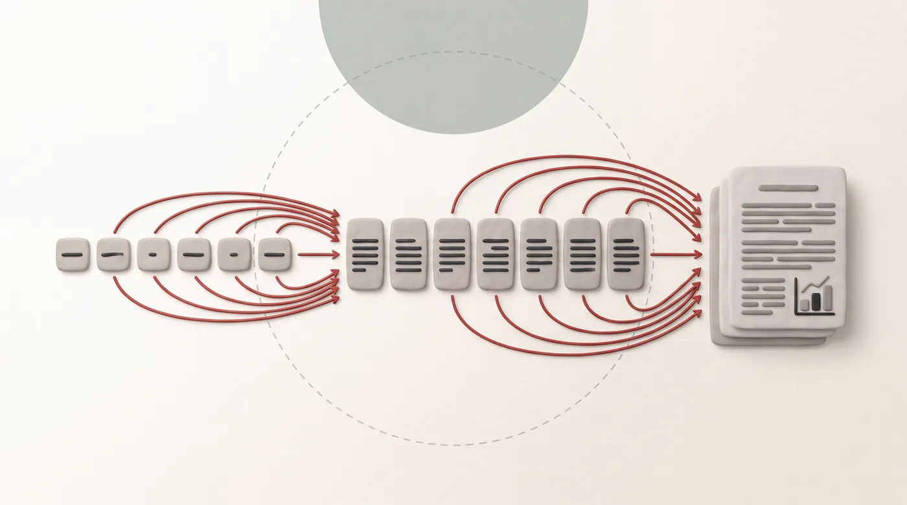{.wp-ill fig-alt="A desk seen from above: one index card with a single line, a red ink arrow to a row of short paragraph cards, and a stack of finished pages."}

This page sets out how we write papers in the lab. It is for students writing their first paper, for anyone reviewing a draft, and for AI agents that help with either. Writing is a skill, and like any skill it improves with *deliberate* practice. This page gives you something concrete to practise against.

Every rule comes with a **before and after**, and every example follows one paper. Pick the paper with the switch below, and the whole page changes with it: text, tables and figures. Four are **our own published papers**. For those, the *after* follows the published paper and its numbers, and the *before* is an invented first draft, the kind every paper starts as. **Kestrel**, the last one, is invented outright: it counts birds from cheap phone recordings, and its numbers are made up.

```{=html}
<div class="paper-switch" role="tablist" aria-label="Paper the examples follow">
  <button type="button" role="tab" data-paper="gemello">Gemello <small>KDD ’16</small></button>
  <button type="button" role="tab" data-paper="thermeval">ThermEval <small>KDD ’26</small></button>
  <button type="button" role="tab" data-paper="jouleseye">JoulesEye <small>IMWUT ’23</small></button>
  <button type="button" role="tab" data-paper="gdmi">GD-MI <small>AAAI ’26</small></button>
  <button type="button" role="tab" data-paper="kestrel">Kestrel <small>invented</small></button>
</div>
<p class="ps-about pv" data-paper="kestrel"><b>Kestrel</b> counts birds from recordings made on cheap phones. It is invented, and so are its numbers.</p>
<p class="ps-about pv" data-paper="gemello"><b>Gemello</b> estimates how much energy each appliance in a home uses, from just the monthly electricity bill. <a href="../papers/2016/batra_kdd.pdf">Paper</a></p>
<p class="ps-about pv" data-paper="thermeval"><b>ThermEval</b> asks whether vision-language models can read thermal images. <a href="https://arxiv.org/abs/2602.14989">Paper</a> · <a href="https://sustainability-lab.github.io/thermeval/">project</a></p>
<p class="ps-about pv" data-paper="jouleseye"><b>JoulesEye</b> estimates calories burned from breathing, seen by a phone's thermal camera. <a href="../papers/2024/IMWUT_JoulesEye.pdf">Paper</a></p>
<p class="ps-about pv" data-paper="gdmi"><b>GD-MI</b> decides where to put new air-quality sensors, by moving them all at once with gradient descent. <a href="../papers/2026/aaai_2026_air_active_gradient_camera_ready.pdf">Paper</a> · <a href="https://sustainability-lab.github.io/gdmi/">project</a></p>
```

::: {.callout-tip}
## Using an AI agent?
This guide also ships as an **agent skill** that Claude Code, Codex, Gemini and similar agents can follow. See [Using this guide with AI agents](#ai-agents).
:::

## Five principles

Every rule on this page comes from one of five principles.

1. **Write for a smart reader from a neighbouring field.** Picture a researcher who knows machine learning well but has never read a paper in your subfield. That reader should be able to follow every section.
2. **State the point first.** Every abstract line, paragraph, section and caption opens with its takeaway. The details follow.
3. **Go from concrete to abstract.** Show a small example with real numbers, and then give the general form.
4. **Back every claim with evidence.** Use a number, a table, a figure, a proof or a citation. If you cannot back a claim, narrow it until you can.
5. **Be honest.** Show your failures and limitations yourself, before a reviewer finds them. A reviewer trusts you more when you do.

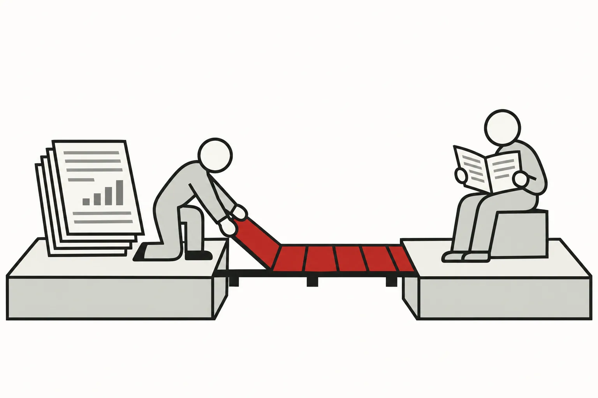{.wp-ill fig-alt="Two cliffs joined by a footbridge whose planks are being laid in red: a stack of papers on one side, a researcher from another field reading a booklet on the other."}

## The skeleton: abstract, introduction, paper {#skeleton}

I gave a talk on how to write a paper ([recording](https://www.youtube.com/watch?v=LoCoplWgvp4), [slides](https://github.com/nipunbatra/CS-Research-Methods-Bootcamp/blob/master/RM101.pdf)), and I recommend watching it. Other material from the talk is in the [Research Methods Bootcamp](https://github.com/nipunbatra/CS-Research-Methods-Bootcamp) repository. The core idea is simple: **the abstract is the skeleton of the paper.**

Write the abstract *first*. Each abstract line then grows into one paragraph of the introduction. Each paragraph then grows into one section of the paper.

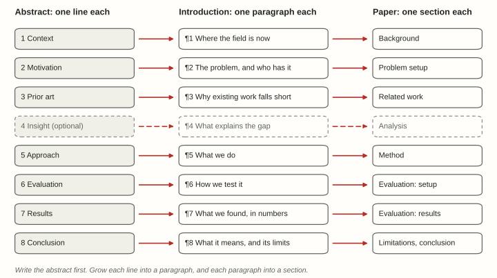{.wp-fig fig-alt="Three columns of eight boxes linked by arrows: abstract lines, introduction paragraphs and paper sections."}

**A quick test.** Read only the first sentence of each introduction paragraph, in order. If those sentences read like your abstract, the structure works. If they don't, fix the structure before you polish any sentence.

## Title

A good title names the method and says what it does. Keep it short.

::: {.pv paper="kestrel"}
::: {.ba}
::: {.bad}
A Novel Deep Learning Framework for Robust Few-Shot Bioacoustic Species Classification Using Low-Cost Mobile Devices in Real-World Settings
:::
::: {.good}
Kestrel: Few-Shot Bird Counting from Cheap Phone Recordings
:::
:::
:::

::: {.pv paper="gemello"}
::: {.ba}
::: {.bad}
A Novel Data-Driven Approach for Scalable Non-Intrusive Appliance-Level Energy Estimation in Residential Buildings
:::
::: {.good}
Gemello: Creating a Detailed Energy Breakdown from just the Monthly Electricity Bill
:::
:::
The *after* says what you get (a breakdown) from what you already have (the monthly bill). *Gemello* is Italian for *twin*: the method finds each home's twins among homes that are already metered.
:::

::: {.pv paper="thermeval"}
::: {.ba}
::: {.bad}
Towards a Comprehensive Understanding of the Capabilities of State-of-the-Art Vision-Language Models on Thermal Images
:::
::: {.good}
ThermEval: A Structured Benchmark for Evaluation of Vision-Language Models on Thermal Imagery
:::
:::
The *before* hides the contribution behind "towards" and "comprehensive understanding". The *after* names the benchmark first, so people can cite it in one word.
:::

::: {.pv paper="jouleseye"}
::: {.ba}
::: {.bad}
A Novel Smartphone-Based Deep Learning Approach for Accurate Calorie Estimation Using Thermal Data
:::
::: {.good}
JoulesEye: Energy Expenditure Estimation and Respiration Sensing from Thermal Imagery While Exercising
:::
:::
*JoulesEye* is a name people can say and remember: joules of energy, seen by an eye. The subtitle then names both outputs and the setting, *while exercising*, which is where watches fail.
:::

::: {.pv paper="gdmi"}
::: {.ba}
::: {.bad}
An Efficient and Scalable Novel Framework for Optimal Sensor Placement in Air Quality Monitoring Networks
:::
::: {.good}
Scalable Air-Quality Sensor Placement via Gradient-Based Mutual Information Maximization
:::
:::
The *after* says what is new, *gradient-based*, instead of claiming *efficient* and *novel*. One step better: the paper calls its method **GD-MI**, so the title could lead with it, as in *GD-MI: Scalable Air-Quality Sensor Placement via Gradient-Based Mutual Information*.
:::

- **Give the method a name people can say.** A real word that fits the idea works best. If you build an acronym, make it spell out the subtitle.
- **Use no word the paper does not earn.** Drop words like *novel*, *robust* and *real-world* unless the paper argues them explicitly.
- **Keep scoping words that are true.** "Cheap phone recordings" is a promise you can keep. "Any audio" is not.
- **Put the name in a macro**, so a late rename is a one-line change:

::: {.pv paper="gemello"}
```tex
\newcommand{\method}{Gemello\xspace}   % needs \usepackage{xspace}
```
:::

::: {.pv paper="thermeval"}
```tex
\newcommand{\method}{ThermEval\xspace}     % needs \usepackage{xspace}
\newcommand{\dataset}{ThermEval-D\xspace}  % the paper names its dataset separately
```
:::

::: {.pv paper="jouleseye"}
```tex
\newcommand{\method}{JoulesEye\xspace}   % needs \usepackage{xspace}
```
:::

::: {.pv paper="gdmi"}
```tex
\newcommand{\method}{GD-MI\xspace}   % needs \usepackage{xspace}
```
:::

::: {.pv paper="kestrel"}
```tex
\newcommand{\method}{Kestrel\xspace}   % needs \usepackage{xspace}
```
:::

## Abstract

We follow the structure from [RM101](https://github.com/nipunbatra/CS-Research-Methods-Bootcamp/blob/master/RM101.pdf): seven parts, plus an optional *insight*. Each part gets one line, so a full abstract is **7–8 lines**. A line may hold two short sentences.

::: {.pv paper="kestrel"}
| Part | What it says | Kestrel |
|-----------|------------|------------------------------|
| 1 Context | Where the field is | Bird counts tell ecologists how habitats change. Volunteers now record birdsong on cheap phones, at a scale no survey team can match. |
| 2 Motivation | The problem | But phone audio is noisy, and most species have only a handful of labelled calls. |
| 3 Prior art | Why existing work falls short | Existing classifiers need hundreds of clean calls per species. On phone audio, their accuracy drops from 91% to 54%. |
| 4 Insight *(optional)* | What explains the gap | We find that the phone's microphone, not the bird, causes most of this drop. |
| 5 Approach | What we do | We present Kestrel, which learns to undo each phone's microphone before it classifies a call. Kestrel needs only five labelled calls to add a new species. |
| 6 Evaluation | How we test it | We test it on 12,000 clips from 40 phone models and 150 species, against six baselines. |
| 7 Results | What we found, in numbers | Kestrel reaches 83% accuracy on phone audio, against 61% for the best baseline. That baseline needs a hundred labelled calls per species; Kestrel needs five. |
| 8 Conclusion | What it means, and its limits | Cheap phones can thus support bird surveys at scale. Kestrel still fails on overlapping calls, which we leave to future work. |

Here is the same content, written the way first drafts usually are, and then rewritten.

::: {.ba}
::: {.bad}
Bird population monitoring is an important problem in ecology which has received a lot of attention, and with the proliferation of low-cost smartphones it has become possible for large numbers of volunteers to record bird vocalisations, although the resulting recordings are noisy and labelled data for most species is scarce. Existing approaches, which are mostly based on deep convolutional networks trained on curated recordings, have been shown to perform well on clean audio, but it is observed that their accuracy degrades significantly when they are applied to recordings collected using phones. In this paper, a novel framework called Kestrel is proposed, in which the frequency response of each device is estimated and compensated before classification is performed, and a few-shot learning strategy is employed so that new species can be added with only a small number of labelled examples. Extensive experiments were conducted on a large dataset and it is shown that Kestrel significantly outperforms state-of-the-art baselines, which demonstrates the effectiveness of the proposed approach.
:::
::: {.good}
Bird counts tell ecologists how habitats change. Volunteers now record birdsong on cheap phones, at a scale no survey team can match. But phone audio is noisy, and most species have only a handful of labelled calls. Existing classifiers need hundreds of clean calls per species. On phone audio, their accuracy drops from 91% to 54%. We find that the phone's microphone, not the bird, causes most of this drop. We present Kestrel, which learns to undo each phone's microphone before it classifies a call. Kestrel needs only five labelled calls to add a new species. We test it on 12,000 clips from 40 phone models and 150 species, against six baselines. Kestrel reaches 83% accuracy on phone audio, against 61% for the best baseline. That baseline needs a hundred labelled calls per species; Kestrel needs five. Cheap phones can thus support bird surveys at scale. Kestrel still fails on overlapping calls, which we leave to future work.
:::
:::

The two versions are almost the same length. The second one says *more*. It gives the size of the drop, the insight, the data, the margin over the best baseline, and a limitation. The first one hides behind "significantly" and "extensive".
:::

::: {.pv paper="gemello"}
| Part | What it says | Gemello |
|-----------|------------|------------------------------|
| 1 Context | Where the field is | The first step to saving energy in a home is often an energy breakdown: how much each appliance uses, like an itemised grocery bill. |
| 2 Motivation | The problem | But producing one needs hardware installed in every home, so it does not scale. |
| 3 Prior art | Why existing work falls short | Disaggregation methods split a home's total power into appliances, but they need high-frequency metering in each home. |
| 4 Insight *(optional)* | What explains the gap | Homes in a region are alike, and "alike" can be defined per appliance: similar seasonal bills mean similar heating and cooling; similar floor area means similar lighting. |
| 5 Approach | What we do | We present Gemello, which estimates a home's breakdown from similar homes whose breakdown is known. It needs only the monthly bill and facts such as floor area and household size. |
| 6 Evaluation | How we test it | We test it on 57 homes from the public Dataport data set, against two disaggregation methods that need metering in each home. |
| 7 Results | What we found, in numbers | Gemello estimates heating and cooling energy with 76% accuracy, against 61% and 56% for the two baselines. With only seven metered homes to learn from, it still reaches about 69%. |
| 8 Conclusion | What it means, and its limits | Its inputs already exist for most homes, so it could be used today. It gives monthly estimates only, and only for common appliances. |

Here is a first draft of the same abstract, and the rewrite.

::: {.ba}
::: {.bad}
Energy conservation in residential buildings is an important research problem and has received significant attention from the research community. Appliance-level energy feedback has been shown to be useful, but existing non-intrusive load monitoring techniques suffer from several limitations which hinder their large-scale adoption. In this paper, a novel data-driven approach called Gemello is proposed, which leverages readily available data to estimate appliance-level energy consumption in a scalable manner. The proposed approach is evaluated on a real-world data set and the results demonstrate that it achieves promising performance compared to state-of-the-art techniques.
:::
::: {.good}
The first step to saving energy in a home is often an energy breakdown: how much each appliance uses. But producing one needs hardware installed in every home, so it does not scale. Disaggregation methods need high-frequency metering in each home. Homes in a region are alike, and "alike" can be defined per appliance. Similar seasonal bills mean similar heating and cooling; similar floor area means similar lighting. We present Gemello, which estimates a home's breakdown from similar homes whose breakdown is known. It needs only the monthly bill and facts such as floor area and household size. We test it on 57 homes from the public Dataport data set, against two methods that need metering in each home. Gemello estimates heating and cooling energy with 76% accuracy, against 61% and 56% for the baselines. With only seven metered homes to learn from, it still reaches about 69%. Its inputs already exist for most homes, so it could be used today. It gives monthly estimates only, and only for common appliances.
:::
:::

The draft names no limitation of prior work: "several limitations which hinder their large-scale adoption" could mean anything. The rewrite names the one that matters, hardware in every home, and the whole paper answers it. The published paper is honest in another way worth copying: for the fridge, one baseline beats Gemello (72% against 69%), and the paper says so.
:::

::: {.pv paper="thermeval"}
| Part | What it says | ThermEval |
|-----------|------------|------------------------------|
| 1 Context | Where the field is | Vision-language models (VLMs) answer questions about ordinary photos well. Thermal cameras see heat instead of light, which matters at night, in search and rescue and in medical screening. |
| 2 Motivation | The problem | But a thermal image encodes temperature, not colour or texture, and no benchmark tests whether VLMs can reason about it. |
| 3 Prior art | Why existing work falls short | VLM benchmarks use RGB images, and thermal datasets release coloured pictures without the temperatures behind them. |
| 4 Insight *(optional)* | What shapes the design | Reading a temperature takes a chain of steps: recognise the modality, read the colour bar, then map pixels to degrees. |
| 5 Approach | What we do | We present ThermEval, which tests each link with more than 70,000 questions across seven tasks. Its new dataset, ThermEval-D, has over 3,500 thermal images with per-pixel temperatures. |
| 6 Evaluation | How we test it | We evaluate 25 VLMs, from 0.3B to over 200B parameters, against human annotators. |
| 7 Results | What we found, in numbers | Asked which of two people is warmer, the best model is right 74% of the time, against 84% for people. Models often answer from language priors, such as a textbook body temperature, instead of the pixels. |
| 8 Conclusion | What it means, and its limits | Bigger models do not reliably do better, and fine-tuning helps only on some tasks. Thermal understanding needs its own evaluation. |

Here is a first draft of the same abstract, and the rewrite.

::: {.ba}
::: {.bad}
Vision-language models have recently attracted significant attention in the computer vision community and have been shown to achieve impressive performance on a wide variety of tasks. However, their capabilities on thermal imagery, which is an important modality for numerous applications, have not been comprehensively studied. In this paper, a novel and comprehensive benchmark called ThermEval is proposed, which consists of a large number of question-answer pairs spanning multiple tasks, along with a new dataset containing thermal images with temperature annotations. Extensive experiments are conducted on a wide range of state-of-the-art open-source and closed-source models, and it is observed that the models struggle significantly on several tasks. Our findings demonstrate the effectiveness of the proposed benchmark and provide valuable insights for future research in this important area.
:::
::: {.good}
Vision-language models (VLMs) answer questions about ordinary photos well. Thermal cameras see heat instead of light, which matters at night, in search and rescue and in medical screening. But a thermal image encodes temperature, not colour or texture, and no benchmark tests whether VLMs can reason about it. VLM benchmarks use RGB images, and thermal datasets release coloured pictures without the temperatures behind them. Reading a temperature takes a chain of steps: recognise the modality, read the colour bar, then map pixels to degrees. We present ThermEval, which tests each link with more than 70,000 questions across seven tasks. Its new dataset, ThermEval-D, has over 3,500 thermal images with per-pixel temperatures. We evaluate 25 VLMs, from 0.3B to over 200B parameters, against human annotators. Asked which of two people is warmer, the best model is right 74% of the time, against 84% for people. Models often answer from language priors, such as a textbook body temperature, instead of the pixels. Bigger models do not reliably do better, and fine-tuning helps only on some tasks. Thermal understanding needs its own evaluation.
:::
:::

The draft says "a large number of question-answer pairs", "multiple tasks" and "a wide range of models". The rewrite gives each number: 70,000, seven and 25. "The models struggle significantly" becomes 74% against 84%, and the rewrite says *how* they fail: they answer from what they expect, not from what they see.
:::

::: {.pv paper="jouleseye"}
| Part | What it says | JoulesEye |
|-----------|------------|------------------------------|
| 1 Context | Where the field is | Phones and watches measure heart rate well, and fitness apps use it to estimate calories burned. |
| 2 Motivation | The problem | But these estimates can be wrong by over 40%, too far off for medical use. |
| 3 Prior art | Why existing work falls short | Watches estimate calories from heart rate alone. Accurate methods need a face mask and lab equipment. |
| 4 Insight *(optional)* | What explains the gap | Breathing carries information about calorie burn that heart rate misses, and a thermal camera can see each breath as the air at the nostrils warms and cools. |
| 5 Approach | What we do | We present JoulesEye, which tracks breathing with a smartphone thermal camera and estimates calories burned from it. |
| 6 Evaluation | How we test it | We test it on 54 participants who cycled and ran at high intensity, against a lab-grade calorimeter. |
| 7 Results | What we found, in numbers | JoulesEye's error is 5.8%, against 37.6% for smartwatch methods that use heart rate alone. |
| 8 Conclusion | What it means, and its limits | A 32×24-pixel camera, small enough for a watch, also beats heart rate alone when combined with it. The calorimeter mask hid the nostrils, so the main test adds the camera's measured error to a chest belt's breathing rate. |

Here is a first draft of the same abstract, and the rewrite.

::: {.ba}
::: {.bad}
Fitness tracking using wearable devices has become extremely popular in recent years, and estimation of calories burned is one of the most widely used features. However, it has been observed in the literature that such estimates can be inaccurate. In this work, a novel system named JoulesEye is proposed, which leverages thermal imaging along with advanced signal processing and deep learning techniques to estimate energy expenditure in an accurate manner. A user study was conducted with a number of participants performing different exercises, and it was found that the proposed system achieves significantly lower error than commercial devices. The results demonstrate the feasibility and great potential of thermal sensing for health monitoring applications.
:::
::: {.good}
Phones and watches measure heart rate well, and fitness apps use it to estimate calories burned. But these estimates can be wrong by over 40%, too far off for medical use. Watches estimate calories from heart rate alone, and accurate methods need a face mask and lab equipment. Breathing carries information about calorie burn that heart rate misses. A thermal camera can see each breath, as the air at the nostrils warms and cools. We present JoulesEye, which tracks breathing with a smartphone thermal camera and estimates calories burned from it. We test it on 54 participants who cycled and ran at high intensity, against a lab-grade calorimeter. JoulesEye's error is 5.8%, against 37.6% for smartwatch methods that use heart rate alone. A 32×24-pixel camera, small enough for a watch, also beats heart rate alone when combined with it: 10.1% against 12%. The calorimeter's mask hid the nostrils, so our main test uses a chest belt's breathing rate with the camera's measured error added.
:::
:::

The draft never says *why* thermal imaging should work. The rewrite gives the reason in one line, breathing, and the reader can then follow everything after it. "Significantly lower error" becomes 5.8% against 37.6%.
:::

::: {.pv paper="gdmi"}
| Part | What it says | GD-MI |
|-----------|------------|------------------------------|
| 1 Context | Where the field is | Over 99% of the world's people breathe air above WHO limits. India has about 500 official monitoring stations for 1.4 billion people. |
| 2 Motivation | The problem | Each new station is expensive, so where we place the next ones matters. |
| 3 Prior art | Why existing work falls short | Mutual information (MI) picks informative sites, but its cost grows with every candidate site it checks. Cheap heuristics scale, but they cluster sensors or place them redundantly. |
| 4 Insight *(optional)* | What explains the gap | If sensor coordinates are continuous parameters, we can move all the new sensors at once by gradient descent, with no search over candidate sites. |
| 5 Approach | What we do | We present GD-MI. Its runtime does not grow with the number of sensors or the size of the candidate grid. |
| 6 Evaluation | How we test it | We test it on PM2.5 data across India, against random placement, the maximum-variance heuristic and greedy MI. |
| 7 Results | What we found, in numbers | With 100 new sensors across India, GD-MI lowers the error (RMSE) by 4% compared with the maximum-variance heuristic. With nine new sensors in one state, it reaches 5.8, against 5.6 for greedy MI, which is feasible only at that smaller scale. |
| 8 Conclusion | What it means, and its limits | Information-based placement becomes feasible at national scale. Gradient descent depends on where the sensors start, and can stop in a local minimum. |

Here is a first draft of the same abstract, and the rewrite.

::: {.ba}
::: {.bad}
Air pollution is a major problem worldwide and monitoring it is very important. Sensor placement is a well-studied problem and many approaches have been proposed in the literature, including mutual information based approaches which are known to be computationally expensive. In this paper we propose a novel, efficient and scalable gradient-based framework for optimal sensor placement which leverages the power of differentiable optimization. Extensive experiments on a large real-world dataset show that our approach significantly outperforms the baselines while being much faster, demonstrating its effectiveness for real-world deployment.
:::
::: {.good}
Over 99% of the world's people breathe air above WHO limits. India has about 500 official monitoring stations for 1.4 billion people, and each new station is expensive. So where we place the next ones matters. Mutual information (MI) picks informative sites, but its cost grows with every candidate site it checks. Cheap heuristics scale, but they cluster sensors or place them redundantly. We treat sensor coordinates as continuous parameters, so we can move all the new sensors at once by gradient descent. We call this GD-MI. Its runtime does not grow with the number of sensors or the size of the candidate grid. We test it on PM2.5 data across India, against random placement, the maximum-variance heuristic and greedy MI. With 100 new sensors, GD-MI lowers the error by 4% compared with the maximum-variance heuristic. With nine new sensors in one state, it reaches an RMSE of 5.8, against 5.6 for greedy MI, which is feasible only at that scale. Gradient descent depends on where the sensors start, and can stop in a local minimum.
:::
:::

The draft claims *efficient*, *scalable* and *significantly outperforms*, and backs none of them. The rewrite shows the honest comparison too: greedy MI is slightly more accurate (5.6 against 5.8), and GD-MI wins on scale. Reviewers trust a paper that says where its method loses. One thing even the published paper could add: it calls GD-MI "orders of magnitude faster", but reports no runtime. Every reader will want that number.
:::

::: {.pv paper="kestrel"}
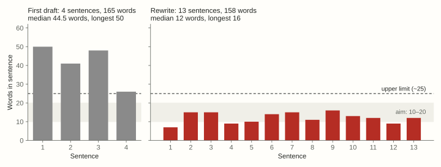{.wp-fig fig-alt="Two bar charts of words per sentence, for the first draft and the rewrite of the kestrel abstract."}
:::

::: {.pv paper="gemello"}
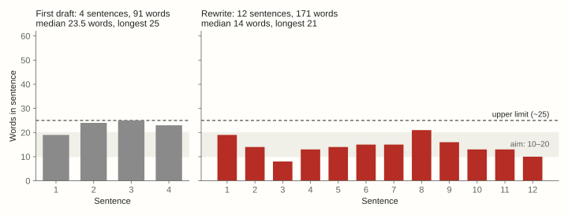{.wp-fig fig-alt="Two bar charts of words per sentence, for the first draft and the rewrite of the gemello abstract."}
:::

::: {.pv paper="thermeval"}
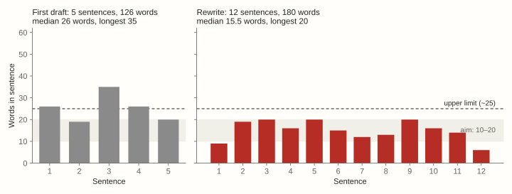{.wp-fig fig-alt="Two bar charts of words per sentence, for the first draft and the rewrite of the thermeval abstract."}
:::

::: {.pv paper="jouleseye"}
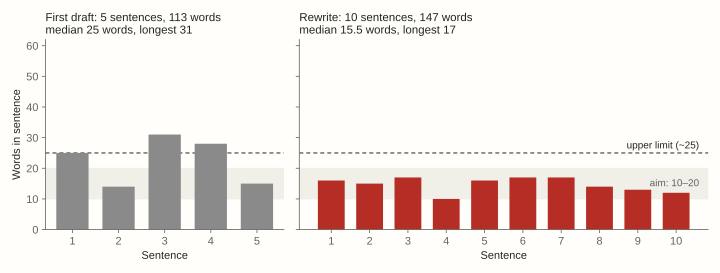{.wp-fig fig-alt="Two bar charts of words per sentence, for the first draft and the rewrite of the jouleseye abstract."}
:::

::: {.pv paper="gdmi"}
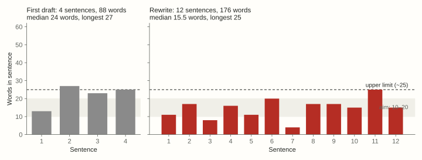{.wp-fig fig-alt="Two bar charts of words per sentence, for the first draft and the rewrite of the gdmi abstract."}
:::


**Abstract rules**

- **Keep sentences short.** Most should run 10–20 words, and none should go past about 25.
- **Make every number comparative.** Write "83%, against 61% for the best baseline", never a bare "83%".
- **Put the main limitation in the last line.** It costs one clause and buys a lot of trust.
- **Update the abstract's numbers after every new run.** You write the abstract first, so update it last.
- **Expand an acronym only if the reader needs it**, and only once.
- **Leave out filler** like "In this paper", "extensive experiments" and "demonstrates the effectiveness".

## Introduction

The introduction is the abstract, grown. Write **one paragraph per abstract line**, in the same order. Each paragraph has the same anatomy.

::: {.pv paper="gemello"}
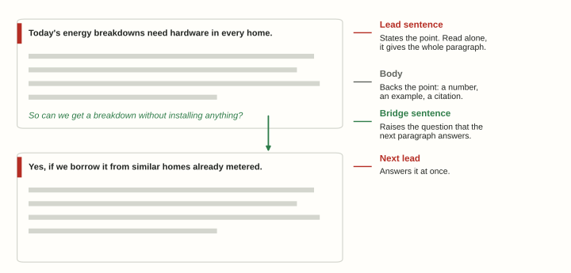{.wp-fig fig-alt="Two paragraph boxes for Gemello: a lead sentence, body lines and a bridge question, with an arrow to the next paragraph's lead."}
:::

::: {.pv paper="thermeval"}
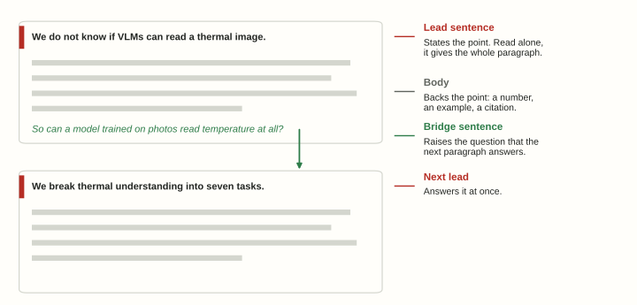{.wp-fig fig-alt="Two paragraph boxes for ThermEval: a lead sentence, body lines and a bridge question, with an arrow to the next paragraph's lead."}
:::

::: {.pv paper="jouleseye"}
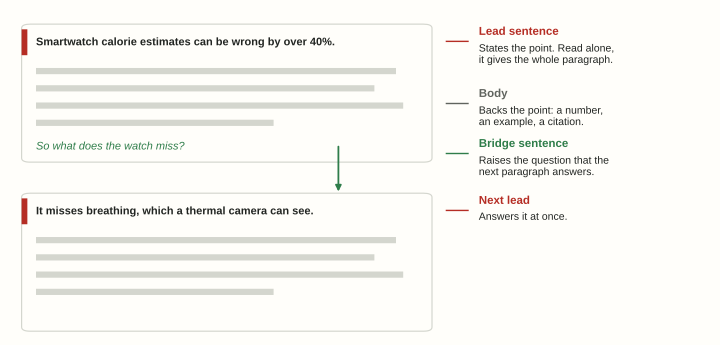{.wp-fig fig-alt="Two paragraph boxes for JoulesEye: a lead sentence, body lines and a bridge question, with an arrow to the next paragraph's lead."}
:::

::: {.pv paper="gdmi"}
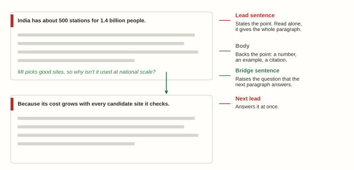{.wp-fig fig-alt="Two paragraph boxes for GD-MI: a lead sentence, body lines and a bridge question, with an arrow to the next paragraph's lead."}
:::

::: {.pv paper="kestrel"}
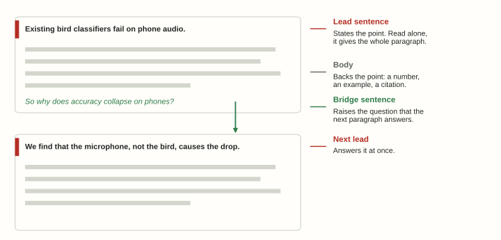{.wp-fig fig-alt="Two paragraph boxes for Kestrel: a lead sentence, body lines and a bridge question, with an arrow to the next paragraph's lead."}
:::

**The lead sentence sets the tone.** It states the point of the paragraph. If a reader skims only the lead sentences, they should still get the argument.

::: {.pv paper="kestrel"}
::: {.ba}
::: {.bad}
Bird monitoring has a long history. Early surveys relied on trained observers walking fixed routes, and later work introduced automated recorders...
:::
::: {.good}
Existing bird classifiers fail on phone audio. Trained on clean recordings, they reach 91% accuracy; on phone clips of the same calls, they reach 54%...
:::
:::
:::

::: {.pv paper="gemello"}
::: {.ba}
::: {.bad}
Energy conservation in buildings has been an active area of research for several decades, and a wide variety of techniques have been proposed...
:::
::: {.good}
Buildings use more than 30% of the world's energy, and an energy breakdown, how much each appliance uses, is one of the best ways to cut it...
:::
:::
:::

::: {.pv paper="thermeval"}
::: {.ba}
::: {.bad}
Thermal imaging has a long history. It was first developed for military night vision, and over the decades it has found uses in industry, medicine and many other fields...
:::
::: {.good}
We do not know whether vision-language models can read a thermal image. They describe ordinary photos well, but a thermal image encodes temperature, not colour or texture...
:::
:::
:::

::: {.pv paper="jouleseye"}
::: {.ba}
::: {.bad}
Wearable devices have become increasingly popular over the last decade, and millions of people now use them to track their health and fitness...
:::
::: {.good}
Smartwatch calorie estimates can be wrong by more than 40%. They estimate it from heart rate alone, and heart rate misses much of what the body is doing...
:::
:::
:::

::: {.pv paper="gdmi"}
::: {.ba}
::: {.bad}
Air pollution has been widely studied over the past decades, and many methods for monitoring it have been proposed in the literature...
:::
::: {.good}
India has about 500 official air-quality stations for 1.4 billion people. New stations are expensive, so each one must go where it adds the most information...
:::
:::
:::

**The last sentence builds a bridge.** It leads the reader into the next paragraph, so the paragraphs connect *organically*. A question works well just before the insight:

::: {.pv paper="kestrel"}
<span class="bridge-hl">"So why does accuracy collapse on phones?"</span> The next paragraph then opens with the answer: <span class="lead-hl">"We find that the microphone, not the bird, causes the drop."</span>
:::

::: {.pv paper="gemello"}
<span class="bridge-hl">"So can we get a breakdown without installing anything in the home?"</span> The next paragraph then opens with the answer: <span class="lead-hl">"Yes, if we borrow it from similar homes that are already metered."</span>
:::

::: {.pv paper="thermeval"}
<span class="bridge-hl">"So can a model trained on ordinary photos read temperature at all?"</span> The next paragraph then opens with how we find out: <span class="lead-hl">"To answer this, we break thermal understanding into seven tasks, from easy to hard."</span>
:::

::: {.pv paper="jouleseye"}
<span class="bridge-hl">"So what does the watch miss?"</span> The next paragraph then opens with the answer: <span class="lead-hl">"It misses breathing, and a thermal camera can see every breath."</span>
:::

::: {.pv paper="gdmi"}
<span class="bridge-hl">"Mutual information picks good sites, so why isn't it used at national scale?"</span> The next paragraph then opens with the answer: <span class="lead-hl">"Because its cost grows with every candidate site it checks."</span>
:::

More rules for the introduction:

- **Don't use bold run-in heads** like "**Challenges.**" or "**Our approach.**" The lead sentence does that job, and does it better.
- **State your goals once and reuse them.** For example: [*Gemello must be as accurate as methods that need hardware in every home (G1), use only data that already exists (G2), and need few metered homes to learn from (G3).*]{.pv paper="gemello"}[*ThermEval must test each step towards reading temperature on its own (G1), and score temperature answers against measured values, not guesses (G2).*]{.pv paper="thermeval"}[*JoulesEye must sense breathing while the user cycles or runs hard (G1), estimate calories burned more accurately than a smartwatch (G2), and work with a thermal camera small enough for a watch (G3).*]{.pv paper="jouleseye"}[*GD-MI must place sensors nearly as well as greedy MI (G1), at a cost that does not grow with the grid (G2), without clustering them (G3).*]{.pv paper="gdmi"}[*Kestrel must be accurate on phone audio (G1) and need few labels per species (G2).*]{.pv paper="kestrel"} The evaluation later answers G1 and G2 by name.
- **Include a results paragraph** with the headline numbers. Many drafts skip it, and reviewers notice.
- **Keep the contributions short:** three to five items, ideally in running prose.
- **Put the caveats at the end.** Don't list weaknesses before the reader knows the method.

## Background and related work

These are **two separate sections**, and they do two different jobs. *Background* teaches what the reader needs in order to follow your method. *Related work* places your paper among other papers.

### Background

- **Open with why the section exists:** ["We now describe what each kind of electricity meter records, because Gemello works from the coarsest one: the monthly bill."]{.pv paper="gemello"}["We now describe how a thermal camera turns temperatures into colours, because most ThermEval tasks ask a model to turn those colours back into temperatures."]{.pv paper="thermeval"}["We now describe how the body burns energy and how breathing reflects it, because JoulesEye estimates calories burned from breathing alone."]{.pv paper="jouleseye"}["We now describe how a neural process predicts PM2.5 and how sure it is, because GD-MI places sensors to shrink that uncertainty."]{.pv paper="gdmi"}["We now describe how phone microphones distort sound, because Kestrel must undo that distortion."]{.pv paper="kestrel"}
- **Explain in plain words, with one picture or analogy.** For example: [*the monthly bill is the total at the bottom of a grocery receipt; an energy breakdown is the itemised list above it.*]{.pv paper="gemello"}[*a thermal image is a map of temperatures painted with a colour key; the colour bar is the map's legend, and a new colour map repaints the same map.*]{.pv paper="thermeval"}[*heart rate is like an engine's revs: two engines at the same revs can burn very different amounts of fuel, depending on their size.*]{.pv paper="jouleseye"}[*each sensor is a lamp in a dark room; uncertainty is the dark, and two lamps side by side light the same patch twice.*]{.pv paper="gdmi"}[*a phone colours sound the way a tinted window colours light; each phone has its own tint.*]{.pv paper="kestrel"}
- **Define every symbol the method uses later.** Define each one once, here.
- **Define every term before you use it,** most of all in the abstract and Figure 1, which are read first.
- **Anchor anything the reader may not know:** a place, a dataset, an agency. *"Madhya Pradesh, a central Indian state about the size of Germany"* tells a reader abroad what *"MP"* does not.
- **End with the two or three facts the method builds on.**
- **Add a figure** if the mechanism is hard to picture.

Put background *before* related work whenever the way you group prior work depends on it.

### Related work

**The first sentence is always "We now categorize ...".** It names the axis along which you group prior work. Pick an axis that matters for your contribution, such as *what methods need*, *where they act* or *what they assume*.

Then write **one family per paragraph**. Give each family a short run-in head, which is fine here. Open with a verdict, and **end with one line on how you relate**: what you share, how you differ, and what the difference buys.

::: {.pv paper="gemello"}
::: {.example}
We now categorize prior work by *what it must install in each home*.

**Per-appliance and indirect sensing.** Sensing systems give accurate breakdowns, but they need hardware in *every* home. Some put a sensor on each appliance [26, 16] or circuit [37]; others infer use from vibration, temperature or electrical noise [32, 25, 20]. <span class="bridge-hl">Like them, Gemello learns from appliance-level measurements; unlike them, it needs those measurements in only a few homes, not all.</span>

**Non-intrusive load monitoring (NILM).** NILM needs only one meter per home, but that meter must sample every minute or faster [39, 11]. Most smart meters record every 15 minutes or hourly, and most of the world has none. NILM also needs a model of each appliance, and such models have not been shown to transfer across homes [21, 33]. <span class="bridge-hl">Like NILM, Gemello starts from a home's total energy; unlike NILM, it needs one reading a month and no appliance models.</span>
:::
:::

::: {.pv paper="thermeval"}
::: {.example}
We now categorize prior work by *whether it can score a temperature answer*.

**RGB benchmarks for VLMs.** RGB benchmarks test perception and reasoning broadly, but *only* on ordinary photos. MME, MMBench, SEED-Bench and MM-Vet cover many tasks [21, 35, 36, 42, 58, 59], and newer benchmarks add adversarial and harder questions [37, 49]. <span class="bridge-hl">Like them, ThermEval scores VLMs on visual questions; unlike them, its images encode temperature, where a plausible answer can still be wrong.</span>

**Thermal and multispectral benchmarks.** These benchmarks do use thermal images, but they allow *only* fixed-choice answers. One builds multiple-choice questions with GPT-4o [15]; RGB-Th-Bench asks binary questions and never tests temperature reading [47]. <span class="bridge-hl">Like them, ThermEval tests VLMs on thermal images; unlike them, it also asks for temperatures in degrees, scored against measured per-pixel values.</span>
:::
:::

::: {.pv paper="jouleseye"}
::: {.example}
We now categorize prior work by *what it can still sense while the user exercises*.

**Respiration sensing.** Chest belts, RGB cameras and earables track breathing well at rest, but vigorous motion drowns the signal. A chest belt confuses pedalling with breathing, because both move the chest at a similar rate [31]. RGB methods amplify light flickering across a moving face [77], and earable methods were tested on everyday head movements [2]. <span class="bridge-hl">Like them, JoulesEye needs no mask; unlike them, it sees warm and cool air at the nostrils, which room lighting does not affect.</span>

**Energy expenditure estimation.** Wearables estimate calories from motion or heart rate, which is convenient but error prone. Accelerometer methods rely on predictive equations that vary widely [47], and heart-rate watches disagree from brand to brand [17]. Accurate alternatives need ECG probes across the torso [54] or confine one person to a room watched by a thermal camera [26, 38]. <span class="bridge-hl">Like them, JoulesEye uses a sensor a watch can carry; unlike them, it adds breathing, which tracks calorie burn better than heart rate.</span>
:::
:::

::: {.pv paper="gdmi"}
::: {.example}
We now categorise prior work by *how it searches for sites*.

**Greedy mutual information.** Greedy MI picks sites one at a time, each the one that most reduces uncertainty over the map [3, 7]. Because MI is submodular, this greedy choice is provably near-optimal. But it must score *every* candidate site before each pick, and its Gaussian-process model scales cubically with the data [7, 12]. <span class="bridge-hl">Like it, GD-MI scores placements by the uncertainty they remove; unlike it, GD-MI never scores each candidate site.</span>

**Learned placement policies.** Neural processes learn from many past pollution maps and give uncertainty quickly on a new one [5, 9]. Placement methods built on them still pick sites one at a time from a discrete list, and that choice cannot be differentiated [2]. <span class="bridge-hl">Like them, GD-MI uses a neural process for its uncertainty; unlike them, it moves all the new sensors at once, by gradient descent.</span>
:::
:::

::: {.pv paper="kestrel"}
::: {.example}
We now categorize prior work by *what it needs to learn a new species*.

**Supervised classifiers.** Supervised classifiers are accurate on clean audio, but they need *hundreds* of labelled calls per species. They train on curated recordings [3, 7] and degrade on phone audio [12]. <span class="bridge-hl">Like them, Kestrel classifies calls with a neural network; unlike them, it needs five calls per species, not hundreds.</span>

**Denoising front-ends.** Denoising front-ends clean the audio before any classifier sees it [5, 9]. They remove background noise, but they *cannot* remove the microphone's own colouring, because that colouring is not noise. <span class="bridge-hl">Like them, Kestrel fixes the audio before classification; unlike them, it models each phone, which is where most of the error comes from.</span>
:::
:::

- **Group by idea, never by date.** "Recent work" ages quickly, and it has no thread.
- **Use the same groups in your comparison table** as in the text.
- **Every claim about another method must come from its paper or your own run.** Say which.
- **Hedge every "first".** Write "to our knowledge, no prior work …", and only after a real search. Cite only papers you have read.

## Method

Lead with the **intuition**: one picture, in three to five sentences. Someone who reads only that paragraph should know what the method does and why it works. Then organise the method around **plain questions**. Each question becomes a subsection, and inside each one, the same four beats repeat.

::: {.pv paper="gemello"}
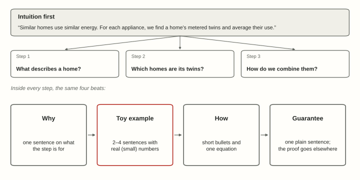{.wp-fig fig-alt="The Gemello intuition in one box, feeding three plain-question steps; below, four beats: why, toy example, how, guarantee."}
:::

::: {.pv paper="thermeval"}
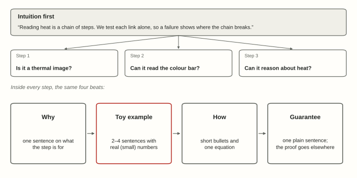{.wp-fig fig-alt="The ThermEval intuition in one box, feeding three plain-question steps; below, four beats: why, toy example, how, guarantee."}
:::

::: {.pv paper="jouleseye"}
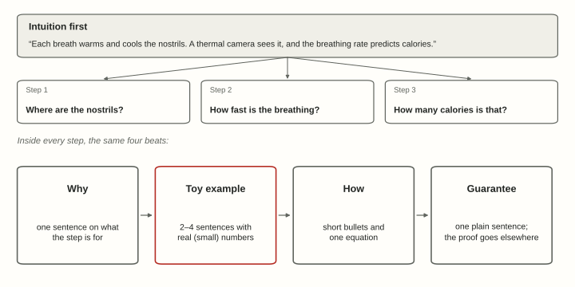{.wp-fig fig-alt="The JoulesEye intuition in one box, feeding three plain-question steps; below, four beats: why, toy example, how, guarantee."}
:::

::: {.pv paper="gdmi"}
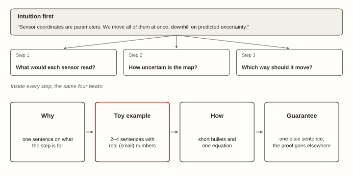{.wp-fig fig-alt="The GD-MI intuition in one box, feeding three plain-question steps; below, four beats: why, toy example, how, guarantee."}
:::

::: {.pv paper="kestrel"}
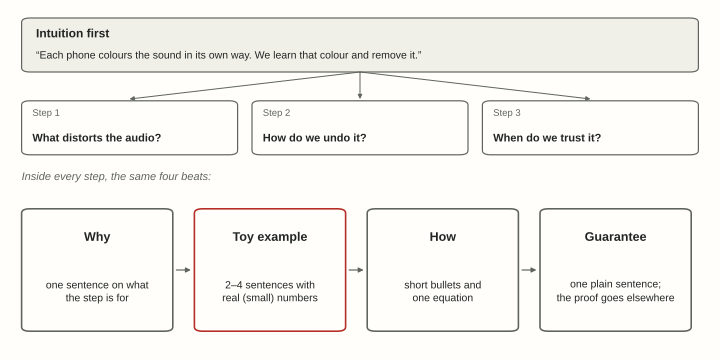{.wp-fig fig-alt="The Kestrel intuition in one box, feeding three plain-question steps; below, four beats: why, toy example, how, guarantee."}
:::

**A toy example teaches more than an equation.** Use two dimensions and numbers small enough to check in your head. Follow the same toy through every step.

::: {.pv paper="gemello"}
::: {.example}
Suppose we want the lighting energy of home X, which has 1,500 sq ft. Three metered homes have 1,400, 1,600 and 3,000 sq ft. They use 20, 30 and 80 kWh a month on lights. For lighting, Gemello compares floor area, so X's two nearest twins are the first two homes. It averages their lighting: (20 + 30) ÷ 2 = 25 kWh. For heating and cooling, it compares summer bills instead, so X may get different twins. Real homes have many features and many metered homes, but every step works the same way.
:::
:::

::: {.pv paper="thermeval"}
::: {.example}
Suppose a colour bar runs from 30 °C (dark) to 40 °C (bright) in ten equal steps, so each step is 1 °C. Person A's nose sits on step 4, so it is 34 °C. Person B's nose sits on step 6, so it is 36 °C. B is hotter, and the camera's stored temperatures confirm it. A model that reads 34 as 340 has broken the colour-bar link. A model that answers 37 °C for every nose has ignored the pixels. Each wrong answer points to a different broken link.
:::
:::

::: {.pv paper="jouleseye"}
::: {.example}
Suppose we watch the nostrils for 10 seconds. Their brightness rises and falls four times: warm air out, cool air in. So the breathing rate is 4 × 6 = 24 breaths a minute. The first model turns this rate into the volume of air breathed out. The second turns that volume into oxygen used, say 10 ml per kg per minute. For a 60 kg rider, that is 10 × 60 = 600 ml, or 0.6 litres, a minute. At 5 kcal per litre of oxygen, the rider burns 0.6 × 5 = 3 kcal a minute. Real models learn both steps from data, but the chain is the same.
:::
:::

::: {.pv paper="gdmi"}
::: {.example}
Suppose the map has just two sites. Site A sits next to an existing station, so the model is fairly sure of it: uncertainty 1. Site B is far from any station: uncertainty 9. A new sensor at position *x*, from A (*x* = 0) to B (*x* = 1), clears the uncertainty near it. That leaves *x* + 9(1 − *x*) = 9 − 8*x* in total. We start the sensor at *x* = 0.25, which leaves 7. The gradient is −8, so moving towards B helps. One step of size 0.05 takes it to *x* = 0.65, which leaves 3.8. The next step would carry it past B, so we snap it to B, which leaves 1. Real maps have thousands of sites and many sensors, but every step works the same way.
:::
:::

::: {.pv paper="kestrel"}
::: {.example}
Suppose sound has just two frequency bands, *low* and *high*. A bird sings with energy (4, 2). Phone A halves the high band, so it records (4, 1). From a few clips, Kestrel learns that phone A's gain is (1, 0.5). It divides the gain out: (4, 1) ÷ (1, 0.5) = (4, 2). The bird's song is back. Real audio has hundreds of bands, but every step works the same way.
:::
:::

More rules for the method:

- **Keep the method generic, with no exact counts.** ["We match each home to its nearest metered homes" belongs in the method. "57 homes from Dataport, with K from 1 to 6" belongs in the evaluation.]{.pv paper="gemello"}["We test each model at several imaging distances" belongs in the method. "2 ft, 6 ft and 10 ft" belongs in the evaluation.]{.pv paper="thermeval"}["We track the nostrils in the thermal video" belongs in the method. "A FLIR One Pro at 8.6 frames per second" belongs in the evaluation.]{.pv paper="jouleseye"}["We start from the existing stations and add *k* new sensors" belongs in the method. "Up to 100 new sensors, added to India's CPCB network" belongs in the evaluation.]{.pv paper="gdmi"}["We record clips from several phones" belongs in the method. "40 phone models" belongs in the evaluation.]{.pv paper="kestrel"}
- **Use few equations:** only the ones the reader needs to follow the argument. Move derivations and implementation details to the appendix.
- **Present textbook results as design guarantees,** and name the parts that are truly new. Don't list a textbook theorem as a contribution.
- **Keep notation clean.** Never use one symbol for two things.
- **Verify every toy number in code** before it goes into the paper.

## Evaluation

Call the section *Evaluation*, and make it **question-driven**. A model I like is the evaluation of [Gemello (KDD 2016)](https://www.kdd.org/kdd2016/papers/files/adp1036-batraA.pdf). The reader can predict its skeleton: data, baselines, metric, then one experiment per question.

**Open with the questions,** each tied to a goal from the introduction:

::: {.pv paper="gemello"}
::: {.example}
We now evaluate Gemello against the goals of Section 1. We ask:

- **Q1** (G1, G2): From the monthly bill alone, is Gemello as accurate as methods that meter each home?
- **Q2** (G1): Does that still hold when those methods get 2-minute data?
- **Q3** (G3): How many metered homes does Gemello need to learn from?
- **Q4**: Does 15-minute smart-meter data help, where a home has it?
- **Q5**: What makes two homes similar, for each appliance?
:::
:::

::: {.pv paper="thermeval"}
::: {.example}
We now use ThermEval to test 25 VLMs against the goals of Section 1. We ask:

- **Q1** (G1): Can VLMs recognise a thermal image, even after recolouring?
- **Q2** (G1): Can they read the colour bar?
- **Q3** (G2): Can they tell which person, or which body part, is hotter?
- **Q4** (G2): Can they estimate a temperature in degrees?
- **Q5**: Do larger models, richer prompts or fine-tuning close the gap?
:::
:::

::: {.pv paper="jouleseye"}
::: {.example}
We now evaluate JoulesEye against the goals of Section 1. We ask:

- **Q1** (G1): How accurately does JoulesEye measure breathing while people cycle and run?
- **Q2** (G2): Does it estimate calories burned more accurately than a smartwatch?
- **Q3** (G3): Does a 32×24-pixel thermal camera still work?
- **Q4**: Which inputs matter most: breathing, heart rate or skin temperature?
:::
:::

::: {.pv paper="gdmi"}
::: {.example}
We now evaluate GD-MI against the goals of Section 1. We ask:

- **Q1**: Which model gives the most useful uncertainty to place sensors with?
- **Q2** (G1): How close does GD-MI come to greedy MI, in a region small enough for greedy MI to run?
- **Q3** (G1, G2): Across all of India, where greedy MI is too slow, does GD-MI beat the maximum-variance heuristic?
- **Q4** (G3): Does GD-MI spread sensors out where the heuristic clusters them?
:::
:::

::: {.pv paper="kestrel"}
::: {.example}
We now evaluate Kestrel against the goals of Section 1. We ask:

- **Q1** (G1): Is Kestrel accurate on phone audio?
- **Q2** (G2): How few labelled calls does a new species need?
- **Q3**: Does Kestrel work on phones it has never seen?
- **Q4**: Which part of Kestrel matters most?
:::
:::

### Setup

- **Scenario.** Write one sentence on the real use case: [*"Our setup mimics a utility that has metered a few homes appliance by appliance, and has only monthly bills for the rest."*]{.pv paper="gemello"}[*"Our setup mimics a user who shows an off-the-shelf model a false-coloured thermal image and asks a plain question."*]{.pv paper="thermeval"}[*"Our setup mimics a gym session: a phone on the handlebar or treadmill console films the face while the person cycles or runs."*]{.pv paper="jouleseye"}[*"Our setup mimics a planner who adds sensors to India's existing CPCB network, choosing sites from past years and judged on later ones."*]{.pv paper="gdmi"}[*"Our setup mimics a volunteer survey, where each species has a few expert-labelled calls."*]{.pv paper="kestrel"} Derive the protocol from that sentence.
- **Data.** Say *why* you chose this data. Give **one table of every data set**, with its size, its purpose and what it tests. State plainly that the test data shares nothing with the training data.


::: {.pv paper="gemello"}
| Set | Size | Purpose |
|---|---|---|
| Monthly bills and home facts (Dataport, Texas, 2013) | 57 homes, 12 months each | Gemello's only input (Q1, Q2, Q5) |
| Appliance submeters, same homes | 12 to 32 homes per appliance | Ground truth, and the twins Gemello averages |
| Whole-home power, 15-minute (and 2-minute for LBM) | Same homes | Baselines' input (Q1, Q2); optional extra for Gemello (Q4) |
| Random subsets of the metered homes | 7 homes upwards, 100 draws each | How many metered homes Gemello needs (Q3) |
:::

::: {.pv paper="thermeval"}
| Set | Size | Purpose |
|---|---|---|
| FLIR and LLVIP road scenes (public) | 40,000 questions | Modality and colour maps (Q1); counting |
| ThermEval-D, colour bars | 8,376 questions | Reading the colour bar (Q2) |
| ThermEval-D, people and objects | 21,845 questions | Comparing and estimating temperatures (Q3, Q4) |
:::

::: {.pv paper="jouleseye"}
| Set | Size | Purpose |
|---|---|---|
| Session 1: thermal video and chest belt, no mask | 54 participants, 3 min each | Breathing accuracy (Q1) |
| Session 2: calorimeter mask, chest belt, Apple Watch | 54 participants, 15 min each | Calorie accuracy, inputs (Q2, Q4) |
| Watch prototype: 32×24 thermal camera | 5 participants, 1 min running | Low resolution (Q3) |
:::

::: {.pv paper="gdmi"}
| Set | Monthly PM2.5 maps | Purpose |
|---|---|---|
| Training | Jan 1998 – Dec 2008 | Train the neural processes |
| Validation | Jan 2009 – Dec 2010 | Choose the model (Q1); Madhya Pradesh case study (Q2) |
| Test | Jan 2011 – Dec 2018 | Placement across India (Q3, Q4) |
:::

::: {.pv paper="kestrel"}
| Set | Size | Purpose |
|---|---|---|
| Clean calls | 30,000 clips | Pre-training only |
| Phone clips, 30 models | 9,000 clips | Main test (Q1, Q2) |
| Phone clips, 10 new models | 3,000 clips | Unseen phones (Q3) |
:::

- **Baselines in groups**, each with a reason it is there: the standard method, the strongest one, the closest to yours, or what a practitioner would try first.
- **Give every baseline its best chance.** Tune all methods with the same rule. Use the authors' code where you can. Check that your copy reproduces a published number.
- **Metrics, listed by goal.** Define each one so the reader could recompute it, and say whether higher or lower is better.
- **Protocol.** Give the number of seeds, the confidence intervals and the statistical tests.
- **Reproducibility.** Say what you will release.

**A new metric gets its own subsection inside Evaluation,** not its own section. Open with the failure it fixes, using your own numbers. List each failure with its fix, and give the formula last.

### Results

**Make each subsection a question, and answer it in its first sentence.**

::: {.pv paper="gemello"}
::: {.ba}
::: {.bad}
**4.5 Results.** In this section, we present the results of our approach and the baselines. Figure 3 shows the energy accuracy of all methods...
:::
::: {.good}
**4.5 From the monthly bill alone, is Gemello as accurate as methods that meter each home?** Yes, and on HVAC it is more accurate: 76%, against 61% for FHMM and 56% for LBM (Figure 3). Only on the fridge does LBM lead, 72% against 69%...
:::
:::
:::

::: {.pv paper="thermeval"}
::: {.ba}
::: {.bad}
**5.4 Task 5: Thermal Reasoning.** In this section, we evaluate the ability of VLMs to reason over thermal intensities. Table 4 shows the results of all models on the two subtasks...
:::
::: {.good}
**5.4 Can VLMs tell which of two people is hotter?** Not reliably. The best model, Gemini 3 Pro, is right 74% of the time, against 84% for people and 50% by chance (Table 4)...
:::
:::
:::

::: {.pv paper="jouleseye"}
::: {.ba}
::: {.bad}
**6.2 Result on estimating energy expenditure.** In this section, we present the results of energy expenditure estimation using different inputs. Figure 9 shows the MAPE of all the inputs...
:::
::: {.good}
**6.2 Does JoulesEye estimate calories better than a smartwatch?** Yes, by a wide margin: 5.8% error, against 37.6% for the Apple Watch's own estimate (Figure 9)...
:::
:::
:::

::: {.pv paper="gdmi"}
::: {.ba}
::: {.bad}
**5.4 Results across India.** In this section, we present the results of the large-scale experiment. Figure 2 shows the RMSE of all methods as a function of the number of added stations...
:::
::: {.good}
**5.4 Does GD-MI beat the maximum-variance heuristic across India?** Yes, and by more as the budget grows: with 100 new sensors, its RMSE is 7.1, against 7.4 for MaxVar (Figure 2)...
:::
:::
:::

::: {.pv paper="kestrel"}
::: {.ba}
::: {.bad}
**5.3 Results on unseen devices.** In this section, we present results on devices not seen during training. Table 3 shows the accuracy of all methods...
:::
::: {.good}
**5.3 Does Kestrel work on phones it has never seen?** Yes, nearly as well: 79% on ten unseen phone models, against 83% on seen ones (Table 3)...
:::
:::
:::


**Give one headline figure** that tells the main result at a glance.

- **Explain *why* each baseline family fails,** in one bullet each. Numbers alone do not convince.
- **Use an oracle or upper bound** to separate the parts of your method. For example: [*with a perfect choice of twins, the paper's Oracle beats Gemello on every appliance, so finding similar homes, not averaging them, limits accuracy.*]{.pv paper="gemello"}[*fine-tuning Qwen-VL 2.5 (8B) doubles its body-part ranking accuracy, from 0.32 to 0.64, but leaves two-person accuracy at 0.60, against 0.84 for people.*]{.pv paper="thermeval"}[*even perfect heart rate leaves 10.2% error, against 5.8% for estimated breathing. Perfect breathing reaches 5.0%, so the signal matters more than sensing it perfectly.*]{.pv paper="jouleseye"}[*with nine new sensors, slow greedy MI reaches an RMSE of 5.6 and MaxVar 6.3; GD-MI, at 5.8, closes most of that gap.*]{.pv paper="gdmi"}[*with perfect phone labels, accuracy rises only from 83% to 85%, so phone detection is not the bottleneck.*]{.pv paper="kestrel"}
- **Choose sensitivity analyses that answer real questions,** such as ["how many metered homes does Gemello need to learn from?"]{.pv paper="gemello"}["does the temperature error grow as the camera moves from 2 ft to 10 ft away?"]{.pv paper="thermeval"}["how many seconds of breathing does one estimate need?"]{.pv paper="jouleseye"}["how does the gain over the heuristic change as the budget grows from 10 to 100 new sensors?"]{.pv paper="gdmi"}["how many labelled calls does a new species need?"]{.pv paper="kestrel"}.
- **Report effect sizes with intervals,** not only p-values. For zero events, use the *rule of three*: 0 errors in 1,000 trials means an error rate of at most about 0.3%, at 95% confidence.
- **Show failure cases,** with their causes.

## Analysis, limitations and conclusion

**Analysis** asks *"Why does it work?"*. Write one question per design choice, in method order, each answered in its first sentence. Show both sides of every choice: too little fails, too much hurts, and there is a sweet spot. Admit what you cannot explain.

**Limitations** come as a numbered list. Each item has an *italic verdict*, the evidence, and a way forward.

::: {.pv paper="gemello"}
::: {.example}
1. *Gemello gives monthly totals, not a power trace.* It averages its twins' monthly energy, so it cannot serve uses that need the trace, such as activity recognition or anomaly detection. Where a home has a smart meter, adding Gemello's features to a trace-level method such as LBM is a natural next step.
:::
:::

::: {.pv paper="thermeval"}
::: {.example}
1. *Even after fine-tuning, temperature errors are too large for safety-critical use.* The fine-tuned Qwen-VL 2.5 still misses absolute temperatures by 1–2 °C on T6 and T7. Its region error falls only from 2.85 °C to 2.60 °C. Pretraining that includes physical sensor data, not only RGB photos, is a natural next step.
:::
:::

::: {.pv paper="jouleseye"}
::: {.example}
1. *The watch prototype is too slow for running.* Its camera runs at 3 frames per second, so its breathing error is 8.1%, against 2.1% for the phone camera. Alone, its calorie error is 15.4%, worse than heart rate's 12%; with heart rate, it is 10.1%. A faster low-resolution camera is the natural next step.
:::
:::

::: {.pv paper="gdmi"}
::: {.example}
1. *GD-MI can stop in a poor local minimum.* Gradient descent depends on where the sensors start, so results vary from run to run. Figures 1 and 2 show the spread over five random starts. Running several starts, or starting from the heuristic's placement, is a natural next step.
:::
:::

::: {.pv paper="kestrel"}
::: {.example}
1. *Kestrel fails on overlapping calls.* When two species sing at once, accuracy falls to 41%. Source separation before classification is a natural next step.
:::
:::

**The conclusion** mirrors the abstract's last lines in four to six sentences: problem, insight, method, headline numbers, takeaway. Two sentences are too few.

## Sentences

### Active voice

Use the **active voice**, with "we" for what *you* did. Active sentences are shorter. They also make clear who did what.

::: {.pv paper="gemello"}
| Passive | Active |
|---|---|
| It is observed that FHMM performs poorly on the dryer. | FHMM performs poorly on the dryer. |
| Experiments were conducted on 57 homes. | We test Gemello on 57 homes. |
| A novel approach, Gemello, is proposed. | We present Gemello. |
| Lighting energy is estimated from homes of similar area. | Gemello estimates lighting energy from homes of similar area. |
:::

::: {.pv paper="thermeval"}
| Passive | Active |
|---|---|
| It is observed that complex colour maps lead to more failures. | Colour maps such as Summer and Spring cause more errors. |
| Experiments were conducted on 25 VLMs. | We evaluate 25 VLMs. |
| A novel benchmark, ThermEval, is proposed. | We present ThermEval. |
| Model outputs are parsed by a language model. | A text-only LLM parses each model's answer. |
:::

::: {.pv paper="jouleseye"}
| Passive | Active |
|---|---|
| It has been observed that calorie estimates from wearables are inaccurate. | Wearable calorie estimates can be wrong by over 40%. |
| Experiments were conducted on 54 participants. | We test JoulesEye on 54 participants. |
| A novel system, JoulesEye, is proposed. | We present JoulesEye. |
| The nostril region is tracked across frames. | JoulesEye tracks the nostrils across frames. |
:::

::: {.pv paper="gdmi"}
| Passive | Active |
|---|---|
| It is observed that MaxVar clusters sensors. | MaxVar clusters sensors. |
| Experiments were conducted on PM2.5 data across India. | We test GD-MI on PM2.5 data across India. |
| A novel gradient-based framework is proposed. | We present GD-MI. |
| The sensor coordinates are updated with Adam. | GD-MI updates the sensor coordinates with Adam. |
:::

::: {.pv paper="kestrel"}
| Passive | Active |
|---|---|
| It is observed that accuracy drops on phones. | Accuracy drops on phones. |
| Experiments were conducted on 12,000 clips. | We test Kestrel on 12,000 clips. |
| A novel framework, Kestrel, is proposed. | We present Kestrel. |
| The gain is estimated from a few clips. | Kestrel estimates the gain from a few clips. |
:::

The passive is fine when the actor doesn't matter: [*"The appliance data were recorded at one-minute resolution."*]{.pv paper="gemello"}[*"All images were captured with a TOPDON TC001 Plus thermal camera."*]{.pv paper="thermeval"}[*"The data were collected in December and January, in a room kept at 76 °F."*]{.pv paper="jouleseye"}[*"The PM2.5 maps were built from satellite, chemical-model and ground data, on a 0.1° grid."*]{.pv paper="gdmi"}[*"The clips were recorded between 2019 and 2023."*]{.pv paper="kestrel"}

### Short sentences

Aim for a median of about **15–18 words** and a maximum of about **25**. Split any sentence with three or more clauses. Give each sentence *one* idea. The [sentence-length figure](#abstract) shows what this does to an abstract.

### Emphasis

Use `\emph{}` on the few words that carry the argument: *every*, *only*, *not*, *before*. Use it for contrast and for new terms. Don't use it for decoration. One or two per paragraph is plenty.

::: {.pv paper="gemello"}
::: {.example}
NILM needs a meter reading *every minute*; Gemello needs one *a month*. It defines similarity *per appliance*, not per home.
:::
:::

::: {.pv paper="thermeval"}
::: {.example}
Most VLMs can *find* the colour bar, but several cannot *read* it. A thermal image encodes *temperature*, not colour or texture.
:::
:::

::: {.pv paper="jouleseye"}
::: {.example}
A chest belt *cannot* tell breathing from pedalling, because both move the chest at a similar rate. JoulesEye watches the *nostrils*, not the chest.
:::
:::

::: {.pv paper="gdmi"}
::: {.example}
Greedy MI must score *every* candidate site before it places each sensor. GD-MI moves *all* the new sensors at once, so a finer grid adds *no* extra search.
:::
:::

::: {.pv paper="kestrel"}
::: {.example}
Denoising removes background noise, but it *cannot* remove the microphone's colouring. Kestrel models *each phone*, not each recording.
:::
:::

### Cut the filler

| Instead of | Write |
|---|---|
| In this paper, we propose | We present |
| It is worth noting that X | X |
| The intuition is simple: X | X |
| a novel / crucial / groundbreaking method | a method (show why it matters) |
| [comparable to or better than]{.pv paper="gemello"}[significantly below human performance]{.pv paper="thermeval"}[significantly better]{.pv paper="jouleseye"}[significantly better]{.pv paper="gdmi"}[significantly better]{.pv paper="kestrel"} | [76% vs 61% and 56% on HVAC; 69% vs 72% on the fridge, where LBM wins]{.pv paper="gemello"}[74% vs 84% (and the test, if you mean statistical significance)]{.pv paper="thermeval"}[5.8% vs 37.6% error (MAPE) for the Apple Watch's own estimate]{.pv paper="jouleseye"}[RMSE of 7.1 against 7.4 for MaxVar with 100 new sensors, 4% lower (and the test, if you mean statistical significance)]{.pv paper="gdmi"}[83% vs 61% (and the test, if you mean statistical significance)]{.pv paper="kestrel"} |
| due to the fact that | because |

**Write like a person.** Avoid inflated words, stacked hedges ("may potentially suggest") and three-item lists that are only there for rhythm.

### Numbers and terms

- **Never write a bare number.** Compare it to something, and give its unit and its *n*.
- **Compare rates, not counts, when the totals differ.** "20 of 40 (50%) became 15 of 20 (75%)" is a rise, though 20 → 15 looks like a fall.
- **Describe what you did, not a verdict on it.** Don't write *validated*, *established* or *confirmed* unless the paper shows that test.
- **Without a causal design, write "we observe" and "is associated with",** not "caused" or "impact". If an interval includes zero, say so in the same sentence.
- **Every adjective needs a number.** *Low-overhead*, *real-time* and *scalable* each need a latency, a memory or a size.
- **Use one word per concept.** [If you call them *metered homes*, don't switch to *submetered*, *train*, *instrumented* and *neighbourhood homes* later.]{.pv paper="gemello"}[If you call it a *colour bar*, don't switch to *colorbar*, *temperature scale* and *legend* later.]{.pv paper="thermeval"}[If you call it *energy expenditure*, don't switch to *calorie burn*, *caloric expenditure* and *VO2* later.]{.pv paper="jouleseye"}[If you call TNP-D the *surrogate*, don't switch to *predictive model*, *the NP* and *the model* later.]{.pv paper="gdmi"}[If you call it a *gain*, don't switch to *response*, *profile* and *filter* later.]{.pv paper="kestrel"}
- **Expand an acronym once**, and only if you use it again.

### American and British English

Some spellings differ: British "colour" and "optimise" are American "color" and "optimize". There are also a few differences in grammar. Pick one variety and stick to it. Most of our previous papers use British English, though this often depends on the co-authors.

## Figures

### One message, and a self-contained caption

Give each figure **one message**, and make that message the first sentence of the caption. A reader who sees only the figure and its caption should understand it.

::: {.pv paper="gemello"}
::: {.ba}
::: {.bad}
**Figure 3.** Energy accuracy of different approaches across appliances.
:::
::: {.good}
**Figure 3. From the monthly bill alone, Gemello is as accurate as methods that meter each home.** Each group is one appliance; bars give energy accuracy (%, higher is better) for FHMM, LBM and Gemello, with standard errors across homes. LBM leads on the fridge, 72% to 69%.
:::
:::
:::

::: {.pv paper="thermeval"}
::: {.ba}
::: {.bad}
**Figure 2.** Overview of the tasks in the ThermEval benchmark.
:::
::: {.good}
**Figure 2. ThermEval asks seven kinds of question, each one step closer to reading temperature.** From left: is it thermal (T1–T2), how many people (T3), what the colour bar says (T4), who is hotter (T5) and how hot (T6–T7). Each panel shows one real question from the benchmark.
:::
:::
:::

::: {.pv paper="jouleseye"}
::: {.ba}
::: {.bad}
**Figure 9.** MAPE of energy expenditure estimation for different inputs.
:::
::: {.good}
**Figure 9. Breathing predicts calories burned far better than heart rate.** Error (MAPE, lower is better) of each input's calorie estimate against an indirect calorimeter. Every input with breathing (RR) stays under 6%; heart rate alone gives 10–12%, and the Apple Watch's own estimate 37.6%.
:::
:::
:::

::: {.pv paper="gdmi"}
::: {.ba}
::: {.bad}
**Figure 1.** Results of different methods on the regional subset.
:::
::: {.good}
**Figure 1. With nine new sensors, GD-MI nearly matches greedy MI and beats MaxVar.** Validation RMSE in Madhya Pradesh (lower is better) as 0 to 9 sensors join the existing CPCB stations. Bands show the 25th to 75th percentile over five runs of the two random methods, GD-MI and Random.
:::
:::
:::

::: {.pv paper="kestrel"}
::: {.ba}
::: {.bad}
**Figure 4.** Results of different methods on the phone dataset.
:::
::: {.good}
**Figure 4. Kestrel is the only method that is both accurate and label-efficient.** Each point is one method: accuracy on phone audio (x) against labelled calls needed per species (y, log scale). The shaded corner is the goal.
:::
:::
:::


If a figure needs a paragraph to decode, split it into step-by-step panels with one idea per panel, or move the detailed version to the appendix.

### Colour that means something

Use **one colour code for the whole paper.** Give each colour a meaning, and state the code once. Show movement or change as a *colour change*: the problem starts orange, your method's blue arrow moves it, and it lands green.

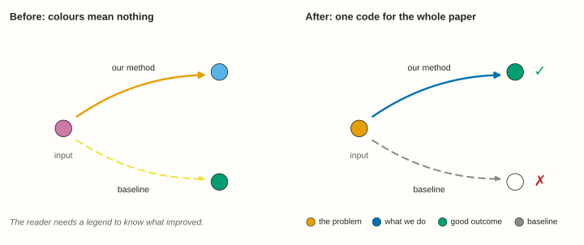{.wp-fig fig-alt="Two diagrams of an input moved by our method and by a baseline. Left: arbitrary pink, yellow and sky colours. Right: orange input, blue arrow to a green ticked output, grey dashed arrow to a hollow crossed output."}

- **Use a colour-blind-safe palette.** [Okabe–Ito](https://jfly.uni-koeln.de/color/) is a good default.
- **Never let meaning depend on colour alone.** Add ✓/✗, filled and hollow markers, or direct labels.
- **Give neutral categories neutral colours,** so they never clash with the semantic code.
- **Keep text at least 6–7 pt** at final size. Check the rendered PDF for overlaps, clipping and margin overflow.
- **Read every plotted number from your results files,** not from memory.
- **Check each plot's shape against your analysis.** A straight line on a log-y axis means exponential growth; if your theory says polynomial, the axis or the data is wrong.
- **Every image comes from the run it claims to show.** Label an illustration as one, and never submit a generated mock-up as a photo of your setup.

### LaTeXify figures

A figure made at the wrong size gets scaled to fit the column, and its text shrinks or swells with it. Here is the same plot, from ThermEval's Table 4, set in a two-column paper twice. The text around it is 9 pt.

{.wp-fig fig-alt="Two columns of a paper with the same paragraph and the same scatter plot. Left, the plot is a shrunk default matplotlib figure with tiny sans-serif labels, a box frame and a title. Right, the plot uses the paper's serif font at text size, with no frame and a caption that leads with its message."}

Why it matters:

- **Readable text.** A 6.4-inch figure shrunk into a 3.33-inch column prints its 10 pt labels at about 5 pt, below the 6–7 pt minimum most venues ask for. A figure made at the column width needs no scaling, so 9 pt stays 9 pt.
- **One typeface.** LaTeXify sets the figure in the paper's own font, so a symbol like $\alpha$ looks the same in the plot and in the text.
- **Sharp at any zoom.** It saves a vector PDF, not a PNG that blurs when a reviewer zooms in.
- **Less clutter.** It drops the box frame and lightens the axes. The message goes in the caption, not in a plot title.

Use our [LaTeXify Python package](https://github.com/sustainability-lab/latexify), and see the [local guide](latexify-plots.qmd) for installation. Set the width from your template: `\the\columnwidth` in the paper prints it.

```python
import latexify
latexify.latexify(fig_width=3.33)   # \columnwidth in inches; columns=2 for a full-width figure
fig, ax = plt.subplots()
...
latexify.format_axes(ax)
latexify.save_fig("accuracy-vs-size.pdf")
```

Then include it at its natural size, `\includegraphics{accuracy-vs-size.pdf}`, with no `width=` that would rescale it.

## Tables

We follow this excellent [short guide to making nice tables](https://people.inf.ethz.ch/markusp/teaching/guides/guide-tables.pdf) by Markus Püschel. Below, the selected paper's table is built up one fix at a time. The numbers are the same in every step.

::: {.pv paper="gemello"}
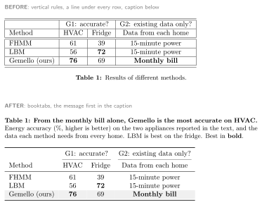{.wp-fig fig-alt="The Gemello results table typeset four times with LaTeX: a grid with centred, mixed-precision numbers and a caption below; booktabs rules with the caption above; numbers right-aligned at one precision; and the final table with goal-grouped columns, bold best results, a shaded row and a message-first caption."}
:::

::: {.pv paper="thermeval"}
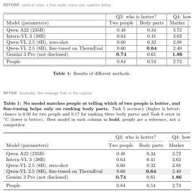{.wp-fig fig-alt="The ThermEval results table typeset four times with LaTeX: a grid with centred, mixed-precision numbers and a caption below; booktabs rules with the caption above; numbers right-aligned at one precision; and the final table with goal-grouped columns, bold best results, a shaded row and a message-first caption."}
:::

::: {.pv paper="jouleseye"}
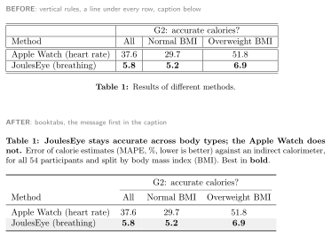{.wp-fig fig-alt="The JoulesEye results table typeset four times with LaTeX: a grid with centred, mixed-precision numbers and a caption below; booktabs rules with the caption above; numbers right-aligned at one precision; and the final table with goal-grouped columns, bold best results, a shaded row and a message-first caption."}
:::

::: {.pv paper="gdmi"}
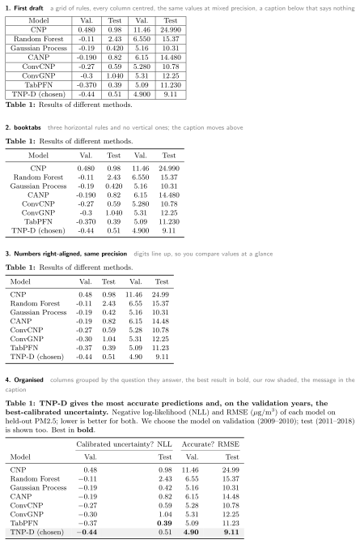{.wp-fig fig-alt="The GD-MI results table typeset four times with LaTeX: a grid with centred, mixed-precision numbers and a caption below; booktabs rules with the caption above; numbers right-aligned at one precision; and the final table with goal-grouped columns, bold best results, a shaded row and a message-first caption."}
:::

::: {.pv paper="kestrel"}
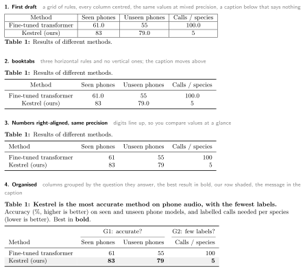{.wp-fig fig-alt="The Kestrel results table typeset four times with LaTeX: a grid with centred, mixed-precision numbers and a caption below; booktabs rules with the caption above; numbers right-aligned at one precision; and the final table with goal-grouped columns, bold best results, a shaded row and a message-first caption."}
:::

What each step buys:

1. **Remove the grid.** Vertical lines and a rule under every row make the eye read lines, not numbers. Use `booktabs`: `\toprule`, `\midrule` and `\bottomrule`, plus `\cmidrule` under a column group. Never use vertical or double lines. Put the caption *above* the table, because a reader scans a table from the top.
2. **Right-align numbers, and give a column one precision.** Then digits of the same place sit in one column, and a longer number really is a bigger one. In the first draft, 0.6 next to 0.64 looks like a less precise result, not the same precision. Pick the decimals your measurement supports, and use them for every cell in the column. With `siunitx`, an `S` column aligns on the decimal point.
3. **Left-align text,** and keep it short. A centred text column has a ragged edge on both sides.
4. **Organise for the reader.** Group columns under the question or goal they answer. Put units in the header, not in every cell. Set reference rows, such as people or an oracle, apart with a `\midrule`. Bold the best value in each column, shade your own row, and say both rules in the caption.
5. **Lead the caption with the message,** then say what the columns mean and which direction is better.

Two more rules for our papers:

- **Leave no empty cells in headline columns.** A "–" in a key column is a gap in your evidence. Fill it.
- **Use counts when *n* is small** (7/10, not 70%).

The LaTeX for step 4:

::: {.pv paper="gemello"}
```tex
\begin{table}[t]
  \caption{\textbf{From the monthly bill alone, \method is the most accurate on HVAC.}
    Energy accuracy (\%, higher is better) on the two appliances reported in the text, and the data each
    method needs from every home. LBM is best on the fridge. Best in \textbf{bold}.}
  \label{tab:main}
  \begin{tabular}{lrrl}
    \toprule
    & \multicolumn{2}{c}{G1: accurate?} & G2: existing data only? \\
    \cmidrule(lr){2-3}\cmidrule(lr){4-4}
    Method & HVAC & Fridge & Data from each home \\
    \midrule
    FHMM & 61 & 39 & 15-minute power \\
    LBM & 56 & \textbf{72} & 15-minute power \\
    \rowcolor{gray!12} \method (ours) & \textbf{76} & 69 & \textbf{Monthly bill} \\
    \bottomrule
  \end{tabular}
\end{table}
```
:::

::: {.pv paper="thermeval"}
```tex
\begin{table}[t]
  \caption{\textbf{No model matches people at telling which of two people is hotter, and fine-tuning helps only on ranking body parts.}
    Task 5 accuracy (higher is better; chance is 0.50 for two people and 0.17 for ranking three body parts)
    and Task 6 error in $^\circ$C (lower is better). Best model in each column in \textbf{bold};
    people are a reference, not a competitor.}
  \label{tab:reasoning}
  \begin{tabular}{lrrrr}
    \toprule
    & \multicolumn{2}{c}{Q3: who is hotter?} & \multicolumn{2}{c}{Q4: how hot?} \\
    \cmidrule(lr){2-3}\cmidrule(lr){4-5}
    Model (parameters) & Two people & Body parts & Marker & Region \\
    \midrule
    Qwen A22 (235B)              & 0.48 & 0.34 & 3.72 & 3.40 \\
    Intern-VL 3 (38B)            & 0.64 & 0.41 & 3.63 & 2.59 \\
    Qwen-VL 2.5 (8B), zero-shot  & 0.60 & 0.32 & 2.88 & 2.85 \\
    \rowcolor{gray!12} Qwen-VL 2.5 (8B), fine-tuned on \method & 0.60 & \textbf{0.64} & 2.40 & 2.60 \\
    Gemini 3 Pro (not disclosed) & \textbf{0.74} & 0.61 & \textbf{1.86} & \textbf{1.47} \\
    \midrule
    People                       & 0.84 & 0.54 & 2.73 & 2.04 \\
    \bottomrule
  \end{tabular}
\end{table}
```
:::

::: {.pv paper="jouleseye"}
```tex
\begin{table}[t]
  \caption{\textbf{\method stays accurate across body types; the Apple Watch does not.}
    Error of calorie estimates (MAPE, \%, lower is better) against an indirect calorimeter,
    for all 54 participants and split by body mass index (BMI). Best in \textbf{bold}.}
  \label{tab:bmi}
  \begin{tabular}{lrrr}
    \toprule
    & \multicolumn{3}{c}{G2: accurate calories?} \\
    \cmidrule(lr){2-4}
    Method & All & Normal BMI & Overweight BMI \\
    \midrule
    Apple Watch (heart rate) & 37.6 & 29.7 & 51.8 \\
    \rowcolor{gray!12} \method (breathing) & \textbf{5.8} & \textbf{5.2} & \textbf{6.9} \\
    \bottomrule
  \end{tabular}
\end{table}
```
:::

::: {.pv paper="gdmi"}
```tex
\begin{table}[t]
  \caption{\textbf{TNP-D gives the most accurate predictions and, on the validation years, the best-calibrated uncertainty.}
    Negative log-likelihood (NLL) and RMSE ($\mu$g/m$^3$) of each model on held-out PM2.5; lower is better for both.
    We choose the model on validation (2009--2010); test (2011--2018) is shown too. Best in \textbf{bold}.}
  \label{tab:surrogate}
  \begin{tabular}{lrrrr}
    \toprule
    & \multicolumn{2}{c}{Calibrated uncertainty? NLL} & \multicolumn{2}{c}{Accurate? RMSE} \\
    \cmidrule(lr){2-3}\cmidrule(lr){4-5}
    Model & Val. & Test & Val. & Test \\
    \midrule
    CNP              & $0.48$  & $0.98$          & 11.46         & 24.99 \\
    Random Forest    & $-0.11$ & $2.43$          & 6.55          & 15.37 \\
    Gaussian Process & $-0.19$ & $0.42$          & 5.16          & 10.31 \\
    CANP             & $-0.19$ & $0.82$          & 6.15          & 14.48 \\
    ConvCNP          & $-0.27$ & $0.59$          & 5.28          & 10.78 \\
    ConvGNP          & $-0.30$ & $1.04$          & 5.31          & 12.25 \\
    TabPFN           & $-0.37$ & $\mathbf{0.39}$ & 5.09          & 11.23 \\
    \rowcolor{gray!12} TNP-D (chosen) & $\mathbf{-0.44}$ & $0.51$ & \textbf{4.90} & \textbf{9.11} \\
    \bottomrule
  \end{tabular}
\end{table}
```
:::

::: {.pv paper="kestrel"}
```tex
\begin{table}[t]
  \caption{\textbf{Kestrel is the most accurate method on phone audio, with the fewest labels.}
    Accuracy (\%, higher is better) on seen and unseen phone models, and labelled calls needed per species
    (lower is better). Best in \textbf{bold}.}
  \label{tab:main}
  \begin{tabular}{lrrr}
    \toprule
    & \multicolumn{2}{c}{G1: accurate?} & G2: few labels? \\
    \cmidrule(lr){2-3}\cmidrule(lr){4-4}
    Method & Seen phones & Unseen phones & Calls / species \\
    \midrule
    Fine-tuned transformer & 61 & 55 & 100 \\
    \rowcolor{gray!12} \method (ours) & \textbf{83} & \textbf{79} & \textbf{5} \\
    \bottomrule
  \end{tabular}
\end{table}
```
:::

## LaTeX hygiene

- **Use `\cref` for every reference.** Never hand-type "Figure 3" or "Table S2". This includes references into the supplement: load `xr-hyper`, add `\externaldocument[S-]{supp}`, and write `\cref{S-tab:ablation}`. On Overleaf, add a `latexmkrc` file so that the supplement is compiled too.
- **Use macros** for the method name, metric names and recurring symbols.
- **Keep a label scheme:** `sec:`, `fig:`, `tab:`, `eq:`.
- **Write one sentence per source line.** Diffs and reviews become much easier.

### Comments in LaTeX

We create a comment macro for each author's initials (I use `\nb`). Comments are useful for notes on the text, and for notes to yourself. I might write `\nb{I'm not sure about this sentence}`, and later search for every `\nb` to find my comments. Put all notes behind one switch, so the submission build hides them:

```tex
\newif\ifshownotes \shownotestrue   % \shownotesfalse for submission
\newcommand{\nb}[1]{\ifshownotes{\color{red}\small\textbf{Nipun:} #1}\fi}
```

A separate `submission.tex` that sets `\shownotesfalse` and then inputs the paper makes this a one-click switch.

## Reviewing a draft

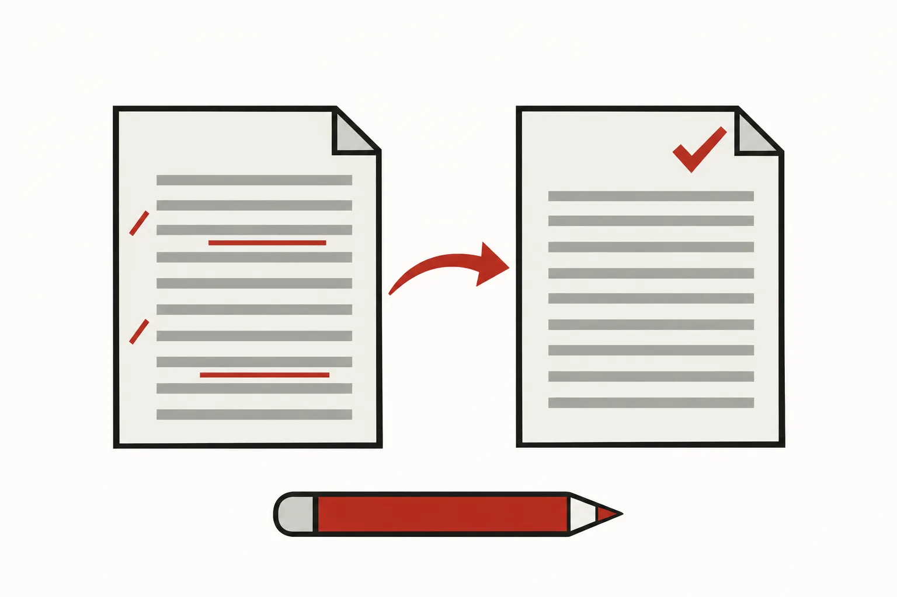{.wp-ill fig-alt="A draft page with red underlines and margin speech bubbles, a red arrow, and a cleaner page with a check mark; a pencil lies in front."}

When you review someone's draft, whether you are a student, an adviser or an AI agent, use the same protocol:

1. **Don't overwrite the author's text.** Add inline comments, and put a *suggested rewrite* after the original, behind the notes switch. The author decides what to keep.
2. **Comment on the why, not just the what.** "The lead sentence is history, so it doesn't set the tone; lead with the claim" teaches. "Rewrite this" doesn't.
3. **Check every number you move or rephrase** against its source table, figure or code. Rewriting can silently change a claim, such as "all 10" becoming "7 of 10".
4. **Mark anything you inferred** with a "please check" note.
5. **End with a short review guide:** what changed and where, which runs are still needed, and which facts the author should confirm.

## Paper timelines

Plan *backwards* from the deadline. The schedule below is a starting point; adjust it to the venue and the project.

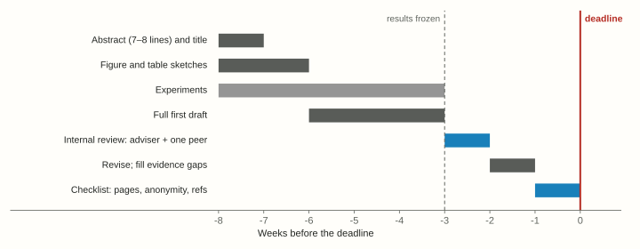{.wp-fig fig-alt="A Gantt chart over eight weeks before a deadline: abstract and figure sketches first, experiments until week minus three, draft, internal review, revision and a final checklist week."}

- **Write the abstract and sketch the figures in week one.** They tell you which experiments you still need.
- **Freeze results about three weeks before the deadline.** After that, write; don't run.
- **Book an internal review:** your adviser and one peer who is *not* on the paper. The peer is your "reader from a neighbouring field".
- **Keep the last week for checks:** page limit, anonymity, references, figures and the checklist below.

## Grammarly, AI tools and agents {#ai-agents}

I recommend that students use Grammarly (or a similar tool) to check their writing, once they have done a complete pass of editing. I do not recommend relying heavily on ChatGPT-like tools to write papers. They often produce sentences that *sound* correct but are not.

AI agents are most useful as **reviewers and checkers**, not as authors. They can flag long sentences, passive voice, hand-typed references and numbers that disagree with a table. They should never invent a number or a citation. You remain responsible for every claim.

### The paper-writing skill

This guide also ships as an **agent skill**: a folder of instructions that an agent loads when it writes or reviews a paper. It lives in its own repository, [**sustainability-lab/paper-writing**](https://github.com/sustainability-lab/paper-writing), and holds three files:

- `SKILL.md`: the entry point, with the workflow and the core rules.
- `reference.md`: every rule, section by section.
- `checklist.md`: the pre-submission checklist.

**Claude Code.** Install it as a plugin, once, for all your projects:

```text
/plugin marketplace add sustainability-lab/paper-writing
/plugin install paper-writing@sustainability-lab
```

Then ask: *"Review the introduction of main.tex using the paper-writing skill."*

**Other agents (Codex, Gemini CLI, Cursor).** Copy the repository's `skills/paper-writing/` folder into your paper's repository, for example as `docs/writing/`. Then add one line to the project's `AGENTS.md` or `GEMINI.md`: *"When writing or reviewing the paper, follow docs/writing/SKILL.md."*

To change a rule, open a pull request on the repository, and update this page too, so that the two stay in step.

## Pre-submission checklist

- [ ] The abstract has 7–8 parts, short sentences, and the main limitation in its last line.
- [ ] The introduction's lead sentences, read in order, give the abstract.
- [ ] Every paragraph opens with its point, and the introduction has no bold run-in heads.
- [ ] Background and related work are separate. Related work opens with "We now categorize", and each family ends with how we relate.
- [ ] The method gives the intuition first, follows a toy example, and contains no experiment counts.
- [ ] The evaluation goes from questions, to setup, to answer-first results, with one headline figure.
- [ ] Every baseline got its best chance, and no headline cell is empty.
- [ ] Every number in the text matches its table or figure.
- [ ] Every reference uses `\cref`, including references to the supplement.
- [ ] All figures share one colour code, are colour-blind safe, and have text of at least 6–7 pt.
- [ ] No symbol stands for two things.
- [ ] The limitations form a numbered list with ways forward, and the conclusion runs 4–6 sentences.
- [ ] Page limit and anonymity are checked, and all notes are off in the submission build.

```{=html}
<script>
(() => {
  const papers = ["gemello", "thermeval", "jouleseye", "gdmi", "kestrel"];
  const buttons = document.querySelectorAll(".paper-switch button");
  function choose(p, save) {
    if (!papers.includes(p)) p = "gemello";
    document.documentElement.dataset.paper = p;
    buttons.forEach(b => b.setAttribute("aria-selected", b.dataset.paper === p));
    if (save) {
      try { localStorage.setItem("wp-paper", p); } catch (e) {}
      const u = new URL(location.href); u.searchParams.set("paper", p); history.replaceState(null, "", u);
    }
  }
  let start = new URLSearchParams(location.search).get("paper");
  if (!start) { try { start = localStorage.getItem("wp-paper"); } catch (e) {} }
  choose(start || "gemello", false);
  // Quarto's navbar slides in and out on scroll; keep the switch just below it when it shows.
  const bar = document.querySelector(".paper-switch"), header = document.getElementById("quarto-header");
  const dock = () => { bar.style.top = Math.max(0, header ? header.getBoundingClientRect().bottom : 0) + "px"; };
  ["scroll", "resize"].forEach(e => window.addEventListener(e, dock, { passive: true }));
  if (header) header.addEventListener("transitionend", dock);
  dock();
  buttons.forEach(b => b.addEventListener("click", () => {
    // Keep the clicked switch where it is on screen while the content above it changes height.
    const y = b.getBoundingClientRect().top;
    choose(b.dataset.paper, true);
    window.scrollBy(0, b.getBoundingClientRect().top - y);
  }));
})();
</script>
```
