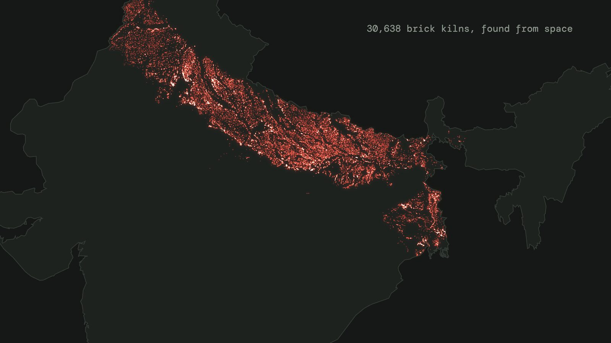
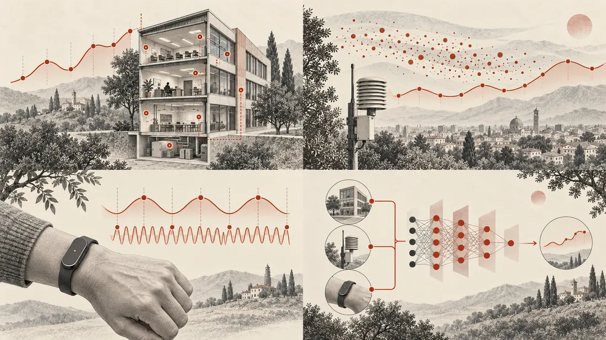
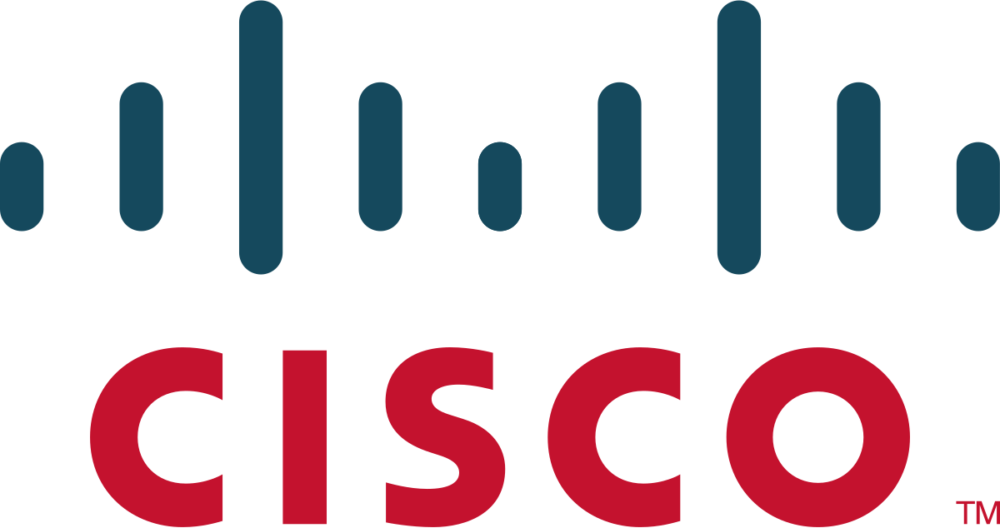
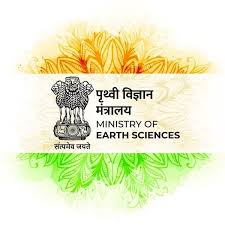
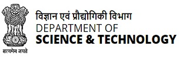
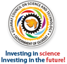
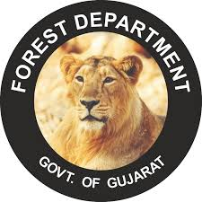

::: {.frame .page-main}

```{=html}
<section>
  <div class="hero">
    <div class="intro">
      <h1>AI for a Sustainable Future</h1>
      <p class="sub">Sustainability Lab · IIT Gandhinagar</p>
      <p>We build AI that serves both people and the planet — from air quality and health sensing to energy and Earth observation.</p>
      <p>The lab is led by <a href="https://nipunbatra.github.io">Nipun Batra</a>. Our alumni have gone on to Cambridge, Microsoft Research, Google DeepMind, CMU and industry.</p>
      <p class="awards-line">Recent recognition: <b>Best Paper Runner-Up at BuildSys 2026</b>, the <b>ACM e-Energy Test-of-Time Award 2025</b> for NILMTK, and the <b>ACM SIGEnergy Rising Star 2025</b>. Work published at NeurIPS, KDD, AAAI, IMWUT, BuildSys and UbiComp.</p>
      <a class="recruit" href="join.html">Now recruiting PhD students &amp; interns</a>
      <div class="btns">
        <a class="btn btn-primary" href="join.html">Join the lab</a>
        <a class="btn btn-outline-primary" href="flyer.pdf">Lab flyer (PDF)</a>
        <a class="btn btn-outline-primary" href="papers/index.html">Publications</a>
      </div>
    </div>
    <figure class="film">
      <button class="film-open" type="button" aria-haspopup="dialog" aria-controls="film-dialog">
        
        <span class="film-cta"><span class="film-play" aria-hidden="true"></span><span><b>Watch the lab film</b><span>2½ minutes · sound on</span></span></span>
      </button>
      <figcaption>Our research, people and alumni in one short film · <a href="people.html">meet everyone</a></figcaption>
    </figure>
  </div>
  <dialog id="film-dialog" class="film-dialog" aria-label="The Sustainability Lab film">
    <form method="dialog"><button class="film-close" aria-label="Close the film">Close ×</button></form>
    <video controls playsinline preload="none" poster="images/film/poster.jpg">
      <source src="images/film/lab-film.mp4" type="video/mp4">
    </video>
  </dialog>
  <script>
    (() => {
      const dialog = document.getElementById("film-dialog");
      const video = dialog.querySelector("video");
      document.querySelector(".film-open").addEventListener("click", () => {
        dialog.showModal();
        video.play().catch(() => {});
      });
      dialog.addEventListener("close", () => video.pause());
      dialog.addEventListener("click", (e) => { if (e.target === dialog) dialog.close(); });
    })();
  </script>
</section>
```

```{=html}


<section>
  <div class="vrule">
    <div>
      <h2>Research</h2>
      <a class="trow" href="research.html#air"><span><b>Clean Air</b><span>Sensors, models and LLM tools for cleaner cities.</span></span></a>
      <a class="trow" href="research.html#health"><span><b>Health Sensing</b><span>Cameras and wearables for breathing and metabolism.</span></span></a>
      <a class="trow" href="research.html#energy"><span><b>Energy</b><span>What uses power, and when, from a single meter.</span></span></a>
      <a class="trow" href="research.html#earth"><span><b>Earth Observation</b><span>Finding brick kilns and mapping land from space.</span></span></a>
      <p class="small" style="margin-top:10px"><a href="research.html">All research</a> &nbsp;·&nbsp; <a href="research.html#tools">Datasets &amp; tools</a></p>
    </div>
    <div>
      <h2>Join &amp; learn</h2>
      <a class="trow" href="join.html#phd"><span><b>PhD &amp; postdoc</b><span>How admissions work, and where alumni went.</span></span></a>
      <a class="trow" href="join.html#internships"><span><b>Internships</b><span>Summer (SRIP) and 6-month research internships.</span></span></a>
      <a class="trow" href="handbook/index.html"><span><b>Lab handbook</b><span>Week-one checklist, servers, writing and culture.</span></span></a>
      <a class="trow" href="experiences.html"><span><b>Student stories</b><span>Alumni on how they started and where they went.</span></span></a>
      <p class="small" style="margin-top:10px"><a href="join.html">Open positions</a> &nbsp;·&nbsp; <a href="https://sustainability-lab.github.io/sustainability-research-bootcamp/">Research Skills Bootcamp</a></p>
    </div>
  </div>
</section>

<section class="life">
  <div class="head-row"><h2>Life in the lab</h2><span class="small"><a class="arrow" href="memories.html">All photos</a> &nbsp; <a class="arrow" href="experiences.html">All stories</a></span></div>
```

::: {#life-photos}
:::

```{=html}
  <h3 class="life-sub">In their words</h3>
```

::: {#life-stories}
:::

```{=html}
</section>

<section>
  <div class="head-row"><h2>Selected work</h2><a class="arrow small" href="papers/index.html">All publications</a></div>
```

::: {#selected-work}
:::

```{=html}
</section>

```

::: {.news-flyer}
::: {.news-col}
```{=html}
<div class="head-row"><h2>Latest</h2><a class="arrow small" href="news.html">All news</a></div>
```

::: {#news-latest}
:::
:::

```{=html}
<div class="flyer-col">
  <a class="flyer-card" href="flyer.pdf">
    
    <b>Lab flyer</b>
    <span>Our research, people and openings on two pages. PDF.</span>
  </a>
  <div class="side-links">
    <a href="news.html?type=award">Awards &amp; recognition</a>
    <a href="news.html?type=media">Media coverage</a>
    <a href="memories.html">Photos</a>
    <a href="news.html?type=event">Events</a>
  </div>
</div>
```
:::

```{=html}
<section class="funders-row">
  <div class="kicker">Supported by</div>
  <div class="logos">
    
  </div>
</section>
```

:::
