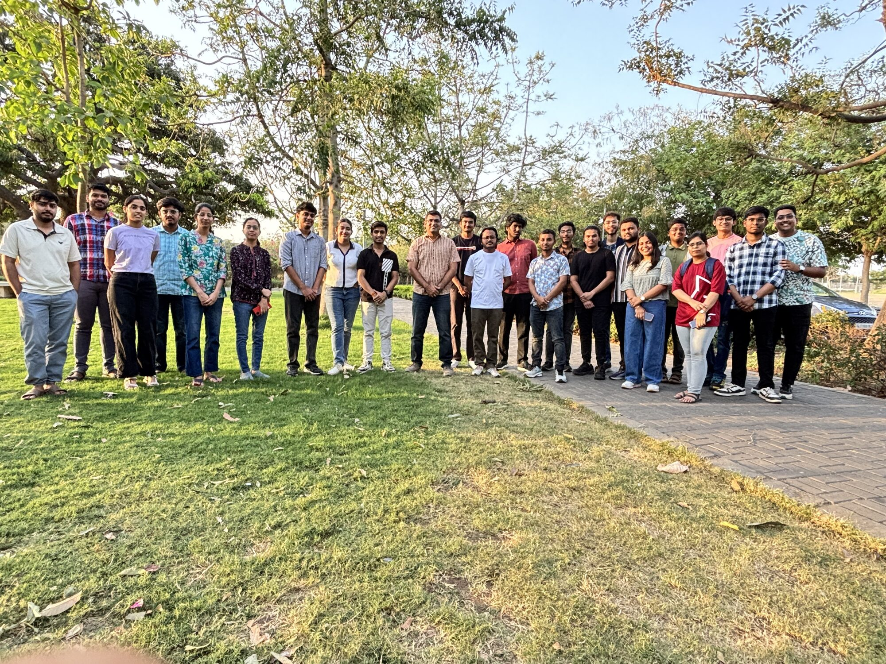
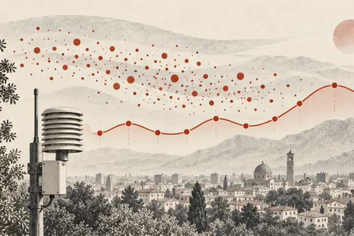
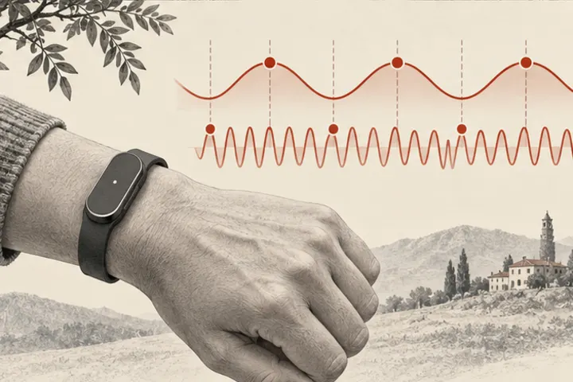
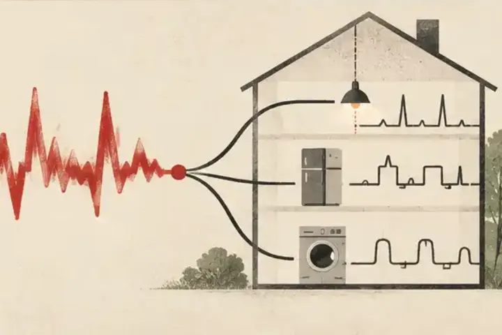
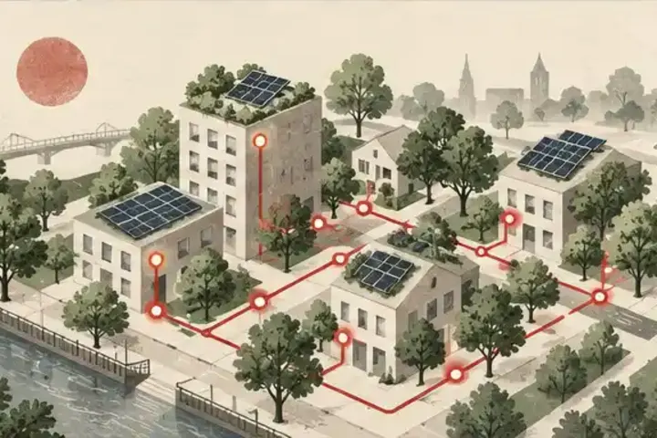
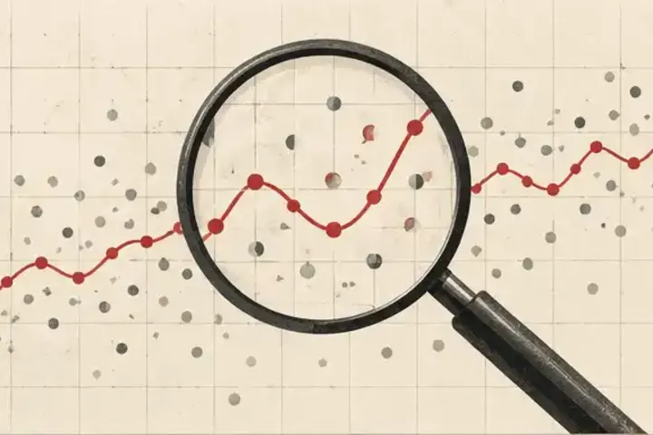

::: {.frame .page-main}

```{=html}
<section>
  <div class="hero">
    <div class="intro">
      <h1>AI for a Sustainable Future</h1>
      <p class="sub">Sustainability Lab · IIT Gandhinagar</p>
      <p>We build AI that serves both people and the planet — from air quality and health sensing to energy and Earth observation.</p>
      <p>The lab is led by <a href="https://nipunbatra.github.io">Nipun Batra</a> and has 17 researchers today. Our 50+ alumni have gone on to Cambridge, Microsoft Research, Google DeepMind, CMU and industry.</p>
      <p class="awards-line">Recent recognition: <b>Best Paper Runner-Up at BuildSys 2026</b>, the <b>ACM e-Energy Test-of-Time Award 2025</b> for NILMTK, and the <b>ACM SIGEnergy Rising Star 2025</b>. Work published at NeurIPS, KDD, AAAI, IMWUT, BuildSys and UbiComp.</p>
      <a class="recruit" href="join.html">Now recruiting PhD students &amp; interns</a>
    </div>
    <figure>
      
      <figcaption>The lab, 2025 · <a href="people.html">meet everyone</a></figcaption>
    </figure>
  </div>
</section>

<section>
  <div class="vrule">
    <div>
      <h2>Research</h2>
      <a class="trow" href="research.html#air"><span><b>Clean Air</b><span>Sensors, models and LLM tools for cleaner cities.</span></span></a>
      <a class="trow" href="research.html#health"><span><b>Health Sensing</b><span>Cameras and wearables for breathing and metabolism.</span></span></a>
      <a class="trow" href="research.html#energy"><span><b>Energy</b><span>What uses power, and when, from a single meter.</span></span></a>
      <a class="trow" href="research.html#earth"><span><b>Earth Observation</b><span>Finding brick kilns and mapping land from space.</span></span></a>
      <p class="small" style="margin-top:10px"><a href="papers/index.html">Publications</a> &nbsp;·&nbsp; <a href="research.html">All projects</a></p>
    </div>
    <div>
      <h2>Join &amp; learn</h2>
      <a class="trow" href="join.html#phd"><span><b>PhD &amp; postdoc</b><span>How admissions work, and where alumni went.</span></span></a>
      <a class="trow" href="join.html#internships"><span><b>Internships</b><span>Summer (SRIP) and 6-month research internships.</span></span></a>
      <a class="trow" href="handbook/index.html"><span><b>Lab handbook</b><span>Week-one checklist, servers, writing and culture.</span></span></a>
      <a class="trow" href="people.html"><span><b>People</b><span>The team, alumni and their stories.</span></span></a>
      <p class="small" style="margin-top:10px"><a href="join.html">Open positions</a> &nbsp;·&nbsp; <a href="https://sustainability-lab.github.io/sustainability-research-bootcamp/">Research Skills Bootcamp</a></p>
    </div>
  </div>
</section>

<section>
  <h2>Latest</h2>
```

::: {#news-latest}
:::

```{=html}
  <p style="margin-top:12px"><a class="arrow" href="news.html">All news</a></p>
</section>
```

:::
