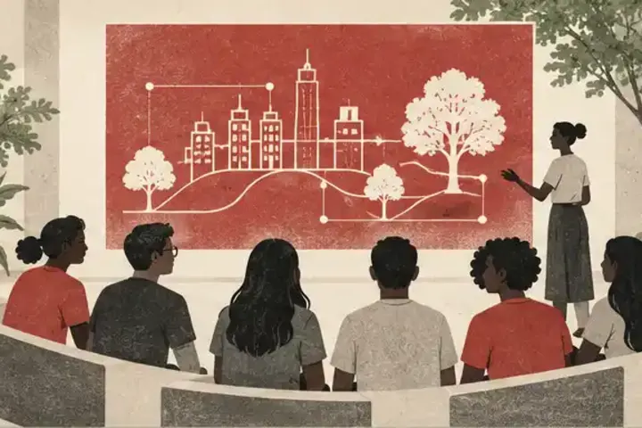

::: {.frame .page-main}

```{=html}
<section>
  <div class="grid g2" style="align-items:center;gap:44px">
    <div>
      <h1 class="page">News</h1>
      <p class="lede" style="margin-top:12px">Papers, awards, grants, talks and people — in one place.</p>
      <p class="small"><a href="awards.html">Awards &amp; photos</a> · <a href="media.html">Media coverage</a> · <a href="events/index.html">Events</a></p>
    </div>
    
  </div>
  <div class="chips" id="newschips"><button class="chip on" data-c="all">All</button><button class="chip" data-c="paper">Papers</button><button class="chip" data-c="award">Awards</button><button class="chip" data-c="grant">Grants</button><button class="chip" data-c="people">People</button><button class="chip" data-c="talk">Talks</button><button class="chip" data-c="event">Events</button></div>
```

::: {#news-all}
:::

```{=html}
  <p class="small muted" style="margin-top:18px">Adding news? Edit <code>data/news.yml</code>.</p>
</section>
<script>
document.querySelectorAll('#newschips .chip').forEach(c => c.onclick = () => {
  document.querySelectorAll('#newschips .chip').forEach(x => x.classList.toggle('on', x === c));
  const rows = document.querySelectorAll('.newsfeed .list-row');
  rows.forEach(r => r.style.display = (c.dataset.c === 'all' || r.dataset.type === c.dataset.c) ? '' : 'none');
  document.querySelectorAll('.newsfeed .year').forEach(y => {
    let el = y.nextElementSibling, any = false;
    while (el && !el.classList.contains('year')) { if (el.style.display !== 'none') any = true; el = el.nextElementSibling; }
    y.style.display = any ? '' : 'none';
  });
});
</script>
```

:::
