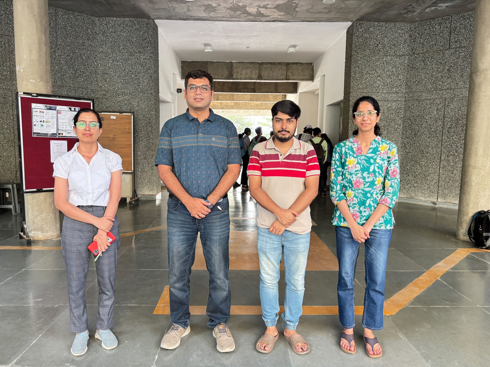
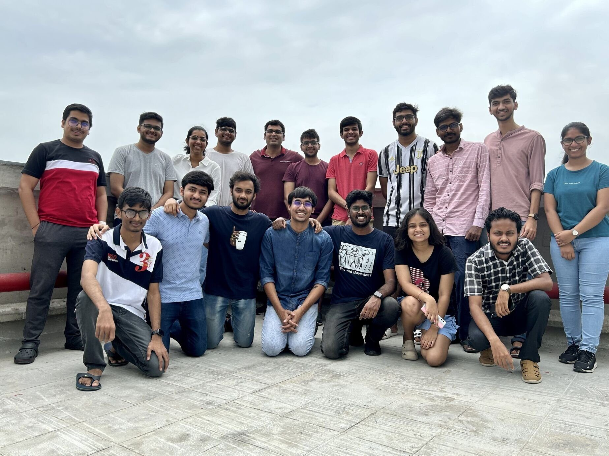

::: {.frame .page-main}

```{=html}
<section>
  <h1 class="page">People</h1>
  <p class="lede" style="margin-top:12px">17 researchers today, 50+ alumni in academia and industry, and two PhD graduates.</p>
  <div class="jump"><a href="#phd">PhD</a><a href="#mtech">MTech</a><a href="#fellows">Research fellows</a><a href="#graduates">PhD graduates</a><a href="#alumni-list">Alumni</a><a href="#stories">Stories</a><a href="#photos">Photos</a></div>
  <div class="pi-row">
    
    <div><h2 style="margin:0 0 4px">Prof. Nipun Batra</h2>
      <p class="muted" style="margin:0 0 6px">Associate Professor, Computer Science, IIT Gandhinagar · postdoc at the University of Virginia · PhD from IIIT Delhi</p>
      <p class="small" style="margin:0"><a href="https://nipunbatra.github.io">nipunbatra.github.io</a> · <a href="https://scholar.google.co.in/citations?user=rFGzHlIAAAAJ">Google Scholar</a> · <a href="mailto:nipun.batra@iitgn.ac.in">Email</a></p></div>
  </div>
  <h2 id="phd" style="margin-top:36px">PhD students</h2>
```

::: {#phd}
:::

```{=html}
  <h2 id="mtech" style="margin-top:36px">MTech students</h2>
```

::: {#mtech}
:::

```{=html}
  <h2 id="fellows" style="margin-top:36px">Research fellows</h2>
```

::: {#fellows}
:::

```{=html}
  <p class="small muted" style="margin-top:18px">New member? Add yourself to <code>data/members.yml</code> and put your photo in <code>images/members/</code>.</p>
</section>

<section>
  <h2 id="graduates">PhD graduates</h2>
```

::: {#grads}
:::

```{=html}
</section>

<section>
  <h2 id="alumni-list">Alumni</h2>
  <p class="muted" style="max-width:64ch">Where they are now: Cambridge, Microsoft Research, Google DeepMind, CMU, UIUC, Texas A&amp;M, NYU, Oracle, Microsoft, Nykaa, Wadhwani AI, Skan.ai and more.</p>
```

::: {#alumni}
:::

```{=html}
</section>

<section>
  <h2 id="stories">In their words</h2>
```

::: {#quotes}
:::

```{=html}
  <p style="margin-top:16px"><a class="arrow" href="experiences.html">All 16 stories</a></p>
</section>

<section>
  <h2 id="photos">Photos</h2>
  <div class="grid g4" style="gap:8px">
    
    
    
    
  </div>
  <p style="margin-top:12px"><a class="arrow" href="memories.html">All photos by year</a></p>
</section>

<script>
document.querySelectorAll('#alumchips .chip').forEach(c => c.onclick = () => {
  document.querySelectorAll('#alumchips .chip').forEach(x => x.classList.toggle('on', x === c));
  document.querySelectorAll('#alumtable tbody tr').forEach(r => r.style.display = (c.dataset.g === 'all' || r.dataset.g === c.dataset.g) ? '' : 'none');
});
</script>
```

:::
