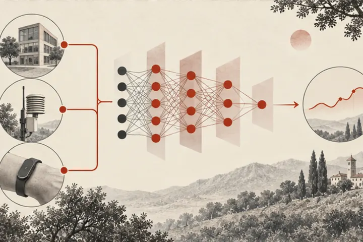

::: {.frame .page-main}

```{=html}
<section>
  <h1 class="page">Research</h1>
  <p class="lede" style="margin-top:12px">Four themes, one approach: build the sensor or dataset, then the model, then put it in front of the people who need it — and release the tools so others can build on them. <a href="papers/index.html">All publications</a>.</p>
  <div class="jump"><a href="#air">Clean Air</a><a href="#health">Health Sensing</a><a href="#energy">Energy</a><a href="#earth">Earth Observation</a><a href="#methods">Methods</a><a href="#tools">Datasets &amp; tools</a></div>

  <div class="area" id="air"><div>
    <h2 style="margin-bottom:6px">Clean Air</h2>
    <p class="muted">Most Indian cities have few air monitors. We build low-cost sensing, models that fill the gaps between monitors, and LLM tools that let non-experts ask questions of the data.</p>
    <div class="projects">
      <a href="https://neurips.cc/virtual/2023/poster/73476">AirDelhi <span>NeurIPS ’23</span></a>
      <a href="https://github.com/patel-zeel/AAAI22">Scalable Gaussian processes <span>AAAI ’22</span></a>
      <a href="papers/index.html#2026">Sensor placement <span>AAAI ’26</span></a>
      <a href="https://sustainability-lab.github.io/vayubuddy/">VayuBuddy &amp; VayuBench <span>CODS ’25</span></a>
      <a href="https://github.com/karm-patel/Samachar-News-media-on-air-pollution">Samachar <span>COMPASS ’22</span></a>
    </div></div></div>

  <div class="area" id="health"><div>
    <h2 style="margin-bottom:6px">Health Sensing</h2>
    <p class="muted">Measuring lung function or calories burned usually needs a clinic. We turn thermal cameras, face masks and wearables into measurement tools, and test how well AI models read them.</p>
    <div class="projects">
      <a href="https://sustainability-lab.github.io/jouleseye/">JoulesEye <span>IMWUT ’24</span></a>
      <a href="https://dl.acm.org/doi/fullHtml/10.1145/3570167">SpiroMask <span>TOCH ’23</span></a>
      <a href="https://sustainability-lab.github.io/thermeval/">ThermEval <span>KDD ’26</span></a>
      <a href="papers/2026/signal-descriptors.html">Signal descriptors <span>DSAA ’26</span></a>
      <a href="news.html">ApneaEye <span>patent filed ’25</span></a>
    </div></div></div>

  <div class="area" id="energy"><div>
    <h2 style="margin-bottom:6px">Energy</h2>
    <p class="muted">An electricity bill says how much a home used, not what used it. Since 2014 we have built the open toolkit, benchmarks and models the field uses to answer that.</p>
    <div class="projects">
      <a href="https://github.com/nilmtk/nilmtk">NILMTK <span>Test-of-Time Award ’25</span></a>
      <a href="papers/2026/nilmbench2026_buildsys.pdf">NILMBench2026 <span>Best Paper Runner-Up ’26</span></a>
      <a href="https://github.com/VibhutiBansal-11/NILM_Uncertainty">“I do not know” <span>BuildSys ’22</span></a>
      <a href="papers/index.html#2016">Gemello <span>KDD ’16</span></a>
    </div></div></div>

  <div class="area" id="earth"><div>
    <h2 style="margin-bottom:6px">Earth Observation</h2>
    <p class="muted">Polluters such as brick kilns are spread over areas too large to survey. We map them from satellite imagery and connect detections to compliance rules.</p>
    <div class="projects">
      <a href="https://sustainability-lab.github.io/sentinelkilndb/">SentinelKilnDB <span>NeurIPS ’25</span></a>
      <a href="https://sustainability-lab.github.io/brick-kilns/">Space to Policy <span>JCSS ’24</span></a>
      <a href="papers/2026/flowsat.html">FlowSat <span>BMVC ’26</span></a>
      <a href="papers/index.html#2020">PlantDoc <span>CODS ’20</span></a>
    </div></div></div>

  <div class="area" id="methods" style="border-bottom:0"><div>
    <h2 style="margin-bottom:6px">Methods &amp; explainers</h2>
    <p class="muted">The machine learning underneath — Gaussian processes, active learning, uncertainty — and interactive articles that teach it.</p>
    <div class="projects">
      <a href="https://distill.pub/2020/bayesian-optimization/">Exploring Bayesian Optimization <span>Distill</span></a>
      <a href="https://patel-zeel.github.io/active-learning-visualization/">Active Learning: A Visual Tour <span>VISxAI</span></a>
      <a href="https://nipunbatra.github.io/hmm/">Exploring Hidden Markov Models <span>VISxAI</span></a>
    </div></div></div>
</section>

<section id="tools">
  <h2>Datasets &amp; tools you can use</h2>
  <div class="grid g3" style="gap:0 28px">
    <div class="list-row"><span class="d">Toolkit</span><span><a href="https://github.com/nilmtk/nilmtk">NILMTK</a> — energy disaggregation</span></div>
    <div class="list-row"><span class="d">Benchmark</span><span><a href="papers/2026/nilmbench2026_buildsys.pdf">NILMBench2026</a> — reproducible NILM</span></div>
    <div class="list-row"><span class="d">Dataset</span><span><a href="https://neurips.cc/virtual/2023/poster/73476">AirDelhi</a> — mobile PM2.5</span></div>
    <div class="list-row"><span class="d">Dataset</span><span><a href="https://sustainability-lab.github.io/sentinelkilndb/">SentinelKilnDB</a> — brick kilns</span></div>
    <div class="list-row"><span class="d">Benchmark</span><span><a href="https://sustainability-lab.github.io/thermeval/">ThermEval</a> — VLMs on thermal</span></div>
    <div class="list-row"><span class="d">Benchmark</span><span><a href="https://sustainability-lab.github.io/vayubuddy/">VayuBench</a> — LLMs on air data</span></div>
  </div>
</section>
```

:::
